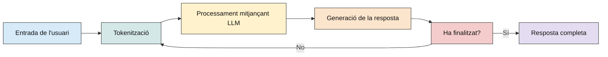

## 1. LLM (LARGE LANGUAGE MODEL)

Un LLM (Large Language Model) és un model d’intel·ligència artificial entrenat amb grans quantitats de dades per aprendre patrons del llenguatge i generar respostes a partir d’una entrada proporcionada per l’usuari.

Aquests models poden realitzar diferents tipus de tasques, com ara respondre preguntes, generar i resumir text, traduir contingut, analitzar i generar codi, entre d’altres. Alguns exemples de famílies de LLM són Qwen, Gemma, Llama, Mistral, DeepSeek...

El funcionament d’un LLM es basa en la generació de text token a token. Un token pot correspondre a una paraula, una part d’una paraula o un símbol. A partir del text introduït i del context disponible, el model calcula quin és el següent token més adequat i repeteix aquest procés fins a construir la resposta completa.

### 1.1. FUNCIONAMENT D’UN LLM

El següent esquema representa com un LLM processa una pregunta i genera una resposta, des del moment en què l'usuari introdueix el text fins que el model acaba de respondre.

  Figura 1. Esquema funcionament LLM

1. Entrada de l’usuari: l'usuari introdueix una pregunta o instrucció (prompt). Aquesta entrada pot incloure una pregunta, instruccions, codi o informació addicional. El model utilitzarà tant aquesta entrada com el context disponible de la conversa per generar una resposta.

2. Tokenització: un LLM no processa directament les paraules tal com les llegim nosaltres. Primer utilitza un tokenitzador, que transforma el text en unitats més petites anomenades tokens. Un token pot representar una paraula completa, una part d'una paraula, un número o un símbol. La divisió real depèn del tokenitzador utilitzat per cada model. Posteriorment, aquests identificadors es transformen en representacions numèriques (vectors) que poden ser processades per la xarxa neuronal.

3. Processament mitjançant LLM: aquesta és la part principal del funcionament. El model rep els tokens i els processa mitjançant la seva xarxa neuronal.

   Durant aquest processament utilitza diferents elements:
   - **Paràmetres**: valors numèrics apresos durant l'entrenament que permeten identificar patrons i relacions entre conceptes.
   - **Context**: informació de la pregunta, de la conversa anterior i dels tokens generats fins al moment.
   - **Mecanismes d'atenció**: permeten relacionar diferents parts de la seqüència per interpretar-ne el significat.

   Per exemple, quan el model rep la pregunta “Què és la fotosíntesi?”, pot relacionar el concepte de fotosíntesi amb els coneixements apresos durant l'entrenament sobre les plantes, la llum solar i la transformació d'energia.

   A partir d'aquesta informació, el model calcula una distribució de probabilitats dels possibles tokens següents.

4. Generació de la resposta: el model selecciona un token a partir de les probabilitats calculades i de l'estratègia de generació configurada.

   Per exemple, podria començar generant: La. Després, torna a processar la seqüència tenint en compte els tokens que acaba de generar: La fotosíntesi. I continuar amb: La fotosíntesi és. Fins a construir una resposta completa, com ara: La fotosíntesi és el procés mitjançant el qual les plantes, les algues i alguns microorganismes transformen l'energia de la llum en energia química.

   Per tant, el model no genera tota la resposta de cop, sinó que la construeix progressivament, token a token.

5. Finalització: després de generar cada token, el procés continua fins que es compleix alguna condició de finalització.

### 1.2. INFERÈNCIA

Tot aquest procés rep el nom d'inferència. La inferència consisteix a utilitzar un model que ja ha estat entrenat per processar una entrada i generar una resposta.

És important diferenciar-la de l'entrenament. Les definicions són les següents:
Entrenament: procés durant el qual el model aprèn patrons a partir de grans quantitats de dades i s'ajusten els seus paràmetres.
Inferència: procés durant el qual el model utilitza els paràmetres apresos per generar respostes a noves consultes.

Quan s'executa un model com Qwen mitjançant Ollama, el sistema està realitzant inferència local. Això significa que el model utilitza els recursos de càlcul de l'ordinador per generar respostes, sense tornar-se a entrenar ni modificar els seus paràmetres amb cada consulta.
