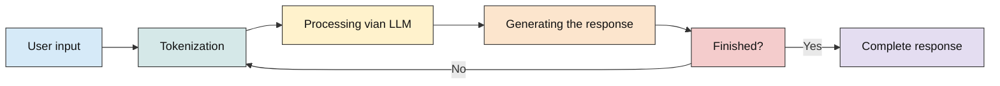

## 1. LLM (LARGE LANGUAGE MODEL)

An LLM (Large Language Model) is an artificial intelligence model trained with large amounts of data to learn language patterns and generate responses based on input provided by the user.

These models can perform different types of tasks, such as answering questions, generating and summarizing text, translating content, parsing and generating code, among others. Some examples of LLM families are Qwen, Gemma, Llama, Mistral, DeepSeek...

The operation of an LLM is based on token-by-token text generation. A token can correspond to a word, part of a word or a symbol. Based on the input text and available context, the model calculates the next most appropriate token and repeats this process until the complete response is constructed.

### 1.1. OPERATION OF An LLM

The following diagram represents how an LLM processes a question and generates an answer, from the time the user enters the text until the model finishes answering.

  Figure 1. LLM operation diagram

1. User input: The user enters a question or instruction (prompt). This entry may include a question, instructions, code, or additional information. The model will use both this input and the available conversation context to generate a response.

2. Tokenization: An LLM does not directly process words as we read them. It first uses a tokenizer, which transforms the text into smaller units called tokens. A token can represent a whole word, part of a word, a number, or a symbol. The actual split depends on the tokenizer used by each model. Subsequently, these identifiers are transformed into numerical representations (vectors) that can be processed by the neural network.

3. Processing by LLM: This is the main part of the operation. The model receives the tokens and processes them using its neural network.

   During this processing it uses different elements:
   - **Parameters**: Numerical values learned during training that allow patterns and relationships between concepts to be identified.
   - **Context**: Information about the question, the previous conversation, and the tokens generated so far.
   - **Attention Mechanisms**: allow different parts of the sequence to be related to interpret its meaning.

   For example, when the model receives the question “What is photosynthesis?”, it can relate the concept of photosynthesis to the knowledge learned during training about plants, sunlight, and energy transformation.

   Based on this information, the model calculates a probability distribution of the following possible tokens.

4. Response generation: The model selects a token based on the calculated probabilities and the configured generation strategy.

   For example, it could start by generating: Photosynthesis. It then reprocesses the sequence taking into account the tokens it just generated: Photosynthesis is. It can then continue with: Photosynthesis is the process. Until constructing a complete answer, such as: Photosynthesis is the process by which plants, algae, and some microorganisms transform light energy into chemical energy.

   Therefore, the model does not generate the entire response at once, but builds it up incrementally, token by token.

5. Termination: After each token is generated, the process continues until some termination condition is met.

### 1.2. INFERENCE

This whole process is called inference. Inference involves using a model that has already been trained to process an input and generate a response.

It is important to differentiate it from training. The definitions are as follows:
Training: The process during which the model learns patterns from large amounts of data and its parameters are adjusted.
Inference: Process during which the model uses learned parameters to generate answers to new queries.

When running a model like Qwen using Ollama, the system is performing local inference. This means that the model uses the computer's computing resources to generate answers, without retraining itself or changing its parameters with each query.
