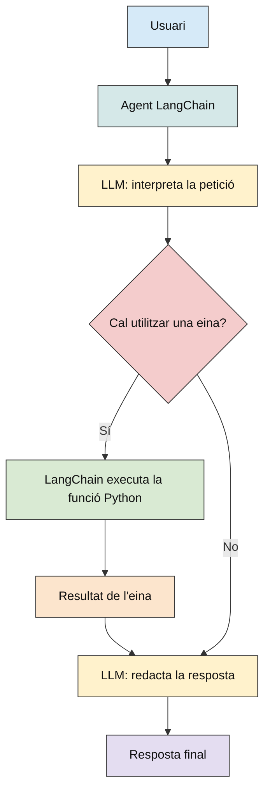
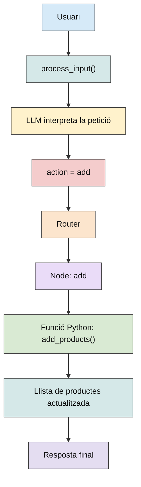

## 4. LANGCHAIN I LANGGRAPH

Abans d'analitzar els exemples de Python, és important entendre el paper de LangChain i LangGraph en el desenvolupament d'aplicacions basades en models de llenguatge.

### 4.1. LANGCHAIN

LangChain és un framework que facilita la integració de models de llenguatge (LLM) amb aplicacions Python i altres recursos externs, com funcions, bases de dades, documents o APIs.

Permet desenvolupar aplicacions en què el model no es limita a respondre preguntes, sinó que també pot utilitzar eines per obtenir informació o executar determinades operacions.

Per exemple, si un usuari pregunta quin temps fa en una ciutat, un LLM sense eines només pot respondre amb els coneixements que té o amb la informació que se li proporciona. En canvi, amb LangChain es pot connectar el model a una funció Python que consulti dades meteorològiques.

Els principals components són:

- **LLM**: model que interpreta les instruccions i genera respostes. En aquests exemples s'utilitza Qwen, executat localment amb Ollama.
- **Tools**: funcions o recursos externs que el model pot sol·licitar quan necessita realitzar una operació.
- **Agent**: sistema que utilitza el LLM per decidir quines eines ha de fer servir per completar una tasca.
- **Messages**: missatges que representen les instruccions, les preguntes de l'usuari, les respostes del model i els resultats de les eines.

Aplicació en Python
Per connectar LangChain amb Ollama s'utilitza la classe ChatOllama:

```python
from langchain_ollama import ChatOllama

llm = ChatOllama(
    model="qwen3.5:9b",
    temperature=0,
)
```

Aquest codi crea un objecte que permet comunicar-se amb Qwen mitjançant el servidor local d'Ollama.

Per enviar una consulta:

```python
response = llm.invoke(
    "Explica què és un LLM"
)
print(response.content)
```

En aquest cas, LangChain envia la pregunta a Ollama, Ollama executa el model i retorna la resposta generada.

Quan s'incorporen eines, el funcionament es modifica:



<p align="center">
  <sub>Figura 1. Flux amb LangChain</sub>
</p>
És important remarcar que el LLM no executa directament el codi Python. El model pot generar una sol·licitud per utilitzar una eina, però és LangChain qui s'encarrega de cridar la funció corresponent.

### 4.2. LANGGRAPH

LangGraph és un framework orientat a construir aplicacions i agents amb fluxos d'execució més estructurats, utilitzant grafs formats per nodes i connexions.

Mentre que LangChain facilita la integració de models i eines, LangGraph permet definir explícitament quines operacions s'executen, en quin ordre, com es prenen les decisions i quin estat es conserva.

Els principals components són:
State (estat): estructura que emmagatzema la informació compartida entre els diferents passos del programa.
Nodes: funcions Python que realitzen una operació determinada.
Edges: connexions que indiquen quin node s'executarà després.
Conditional edges: connexions condicionals que permeten seleccionar diferents camins segons el resultat d'una funció.
Router: funció que decideix quin camí ha de seguir l'execució.
Checkpointer: mecanisme que permet conservar l'estat entre diferents execucions del graf.

Exemple de funcionament
Suposem una aplicació que gestiona una llista de la compra.

L'usuari introdueix: afegeix llet a la llista.
El procés podria ser:
Usuari → process_input → LLM interpreta la petició → action = "add" → Router → Node add →
→ Funció Python add_products() → Llista actualitzada → Resposta final



<p align="center">
  <sub>Figura 2. Models instal·lats</sub>
</p>

En aquest exemple, el LLM interpreta el llenguatge natural i retorna l'acció que considera adequada. Posteriorment, el router de LangGraph llegeix aquesta acció i selecciona el node corresponent. La modificació real de la llista es fa mitjançant una funció Python, no directament amb el LLM.

Creació d'un graf
En Python, LangGraph permet definir una estructura com aquesta:

```python
builder = StateGraph(ShoppingState)

builder.add_node(
    "process_input",
    process_input_node
)

builder.add_node(
    "add",
    add_node
)

builder.add_edge(
    START,
    "process_input"
)
```

Amb add_conditional_edges() es poden definir connexions condicionals que determinen quin node s'executa segons el resultat del router.

Finalment, amb compile() es construeix el graf executable i amb invoke() s'inicia una execució.

### 4.3. DIFERÈNCIA ENTRE LANGCHAIN I LANGGRAPH (no són excloents l’un de l’altre)

Les diferències principals entre LangChain i LangGraph són les següents:

| LangChain                                   | LangGraph                                               |
| ------------------------------------------- | ------------------------------------------------------- |
| Connecta models amb eines i altres recursos | Organitza l'execució mitjançant un graf                 |
| Facilita la creació d'agents                | Permet controlar explícitament nodes i transicions      |
| Gestiona interaccions amb el LLM            | Gestiona l'estat i el recorregut de l'aplicació         |
| Permet fer _tool calling_                   | Permet incorporar condicions, bucles i diferents camins |
