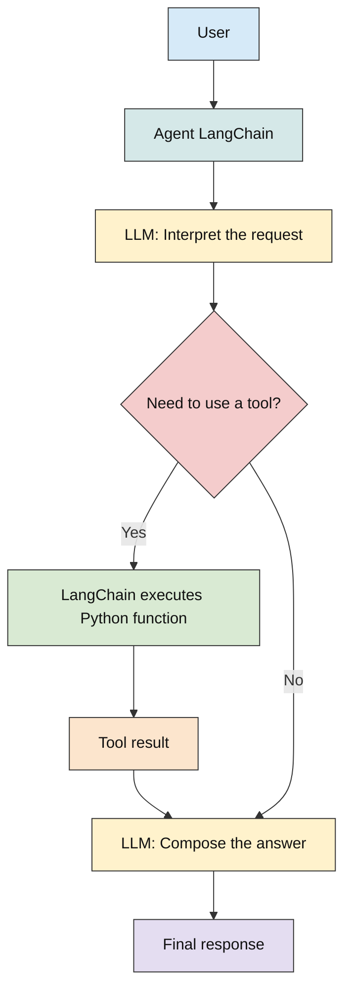
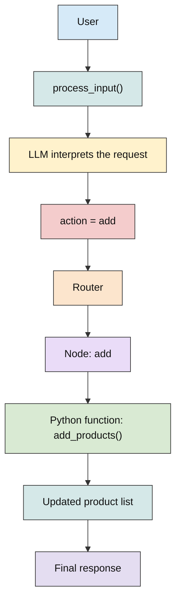

## 3. LANGCHAIN AND LANGGRAPH

Before looking at the Python examples, it is important to understand the role of LangChain and LangGraph in developing applications based on language models.

### 3.1. LANGCHAIN

LangChain is a framework that facilitates the integration of language models (LLM) with Python applications and other external resources, such as functions, databases, documents or APIs.

Allows you to develop applications in which the model is not limited to answering questions, but can also use tools to obtain information or perform certain operations.

For example, if a user asks what the weather is like in a city, a toolless LLM can only respond with the knowledge it has or the information provided. Instead, with LangChain you can connect the model to a Python function that queries weather data.

The main components are:

- **LLM**: Model that interprets instructions and generates responses. These examples use Qwen, running locally with Ollama.
- **Tools**: External functions or resources that the model can request when it needs to perform an operation.
- **Agent** - System that the LLM uses to decide which tools to use to complete a task.
- **Messages** - Messages representing instructions, user questions, model responses, and tool results.

Application in Python
To connect LangChain with Ollama the ChatOllama class is used:

```python
from langchain_ollama import ChatOllama

llm = ChatOllama(
    model="qwen3.5:9b",
    temperature=0,
)
```

This code creates an object that allows communication with Qwen via the local Ollama server.

To send an inquiry:

```python
response = llm.invoke(
    "Explain what an LLM is"
)
print(response.content)
```

In this case, LangChain sends the question to Ollama, Ollama runs the model and returns the generated answer.

When tools are embedded, the behavior changes:



<p align="center">
  <sub>Figure 1. Flow with LangChain</sub>
</p>
It is important to note that the LLM does not directly execute Python code. The model can generate a request to use a tool, but it is LangChain that takes care of calling the corresponding function.

### 3.2. LANGGRAPH

LangGraph is a framework aimed at building applications and agents with more structured execution flows, using graphs formed by nodes and connections.

While LangChain facilitates the integration of models and tools, LangGraph allows you to explicitly define which operations are executed, in what order, how decisions are made, and what state is preserved.

The main components are:
State (state): structure that stores the information shared between the different steps of the program.
Nodes: Python functions that perform a given operation.
Edges: Connections that indicate which node will run next.
Conditional edges: conditional connections that allow different paths to be selected depending on the result of a function.
Router: Function that decides which path the execution should follow.
Checkpointer: mechanism that allows the state to be preserved between different executions of the graph.

Example of operation
Consider an application that manages a shopping list.

User enters: Add milk to list.
The process could be:
User → process_input → LLM interprets the request → action = "add" → Router → Node add →
→ Python function add_products() → List updated → Final answer



<p align="center">
  <sub>Figure 2. Installed models</sub>
</p>

In this example, the LLM interprets the natural language and returns the action it deems appropriate. Later, the LangGraph router reads this action and selects the corresponding node. The actual modification of the list is done via a Python function, not directly with the LLM.

Creating a graph
In Python, LangGraph allows you to define a structure like this:

```python
builder = StateGraph(ShoppingState)

builder.add_node(
    "process_input",
    process_input_node
)

builder.add_node(
    "add",
    add_node
)

builder.add_edge(
    START,
    "process_input"
)
```

With add_conditional_edges(), conditional connections can be defined that determine which node is executed based on the result of the router.

Finally, with compile() the executable graph is built and with invoke() an execution is started.

### 3.3. DIFFERENCE BETWEEN LANGCHAIN AND LANGGRAPH (they are not mutually exclusive)

The main differences between LangChain and LangGraph are as follows:

| LangChain                                     | LangGraph                                                       |
| --------------------------------------------- | --------------------------------------------------------------- |
| Connect models with tools and other resources | Organize execution using a graph                                |
| Facilitates the creation of agents            | Allows you to explicitly control nodes and transitions          |
| Manage interactions with the LLM              | Manage application state and path                               |
| Allows to do _tool calling_                   | Allows you to incorporate conditions, loops and different paths |
