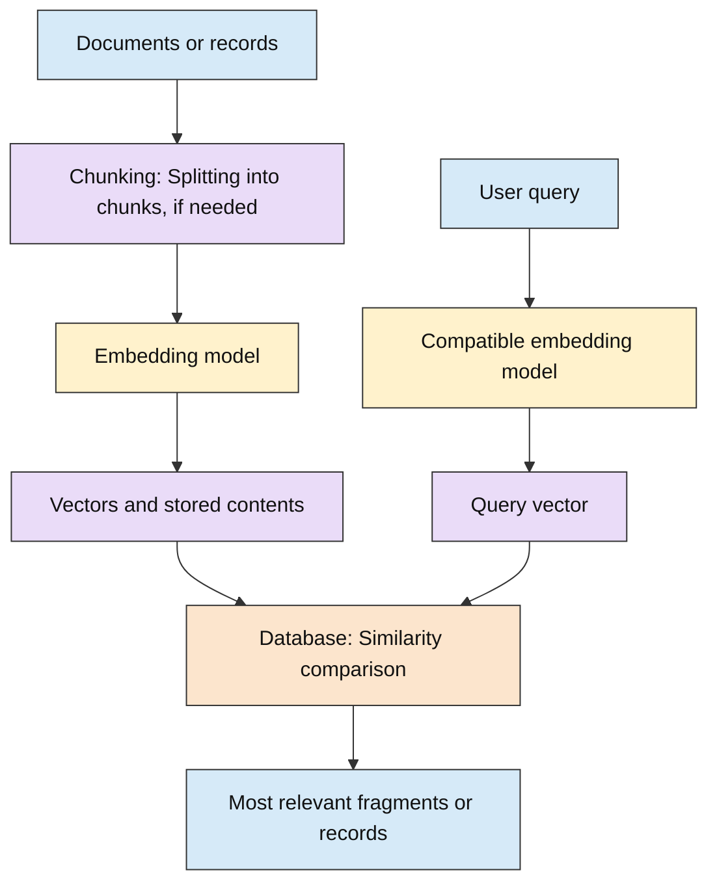

# Vector databases: Weaviate and PostgreSQL with pgvector

Vector databases allow storing numerical representations of information and retrieving the most relevant contents for a query by comparing their similarity. They are particularly useful in AI applications that need to search for information in documents, files, or other data sources based on their semantic meaning and not solely based on exact word matches.

This section explains how a vector search works, how to use **Weaviate** and what deployment options it offers. **PostgreSQL with pgvector** is also presented as an alternative.

> **Relation to the rest of the manual:** [RAG](04_rag.md) explains how the retrieved information is used to generate responses with an LLM. In [Python Examples](08_examples.md) shows the actual implementation of recipe search with Weaviate. Here we focus on **how data is saved and retrieved**.

## 1. What is a vector database?

A **database** allows records to be retrieved using conditions on their fields. For example, if a recipe table contains the field `tiempoMin`, you can get dishes that are prepared in less than X minutes.

A **vector database** incorporates the ability to compare **numeric vectors** that represent the contents of records. This allows you to retrieve results that are semantically related to a question, even if the words used do not exactly match. For example, if the user asks "I want a quick dinner", a semantic search could retrieve recipes described as "easy dish to prepare in a few minutes", because the texts have a similar meaning.

### 1.1. Embeddings: convert information into vectors

An embedding is a numerical representation of a text, image or other type of data. It is obtained through an embedding model, which transforms the content into a vector.

A vector can be represented like this:

```text
[0.12, -0.47, 0.83, 0.25, ...]
```

The above values are examples. In a real application, an embedding can have hundreds or thousands of dimensions, depending on the model used.

The important idea is that **texts with similar meanings tend to have close representations** within the vector space of the model. The texts do not have to contain exactly the same words.

Two types of models must be distinguished:

| Component | Function |
| ---------------------- | ------------------------------------------------------------------- |
| **Embedding model** | Convert text or other data into vectors so you can compare them. |
| **Generative LLM** | It interprets instructions and generates responses in natural language.   |

An embedding model does not write the final response of a RAG system, its role is to help find relevant information.

### 1.2. How do you do a similarity search?

To perform a vector search, you must first prepare the information, transform it into embeddings and store it in the database. Later, when the user enters a query, the vectors are compared to retrieve the most relevant content.

The general process is as follows:

1. **Preparation of the data:** the documents, texts or records that you want to store and consult are collected.

2. **Division into fragments (chunking):** if the documents are long, they are divided into smaller fragments, called _chunks_. This makes it possible to represent and retrieve specific parts of a document without always having to work with its entire content. In some cases, fragments may share a small portion of text to preserve context between them.

3. **Generation of embeddings:** an embedding model transforms each fragment or record into a numeric vector that represents its semantic content.

4. **Storage:** the vectors are saved in the database, associated with the original text (if needed also associated with additional information such as the source document or other metadata).

5. **Query vectorization:** when the user enters a question, it is also transformed into a vector using an embedding model compatible with the one used to store the data.

6. **Search by similarity:** the database compares the query vector with the stored vectors and retrieves the closest fragments or records according to the distance measure used.

7. **Results retrieval:** the system returns the contents associated with the selected vectors, which can then be displayed to the user or provided to an LLM as context in a RAG system.

**General flow of a vector search:**



<p align="center">
  <sub>Figure 1. General operation of a vector search.</sub>
</p>

**Top-k** is the maximum number of results to retrieve. For example, with `k = 5` the five closest fragments or records to the query are requested, based on the distance measure used.

It should be noted that it is not always necessary to apply chunking. In the case of long documents, such as manuals or reports, dividing the content into fragments makes it easier to retrieve specific information. In contrast, when working with short, structured records, each record can be represented without the need to split it.

### 1.3. How do vectors compare?

Different measures of similarity or distance exist. One of the most common is **cosine similarity**, which compares the direction of two vectors:

$$
\operatorname{sim}_{\mathrm{cos}}(\mathbf{u},\mathbf{v}) =
\frac{\mathbf{u}\cdot\mathbf{v}}{\lVert\mathbf{u}\rVert\,\lVert\mathbf{v}\rVert}
$$

For non-null vectors, a value close to `1` indicates highly similar directions, while smaller values indicate lower similarity. Other measures can also be used, such as **Euclidean distance**.

It is important to differentiate between similarity and distance. A higher similarity usually indicates a better match. Whereas in a distance-ordered search, the smallest values ​​are usually of interest.

Vector proximity does not guarantee that a result meets all the conditions of the request. For this reason, in many applications it is combined with exact filters, such as a category, a date...

## 2. Weaviate

**Weaviate** is a database that allows you to store objects with properties and associated vectors, and retrieve them using vector searches, keyword searches, or hybrid searches.

Objects are organized into **collections** (_collections_), which define what kind of information is stored and how it is represented.

### 2.1. Example: the collection `Recetas`

A collection of recipes is used in the project examples. Each object contains structured information about a dish:

| Property | Information | Property | Information |
| ----------- | ----------------------------- | ------------------- | -------------------------- |
| `nombre`    | Name of the recipe | `ingredientes`      | Ingredients and quantities |
| `categoria` | Category of the plate | `ingredientesClave` | Main ingredients |
| `dieta`     | Type of diet | `preparacion`       | Preparation instructions |
| `tiempoMin` | Preparation time in minutes | `descripcion`       | Description of the recipe |
| `raciones`  | Number of portions |                     |                            |

These properties allow combining two types of query:

- **Semantics:** find recipes related to "a light dinner" even if the description does not contain those exact words.
- **Structured:** limit results to recipes with a `tiempoMin` certain or of a specific category.

### 2.2. Vector search with `near_text()`

The Weaviate Python client provides the method `near_text()`, which allows searching for objects related to a text query.

```python
# Tutorial: Assumes the client is already connected.
collection = client.collections.get("Recetas")

result = collection.query.near_text(
    query="recipes for a quick dinner",
    limit=5,
)

for obj in result.objects:
    print(obj.properties.get("nombre"))
```

**Important:** `near_text()` requires the collection to have a compatible **vectorizer** configured. If the collection contains only externally provided vectors and does not have such a mechanism, the application must generate the query vector and use a lookup like `near_vector()`.

So Weaviate **doesn't always automatically generate embeddings** - it depends on the configuration of each collection.

In the project code, the search also incorporates time constraints and checks with Python that all mandatory ingredients are met. This avoids confusing semantic similarity with an exact match of all requirements.

For a step-by-step implementation of this, see the [Weaviate and RAG example](08_examples.md).

### 2.3. Other types of search

| Search Type | How it works | When is it useful?                                                        |
| --------------------- | ----------------------------------------------------------------- | -------------------------------------------------------------------- |
| **Vector** | Compare embeddings to find content with similar meaning. | Questions expressed in natural language.                         |
| **By keywords** | Search for term matches.                                    | Names, codes, identifiers or specific words.                    |
| **Hybrid** | Combine vector search and keyword search.          | When you want to find both related concepts and exact terms. |

## 3. Weaviate deployment options

A key distinction is that Weaviate is the database engine, while Weaviate Cloud is a way to use it. The engine can run as a managed service or in a developer-managed infrastructure.

### 3.1. Weaviate Cloud - managed service

With Weaviate Cloud, the provider manages the server infrastructure. The application connects to the remote instance using the cluster URL and configured credentials.

**Advantages:**

- No need to directly install or maintain the server.
- It is easy to connect applications running on different computers.
- The service provides managed options for development and production.

**Aspects to consider:**

- A connection to the remote service is required.
- Data is managed according to region, settings and provider conditions.
- The cost depends on the service and plan chosen.
- Free plan (_Free_) has storage and resource limitations, and clusters may be deleted after 30 days of inactivity.

**In this project:** Python examples connect to **Weaviate Cloud** to query the collection `Recetas`.

### 3.2. Weaviate on-premise: own infrastructure with Docker

It is also possible to run Weaviate on your own computer or server with **Docker**, a technology that allows you to run applications inside containers.

In this case, the developer administers the server and must consider configuration, data persistence, security, updates, and backups.

**Advantages:**

- More control over infrastructure and configuration.
- Possibility to keep the data in own systems.
- Useful for testing or developing an application without hiring a Weaviate Cloud cluster.

**Aspects to consider:**

- Service and machine resources need to be managed.
- Data must be saved to persistent volumes to avoid losing it when the container is recreated.
- If the service is exposed to other computers, authentication, network and security must be properly configured.

#### Example commands with Docker

First you can check that Docker and Docker Compose are available:

```bash
docker --version
docker compose version
```

After preparing a file `compose.yaml` according to the [Official Weaviate Installation Guide](https://docs.weaviate.io/deploy/installation-guides/docker-installation), the service can be started with:

```bash
docker compose up -d
```

And you can check the status of the containers with:

```bash
docker compose ps
```

> **Warning:** these commands assume that a file already exists `compose.yaml` valid. By themselves they **do not install or configure** Weaviate. You also don't need to run them to play the current examples in the repository, which use Weaviate Cloud.

In a typical local configuration, the Weaviate HTTP interface is accessible on the port `8080` and the gRPC service on the port `50051`, if both have been published to the container.

### 3.3. Comparison: Cloud and on-premise

| Feature | Weaviate Cloud | Weaviate with Docker |
| -------------------------------------- | ------------------------------------------------ | --------------------------------------------- |
| **Database Engine** | Weaviate | Weaviate |
| **Location** | Provider infrastructure | Computer or server managed by the user |
| **Installation and maintenance** | Managed by the provider | Responsibility of the administrator |
| **App Connection** | Remote URL and Credentials | Own server address and ports |
| **Persistence and Backups** | According to the contracted service | They must be configured and managed |
| **Main Cost** | Managed service | Resources and infrastructure maintenance |
| **Common use** | Shared development and managed production | Local development and testing |

**Conclusion:** Weaviate functionalities do not change by using Cloud or Docker; what changes mainly is **who administers the server and where the data resides**. Vectorization settings, available models, and networking must be adapted to each environment.

## 4. Alternative: PostgreSQL with pgvector

**PostgreSQL** is a relational database management system. Traditionally, information is stored in tables and queried using SQL.

**pgvector** is an extension that adds vector data types and similarity search operations to PostgreSQL. This allows you to save structured data and embeddings in the same database.

It is important to understand that pgvector is a different solution that uses PostgreSQL as a base, instead of Weaviate.

### 4.1. How does pgvector work?

With pgvector you can:

- Save embeddings in type columns `vector`.
- Compare vectors using Euclidean distance, cosine distance or other operators.
- Combine a similarity search with SQL filters (`WHERE`, `JOIN`, etc.).
- Create approximate indexes like HNSW or IVFFlat to speed up certain queries.

Unlike using `near_text()` with a vectorizer configured in Weaviate, pgvector does not transform a sentence into an embed by itself. The application must generate the vectors or integrate some mechanism that does so, before comparing them.

### 4.2. Example with SQL

Let's say we want to save recipes and see which ones are most similar to a question. First you need to activate the extension on a PostgreSQL instance that has it installed:

```sql
CREATE EXTENSION IF NOT EXISTS vector;
```

Then we can create a table with structured information and a vector column:

```sql
CREATE TABLE receptes (
    id BIGSERIAL PRIMARY KEY,
    nombre TEXT NOT NULL,
    categoria TEXT,
    tiempo_min INTEGER,
    embedding VECTOR(3)
);
```

For example, you can insert this dummy data:

```sql
INSERT INTO receptes (nombre, categoria, tiempo_min, embedding)
VALUES
    ('Potato omelette', 'Dinner', 25, '[0.10, 0.80, 0.20]'),
    ('Quick salad', 'Dinner', 10, '[0.15, 0.75, 0.25]'),
    ('Baked rice', 'Lunch', 60, '[0.85, 0.10, 0.40]');
```

We can now search for recipes closest to a query vector and restrict the time to 30 minutes:

```sql
SELECT nombre, tiempo_min
FROM receptes
WHERE tiempo_min <= 30
ORDER BY embedding <=> '[0.12, 0.78, 0.22]'
LIMIT 2;
```

The Operator **`<=>`** calculates the **cosine distance**. Because the query orders the results from least to greatest distance, it returns the closest vectors first.

> **Teaching example:** three-dimensional vectors were invented solely to understand the syntax. **These are not real semantic embeddings.** In a practical application one would use an embedding model, and the dimension of `VECTOR(n)` should match the output of this model.

When data volume increases, vector indices can be studied. For example, with HNSW and cosine distance:

```sql
CREATE INDEX receptes_embedding_hnsw
ON receptes
USING hnsw (embedding vector_cosine_ops);
```

Approximate indexes can improve search time, but also incur memory, construction costs, and possible differences from an exact search. You **don't** always need to create them, especially on small datasets.

### 4.3. Where can you run PostgreSQL with pgvector?

Like other databases, PostgreSQL can be installed on its own server, run in containers, or contracted as a managed service in the cloud, as long as the environment allows using the extension `pgvector`.

Therefore, two different decisions must be distinguished:

1. **Database Technology:** Weaviate or PostgreSQL with pgvector.
2. **Deployment form:** Managed cloud or own infrastructure.

The first decision determines APIs, queries, and integration with the application. The second determines who administers the infrastructure.

## 5. Comparison: Weaviate and PostgreSQL with pgvector

| Aspect | Weaviate | PostgreSQL + pgvector |
| ------------------------- | ----------------------------------------------------------- | ----------------------------------------------------------------- |
| **Approach** | Database oriented to vectorial and semantic searches. | Relational database with vector functions.           |
| **Organization of data** | Collections with objects and properties.                     | SQL tables, columns and relationships.                                 |
| **Vector search** | Weaviate API, such as `near_text()` or `near_vector()`.       | SQL with distance operators on embeddings.                  |
| **Text to vector** | You can do this using a configured vectorizer.          | It requires the application or an integration to generate the embeddings. |
| **Structured Filters** | Filters on properties.                                   | SQL clauses, including `WHERE` and `JOIN`.                         |
| **Vector Indices** | Engine indexing mechanisms.                           | Indices like HNSW or IVFFlat.                                        |
| **Deployment** | Managed service or own installation.                     | Managed service or own installation with the extension.            |
| **Can be useful when...** | We want a specialized base in semantic retrieval.    | Already using PostgreSQL and want to add vector search.         |

### 5.1. Which option would we choose?

Weaviate can be a good choice when the application focuses on semantic retrieval and is interested in having a specific API for vector searches, vectorization integrations, and hybrid queries.

PostgreSQL with pgvector can be a good choice when a PostgreSQL database already exists, you need to combine vector search with relational data, or you prefer to maintain a single database technology.

There is no single best option as the decision depends on the amount of data, queries needed, available equipment, security constraints, and deployment requirements.

## 6. Relationship with the project examples

Programs in the repository use **Weaviate Cloud** and the collection `Recetas`:

1. **Python** receives the question and identifies the necessary filters.
2. **Weaviate** retrieves recipes related to query using vector search.
3. **Python** checks exactly what conditions must be met, such as required ingredients.
4. When the example incorporates RAG, **Qwen** generates an explanation using the retrieved recipes.

This makes it possible to separate three responsibilities:

- **Vector Database:** retrieve potentially relevant information.
- **Python:** apply rules, validate filters and manage application state.
- **LLM:** interpret requests and compose responses based on available context.

If one wanted to replace Weaviate with PostgreSQL with pgvector, it would not be enough to change the connection URL: the storage, generation of embeddings and SQL query functions would need to be adapted. The current examples do not implement this alternative. This alternative is only presented to compare the possibilities.

To go deeper into the complete process, continue with [RAG](04_rag.md) and with the [examples of Weaviate, LangGraph and Opik](08_examples.md).

## References

- [Weaviate — Vector search concepts](https://docs.weaviate.io/weaviate/concepts/search/vector-search)
- [Weaviate — Search type](https://docs.weaviate.io/weaviate/concepts/search)
- [Weaviate — Deployment options](https://docs.weaviate.io/deploy)
- [Weaviate — Installing with Docker](https://docs.weaviate.io/deploy/installation-guides/docker-installation)
- [Weaviate — Production Deployments](https://docs.weaviate.io/deploy/production)
- [pgvector — Official documentation and SQL examples](https://github.com/pgvector/pgvector)
