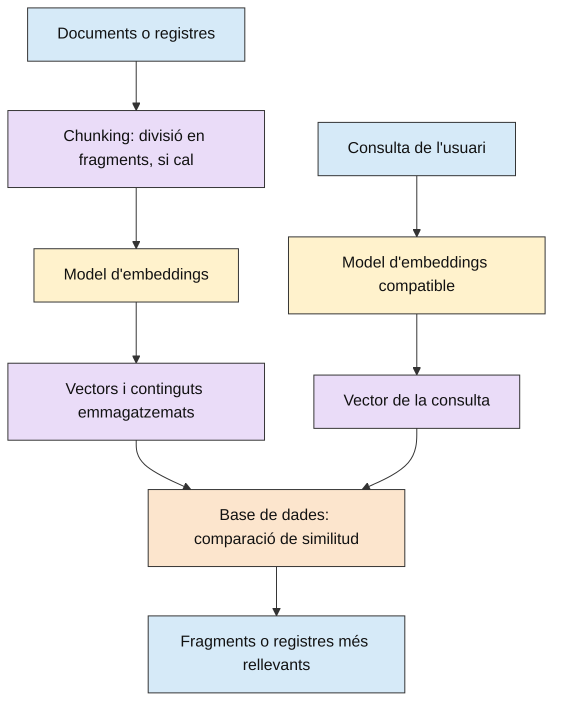

# Bases de dades vectorials: Weaviate i PostgreSQL amb pgvector

Les bases de dades vectorials permeten emmagatzemar representacions numèriques de la informació i recuperar els continguts més rellevants per a una consulta mitjançant la comparació de la seva similitud. Són especialment útils en aplicacions d'IA que necessiten cercar informació en documents, arxius o altres fonts de dades segons el seu significat semàntic i no únicament a partir de la coincidència exacta de paraules.

En aquest apartat s'explica com funciona una cerca vectorial, com s'utilitza **Weaviate** i quines opcions de desplegament ofereix. També es presenta **PostgreSQL amb pgvector** com a alternativa.

> **Relació amb la resta del manual:** [RAG](04_rag.md) explica com s'utilitza la informació recuperada per generar respostes amb un LLM. A [Exemples Python](08_examples.md) es mostra la implementació real de la cerca de receptes amb Weaviate. Aquí ens centrem en **com es guarden i es recuperen les dades**.

## 1. Què és una base de dades vectorial?

Una **base de dades** permet recuperar registres mitjançant condicions sobre els seus camps. Per exemple, si una taula de receptes conté el camp `tiempoMin`, es poden obtenir els plats que es preparen en menys de X minuts.

Una **base de dades vectorial** incorpora la possibilitat de comparar **vectors numèrics** que representen el contingut dels registres. Això permet recuperar resultats relacionats semànticament amb una pregunta, encara que les paraules utilitzades no coincideixin exactament. Per exemple, si l'usuari pregunta "Vull un sopar ràpid", una cerca semàntica podria recuperar receptes descrites com "plat fàcil de preparar en pocs minuts", perquè els textos tenen un significat semblant.

### 1.1. Embeddings: convertir informació en vectors

Un embedding és una representació numèrica d'un text, una imatge o un altre tipus de dada. S'obté mitjançant un model d'embeddings, que transforma el contingut en un vector.

Un vector es pot representar així:

```text
[0.12, -0.47, 0.83, 0.25, ...]
```

Els valors anteriors són d'exemple. En una aplicació real, un embedding pot tenir centenars o milers de dimensions, segons el model utilitzat.

La idea important és que **textos amb significats similars tendeixen a tenir representacions properes** dins de l'espai vectorial del model. No cal que els textos continguin exactament les mateixes paraules.

Cal distingir dos tipus de models:

| Component              | Funció                                                              |
| ---------------------- | ------------------------------------------------------------------- |
| **Model d'embeddings** | Converteix textos o altres dades en vectors per poder comparar-los. |
| **LLM generatiu**      | Interpreta instruccions i genera respostes en llenguatge natural.   |

Un model d'embeddings no redacta la resposta final d'un sistema RAG, la seva funció és ajudar a trobar informació rellevant.

### 1.2. Com es fa una cerca per similitud?

Per realitzar una cerca vectorial, primer cal preparar la informació, transformar-la en embeddings i emmagatzemar-la a la base de dades. Posteriorment, quan l'usuari introdueix una consulta, es comparen els vectors per recuperar els continguts més rellevants.

El procés general és el següent:

1. **Preparació de les dades:** es recopilen els documents, textos o registres que es volen emmagatzemar i consultar.

2. **Divisió en fragments (chunking):** si els documents són extensos, es divideixen en fragments més petits, anomenats _chunks_. Això permet representar i recuperar parts concretes d'un document sense haver de treballar sempre amb tot el seu contingut. En alguns casos, els fragments poden compartir una petita part del text per conservar el context entre ells.

3. **Generació dels embeddings:** un model d'embeddings transforma cada fragment o registre en un vector numèric que representa el seu contingut semàntic.

4. **Emmagatzematge:** els vectors es guarden a la base de dades, associats al text original (si es necessita també associats a informació addicional com el document d'origen o altres metadades).

5. **Vectorització de la consulta:** quan l'usuari introdueix una pregunta, aquesta també es transforma en un vector mitjançant un model d'embeddings compatible amb el que s'ha utilitzat per emmagatzemar les dades.

6. **Cerca per similitud:** la base de dades compara el vector de la consulta amb els vectors emmagatzemats i recupera els fragments o registres més propers segons la mesura de distància utilitzada.

7. **Recuperació dels resultats:** el sistema retorna els continguts associats als vectors seleccionats, que posteriorment es poden mostrar a l'usuari o proporcionar a un LLM com a context en un sistema RAG.

**Flux general d'una cerca vectorial:**



<p align="center">
  <sub>Figura 1. Funcionament general d'una cerca vectorial.</sub>
</p>

**Top-k** és el nombre màxim de resultats que es volen recuperar. Per exemple, amb `k = 5` es demanen els cinc fragments o registres més propers a la consulta, segons la mesura de distància utilitzada.

Cal tenir en compte que no sempre és necessari aplicar chunking. En el cas de documents extensos, com manuals o informes, dividir el contingut en fragments facilita la recuperació d'informació específica. En canvi, quan es treballa amb registres curts i estructurats es pot representar cada registre sense necessitat de dividir-lo.

### 1.3. Com es comparen els vectors?

Existeixen diferents mesures de similitud o distància. Una de les més habituals és la **similitud cosinus**, que compara la direcció de dos vectors:

$$
\operatorname{sim}_{\mathrm{cos}}(\mathbf{u},\mathbf{v}) =
\frac{\mathbf{u}\cdot\mathbf{v}}{\lVert\mathbf{u}\rVert\,\lVert\mathbf{v}\rVert}
$$

Per a vectors no nuls, un valor proper a `1` indica direccions molt semblants, mentre que valors menors indiquen una semblança inferior. També es poden utilitzar altres mesures, com la **distància euclidiana**.

És important diferenciar similitud i distància. Una similitud més alta sol indicar una coincidència millor. Mentre que en una cerca ordenada per distància, normalment interessen els valors més petits.

La proximitat vectorial no garanteix que un resultat compleixi totes les condicions de la petició. Per això, en moltes aplicacions es combina amb filtres exactes, com una categoria, una data...

## 2. Weaviate

**Weaviate** és una base de dades que permet emmagatzemar objectes amb propietats i vectors associats, i recuperar-los mitjançant cerques vectorials, cerques per paraules clau o cerques híbrides.

Els objectes s'organitzen en **col·leccions** (_collections_), que defineixen quin tipus d'informació s'emmagatzema i com es representa.

### 2.1. Exemple: la col·lecció `Recetas`

En els exemples del projecte s'utilitza una col·lecció de receptes. Cada objecte conté informació estructurada sobre un plat:

| Propietat   | Informació                    | Propietat           | Informació                 |
| ----------- | ----------------------------- | ------------------- | -------------------------- |
| `nombre`    | Nom de la recepta             | `ingredientes`      | Ingredients i quantitats   |
| `categoria` | Categoria del plat            | `ingredientesClave` | Ingredients principals     |
| `dieta`     | Tipus de dieta                | `preparacion`       | Instruccions de preparació |
| `tiempoMin` | Temps de preparació en minuts | `descripcion`       | Descripció de la recepta   |
| `raciones`  | Nombre de racions             |                     |                            |

Aquestes propietats permeten combinar dos tipus de consulta:

- **Semàntica:** trobar receptes relacionades amb "un sopar lleuger" encara que la descripció no contingui aquestes paraules exactes.
- **Estructurada:** limitar els resultats a receptes amb un `tiempoMin` determinat o d'una categoria concreta.

### 2.2. Cerca vectorial amb `near_text()`

El client Python de Weaviate ofereix el mètode `near_text()`, que permet cercar objectes relacionats amb una consulta de text.

```python
# Fragment didàctic: pressuposa que el client ja està connectat.
collection = client.collections.get("Recetas")

result = collection.query.near_text(
    query="receptes per a un sopar ràpid",
    limit=5,
)

for obj in result.objects:
    print(obj.properties.get("nombre"))
```

**Important:** `near_text()` requereix que la col·lecció tingui configurat un **vectoritzador** compatible. Si la col·lecció només conté vectors proporcionats externament i no disposa d'aquest mecanisme, l'aplicació ha de generar el vector de consulta i utilitzar una cerca com `near_vector()`.

Per tant, Weaviate **no sempre genera embeddings automàticament**: depèn de la configuració de cada col·lecció.

En el codi del projecte, la cerca incorpora també restriccions sobre el temps i comprova amb Python que es compleixin tots els ingredients obligatoris. Això evita confondre la semblança semàntica amb una coincidència exacta de tots els requisits.

Per veure aquesta implementació pas a pas, consulta l'[exemple de Weaviate i RAG](08_examples.md).

### 2.3. Altres tipus de cerca

| Tipus de cerca        | Com funciona                                                      | Quan és útil?                                                        |
| --------------------- | ----------------------------------------------------------------- | -------------------------------------------------------------------- |
| **Vectorial**         | Compara embeddings per trobar continguts amb significat semblant. | Preguntes expressades en llenguatge natural.                         |
| **Per paraules clau** | Cerca coincidències de termes.                                    | Noms, codis, identificadors o paraules concretes.                    |
| **Híbrida**           | Combina la cerca vectorial i la cerca per paraules clau.          | Quan interessa trobar tant conceptes relacionats com termes exactes. |

## 3. Opcions de desplegament de Weaviate

Una distinció fonamental és que Weaviate és el motor de base de dades, mentre que Weaviate Cloud és una manera d'utilitzar-lo. El motor es pot executar com a servei gestionat o en una infraestructura administrada pel desenvolupador.

### 3.1. Weaviate Cloud: servei gestionat

Amb Weaviate Cloud, el proveïdor gestiona la infraestructura del servidor. L'aplicació es connecta a la instància remota mitjançant l'URL del clúster i les credencials configurades.

**Avantatges:**

- No cal instal·lar ni mantenir directament el servidor.
- És fàcil connectar-hi aplicacions executades en diferents ordinadors.
- El servei proporciona opcions gestionades per a desenvolupament i producció.

**Aspectes a tenir en compte:**

- Cal disposar de connexió amb el servei remot.
- Les dades es gestionen segons la regió, la configuració i les condicions del proveïdor.
- El cost depèn del servei i del pla escollits.
- El pla gratuït (_Free_) té limitacions d'emmagatzematge i recursos, i els clústers es poden eliminar després de 30 dies d'inactivitat.

**En aquest projecte:** els exemples Python es connecten a **Weaviate Cloud** per consultar la col·lecció `Recetas`.

### 3.2. Weaviate on-premise: infraestructura pròpia amb Docker

També és possible executar Weaviate en un ordinador o servidor propi amb **Docker**, una tecnologia que permet executar aplicacions dins de contenidors.

En aquest cas, el desenvolupador administra el servidor i ha de tenir en compte la configuració, la persistència de les dades, la seguretat, les actualitzacions i les còpies de seguretat.

**Avantatges:**

- Més control sobre la infraestructura i la configuració.
- Possibilitat de mantenir les dades en sistemes propis.
- Útil per fer proves o desenvolupar una aplicació sense contractar un clúster de Weaviate Cloud.

**Aspectes a tenir en compte:**

- Cal administrar el servei i els recursos de la màquina.
- Les dades s'han de desar en volums persistents per evitar perdre-les quan es recreï el contenidor.
- Si s'exposa el servei a altres equips, cal configurar correctament l'autenticació, la xarxa i la seguretat.

#### Exemple de comandes amb Docker

Primer es pot comprovar que Docker i Docker Compose estan disponibles:

```bash
docker --version
docker compose version
```

Després de preparar un fitxer `compose.yaml` segons la [guia oficial d'instal·lació de Weaviate](https://docs.weaviate.io/deploy/installation-guides/docker-installation), el servei es pot iniciar amb:

```bash
docker compose up -d
```

I es pot consultar l'estat dels contenidors amb:

```bash
docker compose ps
```

> **Atenció:** aquestes ordres pressuposen que ja existeix un fitxer `compose.yaml` vàlid. Per si soles **no instal·len ni configuren** Weaviate. Tampoc no cal executar-les per reproduir els exemples actuals del repositori, que utilitzen Weaviate Cloud.

En una configuració local habitual, la interfície HTTP de Weaviate és accessible al port `8080` i el servei gRPC al port `50051`, si tots dos s'han publicat al contenidor.

### 3.3. Comparació: Cloud i on-premise

| Característica                         | Weaviate Cloud                                   | Weaviate amb Docker                           |
| -------------------------------------- | ------------------------------------------------ | --------------------------------------------- |
| **Motor de base de dades**             | Weaviate                                         | Weaviate                                      |
| **Ubicació**                           | Infraestructura del proveïdor                    | Ordinador o servidor administrat per l'usuari |
| **Instal·lació i manteniment**         | Gestionats pel proveïdor                         | Responsabilitat de l'administrador            |
| **Connexió de l'aplicació**            | URL remota i credencials                         | Adreça i ports del servidor propi             |
| **Persistència i còpies de seguretat** | Segons el servei contractat                      | S'han de configurar i gestionar               |
| **Cost principal**                     | Servei gestionat                                 | Recursos i manteniment de la infraestructura  |
| **Ús habitual**                        | Desenvolupament compartit i producció gestionada | Desenvolupament i proves locals               |

**Conclusió:** les funcionalitats de Weaviate no canvien pel fet d'utilitzar Cloud o Docker; el que canvia principalment és **qui administra el servidor i on es troben les dades**. La configuració de vectorització, els models disponibles i la xarxa sí que s'han d'adaptar a cada entorn.

## 4. Alternativa: PostgreSQL amb pgvector

**PostgreSQL** és un sistema de gestió de bases de dades relacionals. Tradicionalment, la informació es guarda en taules i es consulta mitjançant SQL.

**pgvector** és una extensió que afegeix a PostgreSQL tipus de dades vectorials i operacions de cerca per similitud. Això permet guardar dades estructurades i embeddings en una mateixa base de dades.

És important entendre que pgvector és una solució diferent que utilitza PostgreSQL com a base, en comptes de Weaviate.

### 4.1. Com funciona pgvector?

Amb pgvector es poden:

- Guardar embeddings en columnes de tipus `vector`.
- Comparar vectors mitjançant distància euclidiana, distància cosinus o altres operadors.
- Combinar una cerca per similitud amb filtres SQL (`WHERE`, `JOIN`, etc.).
- Crear índexs aproximats com HNSW o IVFFlat per accelerar determinades consultes.

A diferència de l'ús de `near_text()` amb un vectoritzador configurat a Weaviate, pgvector no transforma per si sol una frase en un embedding. L'aplicació ha de generar els vectors o integrar algun mecanisme que ho faci, abans de comparar-los.

### 4.2. Exemple amb SQL

Suposem que volem guardar receptes i consultar quines s'assemblen més a una pregunta. Primer cal activar l'extensió en una instància de PostgreSQL que la tingui instal·lada:

```sql
CREATE EXTENSION IF NOT EXISTS vector;
```

Després podem crear una taula amb informació estructurada i una columna vectorial:

```sql
CREATE TABLE receptes (
    id BIGSERIAL PRIMARY KEY,
    nombre TEXT NOT NULL,
    categoria TEXT,
    tiempo_min INTEGER,
    embedding VECTOR(3)
);
```

Per exemple, es pot inserir aquestes dades fictícies:

```sql
INSERT INTO receptes (nombre, categoria, tiempo_min, embedding)
VALUES
    ('Truita de patates', 'Sopar', 25, '[0.10, 0.80, 0.20]'),
    ('Amanida ràpida', 'Sopar', 10, '[0.15, 0.75, 0.25]'),
    ('Arròs al forn', 'Dinar', 60, '[0.85, 0.10, 0.40]');
```

Ara podem buscar les receptes més properes a un vector de consulta i restringir el temps a 30 minuts:

```sql
SELECT nombre, tiempo_min
FROM receptes
WHERE tiempo_min <= 30
ORDER BY embedding <=> '[0.12, 0.78, 0.22]'
LIMIT 2;
```

L'operador **`<=>`** calcula la **distància cosinus**. Com que la consulta ordena els resultats de menor a major distància, retorna primer els vectors més propers.

> **Exemple didàctic:** els vectors de tres dimensions s'han inventat únicament per entendre la sintaxi. **No són embeddings semàntics reals.** En una aplicació pràctica s'utilitzaria un model d'embeddings, i la dimensió de `VECTOR(n)` hauria de coincidir amb la sortida d'aquest model.

Quan el volum de dades augmenta, es poden estudiar índexs vectorials. Per exemple, amb HNSW i distància cosinus:

```sql
CREATE INDEX receptes_embedding_hnsw
ON receptes
USING hnsw (embedding vector_cosine_ops);
```

Els índexs aproximats poden millorar el temps de cerca, però també comporten costos de memòria, construcció i possibles diferències respecte d'una cerca exacta. **No** sempre cal crear-los, especialment en conjunts de dades petits.

### 4.3. On es pot executar PostgreSQL amb pgvector?

Igual que altres bases de dades, PostgreSQL es pot instal·lar en un servidor propi, executar-se en contenidors o contractar-se com a servei gestionat al núvol, sempre que l'entorn permeti utilitzar l'extensió `pgvector`.

Per tant, cal distingir dues decisions diferents:

1. **Tecnologia de base de dades:** Weaviate o PostgreSQL amb pgvector.
2. **Forma de desplegament:** Cloud gestionat o infraestructura pròpia.

La primera decisió determina les APIs, les consultes i la integració amb l'aplicació. La segona determina qui administra la infraestructura.

## 5. Comparació: Weaviate i PostgreSQL amb pgvector

| Aspecte                   | Weaviate                                                    | PostgreSQL + pgvector                                             |
| ------------------------- | ----------------------------------------------------------- | ----------------------------------------------------------------- |
| **Enfocament**            | Base de dades orientada a cerques vectorials i semàntiques. | Base de dades relacional amb funcionalitats vectorials.           |
| **Organització de dades** | Col·leccions amb objectes i propietats.                     | Taules, columnes i relacions SQL.                                 |
| **Cerca vectorial**       | API de Weaviate, com `near_text()` o `near_vector()`.       | SQL amb operadors de distància sobre embeddings.                  |
| **Text a vector**         | Pot fer-ho mitjançant un vectoritzador configurat.          | Necessita que l'aplicació o una integració generi els embeddings. |
| **Filtres estructurats**  | Filtres sobre propietats.                                   | Clàusules SQL, incloent `WHERE` i `JOIN`.                         |
| **Índexs vectorials**     | Mecanismes d'indexació del motor.                           | Índexs com HNSW o IVFFlat.                                        |
| **Desplegament**          | Servei gestionat o instal·lació pròpia.                     | Servei gestionat o instal·lació pròpia amb l'extensió.            |
| **Pot ser útil quan...**  | Es vol una base especialitzada en recuperació semàntica.    | Ja s'utilitza PostgreSQL i es vol afegir cerca vectorial.         |

### 5.1. Quina opció escolliríem?

Weaviate pot ser una bona elecció quan l'aplicació se centra en la recuperació semàntica i interessa disposar d'una API específica per a cerques vectorials, integracions de vectorització i consultes híbrides.

PostgreSQL amb pgvector pot ser una bona elecció quan ja existeix una base de dades PostgreSQL, es necessita combinar la cerca vectorial amb dades relacionals, o es prefereix mantenir una sola tecnologia de base de dades.

No hi ha una opció millor ja que la decisió depèn de la quantitat de dades, les consultes necessàries, l'equip disponible, les restriccions de seguretat i els requisits de desplegament.

## 6. Relació amb els exemples del projecte

Els programes del repositori utilitzen **Weaviate Cloud** i la col·lecció `Recetas`:

1. **Python** rep la pregunta i identifica els filtres necessaris.
2. **Weaviate** recupera receptes relacionades amb la consulta mitjançant cerca vectorial.
3. **Python** comprova les condicions que cal complir exactament, com els ingredients obligatoris.
4. Quan l'exemple incorpora RAG, **Qwen** genera una explicació utilitzant les receptes recuperades.

Això permet separar tres responsabilitats:

- **Base de dades vectorial:** recuperar informació potencialment rellevant.
- **Python:** aplicar regles, validar filtres i gestionar l'estat de l'aplicació.
- **LLM:** interpretar les peticions i redactar respostes a partir del context disponible.

Si es volgués substituir Weaviate per PostgreSQL amb pgvector, no seria suficient canviar l'URL de connexió: caldria adaptar l'emmagatzematge, la generació dels embeddings i les funcions de consulta SQL. Els exemples actuals no implementen aquesta alternativa. Només es presenta aquesta alternativa per comparar les possibilitats.

Per aprofundir en el procés complet, continua amb [RAG](04_rag.md) i amb els [exemples de Weaviate, LangGraph i Opik](08_examples.md).

## Referències

- [Weaviate — Conceptes de cerca vectorial](https://docs.weaviate.io/weaviate/concepts/search/vector-search)
- [Weaviate — Tipus de cerca](https://docs.weaviate.io/weaviate/concepts/search)
- [Weaviate — Opcions de desplegament](https://docs.weaviate.io/deploy)
- [Weaviate — Instal·lació amb Docker](https://docs.weaviate.io/deploy/installation-guides/docker-installation)
- [Weaviate — Desplegaments de producció](https://docs.weaviate.io/deploy/production)
- [pgvector — Documentació oficial i exemples SQL](https://github.com/pgvector/pgvector)
