## 4. RAG (RETRIEVAL-AUGMENTED GENERATION)

RAG (Retrieval-Augmented Generation) is a technique that improves the responses of a language model by incorporating information retrieved from an external source, such as a database, documents, or other storage systems.

An LLM generates answers based on the knowledge acquired during training and the context it receives in each query. As such, this knowledge may not include application-specific information, documents or updated data. RAG allows to solve this limitation by providing the model with relevant information before generating the response. In this way, the LLM can respond based on data that is not necessarily part of their training.

### 4.1. OPERATION OF A RAG SYSTEM

The operation of a RAG system is divided into three main stages: retrieval, augmentation and generation.

1. **Retrieval** (retrieval of information):
   When the user enters a query, the system searches for information related to the request from an external source. In systems that use vector databases, this search can be performed using numerical representations of the content (_embeddings_).

   For example, a query like "recipes for a quick dinner" may retrieve recipes described as "easy dishes to prepare in a few minutes", even if the words are not an exact match.

2. **Augmentation** (enlargement of the context):
   Once the information is retrieved, Python prepares a new prompt that incorporates both the user's original question and the data obtained. The model no longer only receives the question, but also additional information that it can use to craft the answer.

3. **Generation** (generation of the response):
   Finally, the LLM processes the extended prompt and generates a natural language response. At this stage, the model does not need to know the retrieved documents beforehand. You can use them directly because they are part of the context provided.

Using RAG does not automatically guarantee that all answers are correct, but it does reduce reliance on model internal knowledge and ground answers on concrete information.

**General RAG System Flow**

```mermaid
flowchart LR
    U["User query"] --> R["Retrieval: Search Weaviate"]
    R --> C["Recipes retrieved"]
    C --> A["Augmentation: prompt with context"]
    U --> A
    A --> G["Generation: LLM inference"]
    G --> F["Response based on retrieved data"]

    classDef usuari fill:#D6EAF8,stroke:#333333,color:#111111
    classDef retrieval fill:#D5E8E8,stroke:#333333,color:#111111
    classDef dades fill:#FCE5CD,stroke:#333333,color:#111111
    classDef augmentacio fill:#D9EAD3,stroke:#333333,color:#111111
    classDef llm fill:#FFF2CC,stroke:#333333,color:#111111
    classDef resposta fill:#E4DDF1,stroke:#333333,color:#111111

    class U usuari
    class R retrieval
    class C dades
    class A augmentacio
    class G llm
    class F resposta
```

  Figure 1. General flow of a RAG

### 4.2. VECTOR DATABASES AND WEAVIATE

The _Retrieval_ phase needs an information source that the application can query. One option is to use a **vector database**, which allows you to store data and retrieve content that is semantically related to a query.

The project examples use **Weaviate**, deployed via **Weaviate Cloud**, with a collection named `Recetas`. Python retrieves recipes with operations such as `near_text()` and, where necessary, check additional conditions such as preparation time or required ingredients.

To avoid repeating explanations in several chapters, the detailed description of vector databases is in a specific document:

**[See: Vector Databases — Weaviate, Cloud, Docker and PostgreSQL with pgvector](04.1_vector_databases.md)**

This supplementary document explains:

- What are **embeddings** and how similarity search works.
- How information is organized in Weaviate and what it does `near_text()`.
- The differences between **Weaviate Cloud** and **Weaviate on-premise with Docker**.
- The **PostgreSQL with pgvector** alternative, with sample SQL queries.
- A comparison to know when it might be convenient to use each technology.

The concrete implementation of RAG queries, filters, and response generation is shown in **[08_examples.md](08_examples.md)**, with links to the corresponding Python code and _snippets_.

### 4.3. APPLICATIONS AND ADVANTAGES OF RAG

RAG allows you to develop wizards that use specific information without the need to train a new model. This architecture is particularly useful in applications that require consulting technical documentation, manuals, internal databases, regulations or other sources of information. It also allows you to update the available data by modifying the content of the database, without having to modify the parameters of the LLM.

The quality of the system depends as much on the model's ability to interpret the data as on the relevance and quality of the information retrieved.

In the recipe project, this means that the LLM does not invent the recipes to be displayed, but receives a selection of results retrieved from Weaviate and generates an explanation based on this information. The program can also apply Python validations to check that the recipes meet the user's requirements.

> **Key idea:** the database retrieves information, Python prepares and validates it, and the LLM uses it to generate the response. You can consult the operation of the database at [04.1_vector_databases.md](04.1_vector_databases.md) and see the actual code in [08_examples.md](08_examples.md).
