## 4. RAG (RETRIEVAL-AUGMENTED GENERATION)

RAG (Retrieval-Augmented Generation) és una tècnica que permet millorar les respostes d'un model de llenguatge incorporant informació recuperada d'una font externa, com ara una base de dades, documents o altres sistemes d'emmagatzematge.

Un LLM genera respostes a partir dels coneixements adquirits durant l'entrenament i del context que rep en cada consulta. D’aquesta manera, aquests coneixements poden no incloure informació específica d'una aplicació, documents o dades actualitzades. RAG permet solucionar aquesta limitació proporcionant al model informació rellevant abans de generar la resposta. D'aquesta manera, el LLM pot respondre basant-se en dades que no necessàriament formen part del seu entrenament.

### 4.1. FUNCIONAMENT D'UN SISTEMA RAG

El funcionament d'un sistema RAG es divideix en tres etapes principals: retrieval, augmentation i generation.

1. **Retrieval** (recuperació d'informació):
   Quan l'usuari introdueix una consulta, el sistema busca informació relacionada amb la petició en una font externa. En sistemes que utilitzen bases de dades vectorials, aquesta cerca pot realitzar-se mitjançant representacions numèriques del contingut (_embeddings_).

   Per exemple, una consulta com «receptes per a un sopar ràpid» pot recuperar receptes descrites com a «plats fàcils de preparar en pocs minuts», encara que les paraules no coincideixin exactament.

2. **Augmentation** (ampliació del context):
   Una vegada recuperada la informació, Python prepara un nou prompt que incorpora tant la pregunta original de l'usuari com les dades obtingudes. El model ja no rep únicament la pregunta, sinó també informació addicional que pot utilitzar per elaborar la resposta.

3. **Generation** (generació de la resposta):
   Finalment, el LLM processa el prompt ampliat i genera una resposta en llenguatge natural. En aquesta etapa, el model no necessita conèixer prèviament els documents recuperats. Pot utilitzar-los directament perquè formen part del context proporcionat.

El fet d'utilitzar RAG no garanteix automàticament que totes les respostes siguin correctes, però permet reduir la dependència dels coneixements interns del model i fonamentar les respostes en informació concreta.

**Flux general del sistema RAG**

```mermaid
flowchart LR
    U["Consulta de l'usuari"] --> R["Retrieval: cerca a Weaviate"]
    R --> C["Receptes recuperades"]
    C --> A["Augmentation: prompt amb context"]
    U --> A
    A --> G["Generation: inferència del LLM"]
    G --> F["Resposta basada en dades recuperades"]

    classDef usuari fill:#D6EAF8,stroke:#333333,color:#111111
    classDef retrieval fill:#D5E8E8,stroke:#333333,color:#111111
    classDef dades fill:#FCE5CD,stroke:#333333,color:#111111
    classDef augmentacio fill:#D9EAD3,stroke:#333333,color:#111111
    classDef llm fill:#FFF2CC,stroke:#333333,color:#111111
    classDef resposta fill:#E4DDF1,stroke:#333333,color:#111111

    class U usuari
    class R retrieval
    class C dades
    class A augmentacio
    class G llm
    class F resposta
```

  Figura 1. Flux general d'un RAG

### 4.2. BASES DE DADES VECTORIALS I WEAVIATE

La fase de _Retrieval_ necessita una font d'informació que l'aplicació pugui consultar. Una de les opcions és utilitzar una **base de dades vectorial**, que permet emmagatzemar dades i recuperar contingut relacionat semànticament amb una consulta.

En els exemples del projecte s'utilitza **Weaviate**, desplegat mitjançant **Weaviate Cloud**, amb una col·lecció anomenada `Recetas`. Python recupera les receptes amb operacions com `near_text()` i, quan cal, comprova condicions addicionals com el temps de preparació o els ingredients obligatoris.

Per evitar repetir explicacions en diversos capítols, la descripció detallada de les bases de dades vectorials es troba en un document específic:

**[Consultar: Bases de dades vectorials — Weaviate, Cloud, Docker i PostgreSQL amb pgvector](04.1_bbdd.md)**

En aquest document complementari s'expliquen:

- Què són els **embeddings** i com funciona la cerca per similitud.
- Com s'organitza la informació a Weaviate i què fa `near_text()`.
- Les diferències entre **Weaviate Cloud** i **Weaviate on-premise amb Docker**.
- L'alternativa **PostgreSQL amb pgvector**, amb exemples de consultes SQL.
- Una comparació per saber quan pot ser convenient utilitzar cada tecnologia.

La implementació concreta de les consultes, els filtres i la generació de respostes RAG es mostra a **[08_examples.md](08_examples.md)**, amb enllaços al codi Python i als _snippets_ corresponents.

### 4.3. APLICACIONS I AVANTATGES DE RAG

RAG permet desenvolupar assistents que utilitzen informació específica sense necessitat d'entrenar un nou model. Aquesta arquitectura és especialment útil en aplicacions que requereixen consultar documentació tècnica, manuals, bases de dades internes, normatives o altres fonts d'informació. També permet actualitzar les dades disponibles modificant el contingut de la base de dades, sense haver de modificar els paràmetres del LLM.

La qualitat del sistema depèn tant de la capacitat del model per interpretar les dades com de la rellevància i la qualitat de la informació recuperada.

En el projecte de receptes, això significa que el LLM no inventa les receptes que s'han de mostrar, sinó que rep una selecció de resultats recuperats de Weaviate i genera una explicació a partir d'aquesta informació.El programa també pot aplicar validacions amb Python per comprovar que les receptes compleixin els requisits de l'usuari.

> **Idea clau:** la base de dades recupera informació, Python la prepara i valida, i el LLM la utilitza per generar la resposta. Pots consultar el funcionament de la base de dades a [04.1_bbdd.md](04.1_bbdd.md) i veure el codi real a [08_examples.md](08_examples.md).
