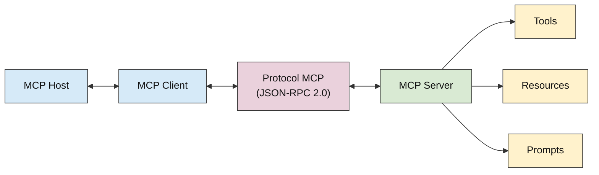

## 5. MCP SERVER (MODEL CONTEXT PROTOCOL)

MCP (Model Context Protocol) is an open and standardized protocol that allows artificial intelligence applications to connect with external tools, data sources and services. Usually, an LLM generates answers based on the information provided in the prompt and the knowledge acquired during its training. However, the model cannot directly access files on a computer, query a database, or perform certain operations if the application does not provide the necessary mechanisms.

MCP facilitates this integration through a standardized communication architecture between applications and servers that offer different functionalities.

For example, through MCP you could connect an LLM-based assistant with:
The local file system, for reading documents or consulting directories.
A database, to retrieve stored information.
An external API, to get data from a service.
A code repository, to consult files and project information.
An application that executes specific Python functions.

One of the main advantages is that the tools can be developed independently of the application using the LLM. In this way, the same MCP server can be used by different compatible applications.

### 5.1. MCP ARCHITECTURE

MCP uses a client-server architecture consisting of three main components:
MCP Host
MCP Client
MCP Server

1. MCP Host:
   is the main application that needs to access external functionality. The host manages the user experience, integration with language models, and connections to MCP servers. For example, a code editor with an AI assistant can act as an MCP Host.

2. MCP Client:
   is the component that establishes and manages communication with an MCP server. Its main responsibilities are to establish the connection, discover the functionalities offered by the server, send requests and receive the results. Typically, the host creates an MCP client for each connection to a server.

3. MCP Server:
   is the program that provides the functionalities through the protocol. The server can run Python functions, query databases, access files, or communicate with other services.

The server does not need to embed an LLM. It can limit itself to providing functions that will later be used by other applications. For example, a file-specialized MCP server might expose the list_files() and read_file() operations. When the client requests to execute list_files(), it is the server that executes the corresponding function and returns the result.



<p align="center">
  <sub>Figure 1. MCP architecture</sub>
</p>

### 5.2. FUNCTIONALITIES OF AN MCP SERVER

An MCP server can provide different types of functionality. The three main primitives are Tools, Resources, and Prompts.

1. Tools:
   are executable functions that the server makes available to clients. They allow specific operations to be performed, such as querying an API, executing a calculation or modifying information.

For example, a server could expose the following function:

```python
@mcp.tool()
def calculate_flight_time(
    distance_km: float,
    speed_kmh: float
) -> float:
    """Calculate flight time in minutes."""
    return (distance_km / speed_kmh) * 60
```

This function receives a distance and a speed, and returns the flight time in minutes. The @mcp.tool() decorator registers the function as a server tool.

This way, when an MCP client queries the available tools, it can discover calculate_flight_time(), the arguments it needs and their description. If you later request to run it, the server performs the calculation with Python and returns the result.

The LLM does not execute the formula directly. The model may request that the tool be used, but the actual computation is the responsibility of the server.

2. Resources:
   allow you to provide information that an application can read and incorporate into its context. Unlike tools, which represent executable operations, resources are oriented to expose content.

   For example, a server could provide the contents of a document or information about a system configuration.

3. Prompts:
   are reusable templates that allow you to structure the instructions provided to a model.

```python
# For example:
@mcp.prompt()
def explain_code(language: str) -> str:
    """Generate a prompt to explain code."""
    return (
        f"Explain how this {language} "
        "code works step by step."
    )
```

The server provides the template, but does not necessarily run any inference. The client can retrieve the prompt and use it later in an interaction with an LLM.

### 5.3. COMMUNICATION BETWEEN CLIENT AND SERVER

MCP uses structured messages based on JSON-RPC 2.0 to exchange requests, responses, and notifications. The protocol defines the necessary mechanisms for a client to discover the capabilities of a server and use them.

For example, a client can request the list of available tools using the tools/list operation. If you want to run a specific tool, use tools/call, providing its name and arguments.

A request to calculate a flight time (with the tool described above) could have a structure equivalent to:

```json
{
  "jsonrpc": "2.0",
  "id": 1,
  "method": "tools/call",
  "params": {
    "name": "calculate_flight_time",
    "arguments": {
      "distance_km": 12,
      "speed_kmh": 40
    }
  }
}
```

The server interprets the request, validates the arguments, and executes the Python function. In this case, the result would be a flight time of 18 minutes. The server then returns the result to the client using a structured protocol response.

The MCP library handles communication, data serialization, and argument validation.

There are different transport mechanisms: stdio, streamable HTTP.
| **Transport** | **Description** |
|---|---|
| **stdio (Standard Input/Output)** | It is mainly used when the server is running locally. The client starts the server as a process and communicates with it using standard input and output. It allows applications to connect with local tools without opening a network port. |
| **Streamable HTTP** | Allows establishing communication with a server via HTTP. It is especially useful when the server is on another machine or has been deployed as a network-accessible service. It makes it easy for different clients to communicate with a remote server. |

Selecting the transport does not change the purpose of the tools: the server continues to provide the same operations, but changes the mechanism used to communicate with clients.

Selecting the transport does not change the purpose of the tools: the server continues to provide the same operations, but changes the mechanism used to communicate with clients.

### 5.4. OPERATION AND FLOW OF EXECUTION

To understand how MCP works, let's assume an application with an LLM that has an MCP server with a flight-time tool (the one seen earlier).

The user enters: “How long would it take a drone to travel 12 km at 40 km/h?”

In an application where the LLM has the server tools, the operation could be as follows:

1. User input: The user enters the question in the main application (MCP Host).
2. Tools availability: The MCP client connects to the server and queries the available tools. This operation may have been performed previously and it is not necessary to repeat it for each question.
3. Interpretation of the LLM: The application provides the model with the question and the description of the available tools. The LLM interprets that it needs to calculate a flight time and can generate a request to use calculate_flight_time().
4. Request to MCP Client: The application receives the model decision and requests the MCP client to run the tool, providing the arguments distance_km=12 and speed_kmh=40.
5. MCP Communication: The client sends the request to the server using the protocol.
6. Execution on the server: The MCP Server executes the Python function calculate_flight_time() and gets a result of 18 minutes.
7. Returning the result: The server returns the result to the MCP client, which provides it to the main application.
8. LLM Response: The application can send the result to the model to generate a natural language explanation.
9. Final Response: The application displays the response to the user.

```mermaid

flowchart LR
    U["User"] --> L1["LLM"]
    L1 --> C1["MCP Client"]
    C1 --> S["MCP Server"]
    S --> T["Python tool"]
    T --> C2["MCP Client"]
    C2 --> L2["LLM"]
    L2 --> F["Final response"]

    classDef usuari fill:#D6EAF8,stroke:#333333,color:#111111
    classDef llm fill:#FFF2CC,stroke:#333333,color:#111111
    classDef client fill:#D9EAD3,stroke:#333333,color:#111111
    classDef server fill:#EADCF8,stroke:#333333,color:#111111
    classDef eina fill:#D6EAF8,stroke:#333333,color:#111111

    class U,F usuari
    class L1,L2 llm
    class C1,C2 client
    class S server
    class T eina
```



<p align="center">
  <sub>Figure 2. Execution flow of a request with MCP and LLM</sub>
</p>

| **Component** | **Function** |
| ---------------------------- | ---------------------------------------------------------------------- |
| **LLM (request)** | Interpret the question and decide to use an MCP server tool. |
| **MCP Client (Request)** | Send the request with the arguments to the server.                    |
| **MCP Server** | It receives the request and runs the corresponding tool.                      |
| **Python Tool** | Performs the operation and returns the result.                             |
| **MCP Client (response)** | It receives the result from the server and provides it to the application.           |
| **LLM (answer)** | Use the result to generate a final answer.                   |

This diagram shows that the LLM steps in to interpret the request and, when the application allows it, decide which tool to use. Instead, the MCP client handles the communication and the server executes the function.
