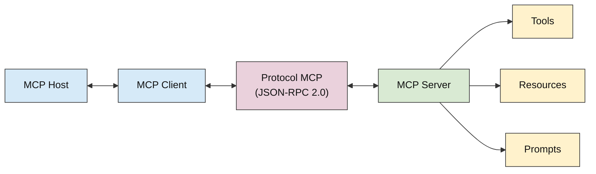

## 5. MCP SERVER (MODEL CONTEXT PROTOCOL)

MCP (Model Context Protocol) és un protocol obert i estandarditzat que permet connectar aplicacions d'intel·ligència artificial amb eines, fonts de dades i serveis externs. Habitualment, un LLM genera respostes a partir de la informació proporcionada en el prompt i dels coneixements adquirits durant el seu entrenament. Tanmateix, el model no pot accedir directament als fitxers d'un ordinador, consultar una base de dades o executar determinades operacions si l'aplicació no li proporciona els mecanismes necessaris.

MCP facilita aquesta integració mitjançant una arquitectura de comunicació estandarditzada entre aplicacions i servidors que ofereixen diferents funcionalitats.

Per exemple, mitjançant MCP es podria connectar un assistent basat en un LLM amb:
El sistema de fitxers local, per llegir documents o consultar directoris.
Una base de dades, per recuperar informació emmagatzemada.
Una API externa, per obtenir dades d'un servei.
Un repositori de codi, per consultar fitxers i informació d'un projecte.
Una aplicació que executi funcions Python específiques.

Un dels principals avantatges és que les eines es poden desenvolupar independentment de l'aplicació que utilitza el LLM. D'aquesta manera, un mateix servidor MCP pot ser utilitzat per diferents aplicacions compatibles.

### 5.1. ARQUITECTURA MCP

MCP utilitza una arquitectura client-servidor formada per tres components principals:
MCP Host
MCP Client
MCP Server

1. MCP Host:
   és l'aplicació principal que necessita accedir a funcionalitats externes. El host gestiona l'experiència de l'usuari, la integració amb els models de llenguatge i les connexions amb els servidors MCP. Per exemple, un editor de codi amb assistent d'intel·ligència artificial pot actuar com a MCP Host.

2. MCP Client:
   és el component que estableix i gestiona la comunicació amb un servidor MCP. Les seves responsabilitats principals són establir la connexió, descobrir les funcionalitats que ofereix el servidor, enviar sol·licituds i rebre els resultats. Normalment, el host crea un client MCP per a cada connexió amb un servidor.

3. MCP Server:
   és el programa que proporciona les funcionalitats a través del protocol. El servidor pot executar funcions Python, consultar bases de dades, accedir a fitxers o comunicar-se amb altres serveis.

El servidor no necessita incorporar un LLM. Pot limitar-se a oferir funcions que posteriorment seran utilitzades per altres aplicacions. Per exemple, un servidor MCP especialitzat en fitxers podria exposar les operacions list_files() i read_file(). Quan el client sol·licita executar list_files(), és el servidor qui executa la funció corresponent i retorna el resultat.



<p align="center">
  <sub>Figura 1. Arquitectura MCP</sub>
</p>

### 5.2. FUNCIONALITATS D'UN MCP SERVER

Un servidor MCP pot proporcionar diferents tipus de funcionalitats. Les tres primitives principals són Tools, Resources i Prompts.

1. Tools:
   són funcions executables que el servidor posa a disposició dels clients. Permeten realitzar operacions concretes, com consultar una API, executar un càlcul o modificar informació.

Per exemple, un servidor podria exposar la funció següent:

```python
@mcp.tool()
def calculate_flight_time(
    distance_km: float,
    speed_kmh: float
) -> float:
    """Calculate flight time in minutes."""
    return (distance_km / speed_kmh) * 60
```

Aquesta funció rep una distància i una velocitat, i retorna el temps de vol en minuts. El decorador @mcp.tool() registra la funció com una eina del servidor.

D'aquesta manera, quan un client MCP consulta les eines disponibles, pot descobrir calculate_flight_time(), els arguments que necessita i la seva descripció. Si posteriorment sol·licita executar-la, el servidor realitza el càlcul amb Python i retorna el resultat.

El LLM no executa directament la fórmula. El model pot sol·licitar que s'utilitzi l'eina, però el càlcul real és responsabilitat del servidor.

2. Resources:
   permeten proporcionar informació que una aplicació pot llegir i incorporar al seu context. A diferència de les tools, que representen operacions executables, els resources estan orientats a exposar contingut.

   Per exemple, un servidor podria proporcionar el contingut d'un document o informació sobre la configuració d'un sistema.

3. Prompts:
   són plantilles reutilitzables que permeten estructurar les instruccions proporcionades a un model.

```python
Per exemple:
@mcp.prompt()
def explain_code(language: str) -> str:
    """Generate a prompt to explain code."""
    return (
        f"Explain how this {language} "
        "code works step by step."
    )
```

El servidor proporciona la plantilla, però no executa necessàriament cap inferència. El client pot recuperar el prompt i utilitzar-lo posteriorment en una interacció amb un LLM.

### 5.3. COMUNICACIÓ ENTRE CLIENT I SERVIDOR

MCP utilitza missatges estructurats basats en JSON-RPC 2.0 per intercanviar sol·licituds, respostes i notificacions. El protocol defineix els mecanismes necessaris perquè un client pugui descobrir les capacitats d'un servidor i utilitzar-les.

Per exemple, un client pot sol·licitar la llista d'eines disponibles mitjançant l'operació tools/list. Si vol executar una eina concreta, utilitza tools/call, proporcionant-ne el nom i els arguments.

Una sol·licitud per calcular un temps de vol (amb la tool anteriorment descrita) podria tenir una estructura equivalent a:

```json
{
  "jsonrpc": "2.0",
  "id": 1,
  "method": "tools/call",
  "params": {
    "name": "calculate_flight_time",
    "arguments": {
      "distance_km": 12,
      "speed_kmh": 40
    }
  }
}
```

El servidor interpreta la sol·licitud, valida els arguments i executa la funció Python. En aquest cas, el resultat seria un temps de vol de 18 minuts. Posteriorment, el servidor retorna el resultat al client mitjançant una resposta estructurada del protocol.

La biblioteca MCP s'encarrega de la comunicació, la serialització de les dades i la validació dels arguments.

Hi ha diferents mecanismes de transport: stdio, streamable HTTP.
| **Transport** | **Descripció** |
|---|---|
| **stdio (Standard Input/Output)** | S'utilitza principalment quan el servidor s'executa localment. El client inicia el servidor com un procés i es comunica amb ell mitjançant l'entrada i la sortida estàndard. Permet connectar aplicacions amb eines locals sense necessitat d'obrir un port de xarxa. |
| **Streamable HTTP** | Permet establir comunicació amb un servidor a través d'HTTP. És especialment útil quan el servidor es troba en una altra màquina o s'ha desplegat com un servei accessible per xarxa. Facilita que diferents clients es puguin comunicar amb un servidor remot. |

La selecció del transport no modifica la finalitat de les eines: el servidor continua proporcionant les mateixes operacions, però canvia el mecanisme utilitzat per comunicar-se amb els clients.

La selecció del transport no modifica la finalitat de les eines: el servidor continua proporcionant les mateixes operacions, però canvia el mecanisme utilitzat per comunicar-se amb els clients.

### 5.4. FUNCIONAMENT I FLUX D’EXECUCIÓ

Per entendre com funciona MCP, suposem una aplicació amb un LLM que disposa d'un servidor MCP amb una eina per calcular temps de vol (la que s’ha vist anteriorment).

L'usuari introdueix: “¿Cuánto tardaría un dron en recorrer 12 km a 40 km/h?”

En una aplicació en què el LLM disposa de les eines del servidor, el funcionament podria ser el següent:

1. Entrada de l'usuari: l'usuari introdueix la pregunta a l'aplicació principal (MCP Host).
2. Disponibilitat de les eines: el client MCP es connecta al servidor i consulta les eines disponibles. Aquesta operació pot haver-se realitzat prèviament i no és necessari repetir-la a cada pregunta.
3. Interpretació del LLM: l'aplicació proporciona al model la pregunta i la descripció de les eines disponibles. El LLM interpreta que necessita calcular un temps de vol i pot generar una sol·licitud per utilitzar calculate_flight_time().
4. Sol·licitud al MCP Client: l'aplicació rep la decisió del model i demana al client MCP que executi l'eina, proporcionant els arguments distance_km=12 i speed_kmh=40.
5. Comunicació MCP: el client envia la sol·licitud al servidor mitjançant el protocol.
6. Execució al servidor: el MCP Server executa la funció Python calculate_flight_time() i obté un resultat de 18 minuts.
7. Retorn del resultat: el servidor retorna el resultat al client MCP, que el proporciona a l'aplicació principal.
8. Resposta del LLM: l'aplicació pot enviar el resultat al model perquè generi una explicació en llenguatge natural.
9. Resposta final: l'aplicació mostra la resposta a l'usuari.

```mermaid

flowchart LR
    U["Usuari"] --> L1["LLM"]
    L1 --> C1["MCP Client"]
    C1 --> S["MCP Server"]
    S --> T["Eina Python"]
    T --> C2["MCP Client"]
    C2 --> L2["LLM"]
    L2 --> F["Resposta final"]

    classDef usuari fill:#D6EAF8,stroke:#333333,color:#111111
    classDef llm fill:#FFF2CC,stroke:#333333,color:#111111
    classDef client fill:#D9EAD3,stroke:#333333,color:#111111
    classDef server fill:#EADCF8,stroke:#333333,color:#111111
    classDef eina fill:#D6EAF8,stroke:#333333,color:#111111

    class U,F usuari
    class L1,L2 llm
    class C1,C2 client
    class S server
    class T eina
```



<p align="center">
  <sub>Figura 2. Flux d’execució d’una petició amb MCP i LLM</sub>
</p>

| **Component**                | **Funció**                                                             |
| ---------------------------- | ---------------------------------------------------------------------- |
| **LLM (petició)**            | Interpreta la pregunta i decideix utilitzar una eina del servidor MCP. |
| **MCP Client (sol·licitud)** | Envia la sol·licitud amb els arguments al servidor.                    |
| **MCP Server**               | Rep la sol·licitud i executa l'eina corresponent.                      |
| **Eina Python**              | Realitza l'operació i retorna el resultat.                             |
| **MCP Client (resposta)**    | Rep el resultat del servidor i el proporciona a l'aplicació.           |
| **LLM (resposta)**           | Utilitza el resultat per generar una resposta final.                   |

Aquest esquema mostra que el LLM intervé per interpretar la petició i, quan l'aplicació ho permet, decidir quina eina utilitzar. En canvi, el client MCP s'encarrega de la comunicació i el servidor executa la funció.
