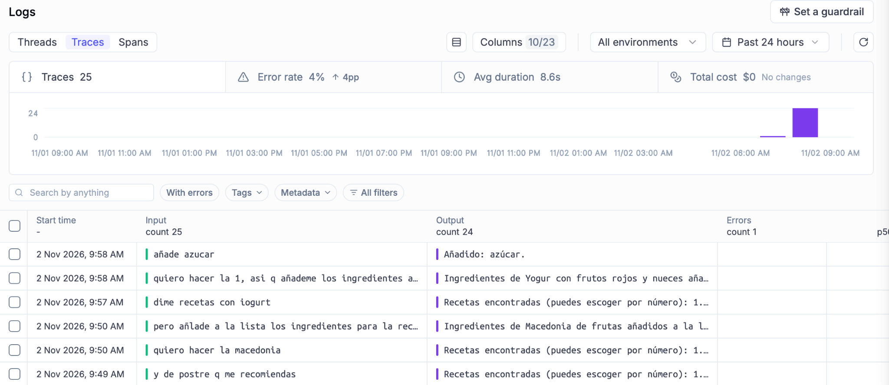
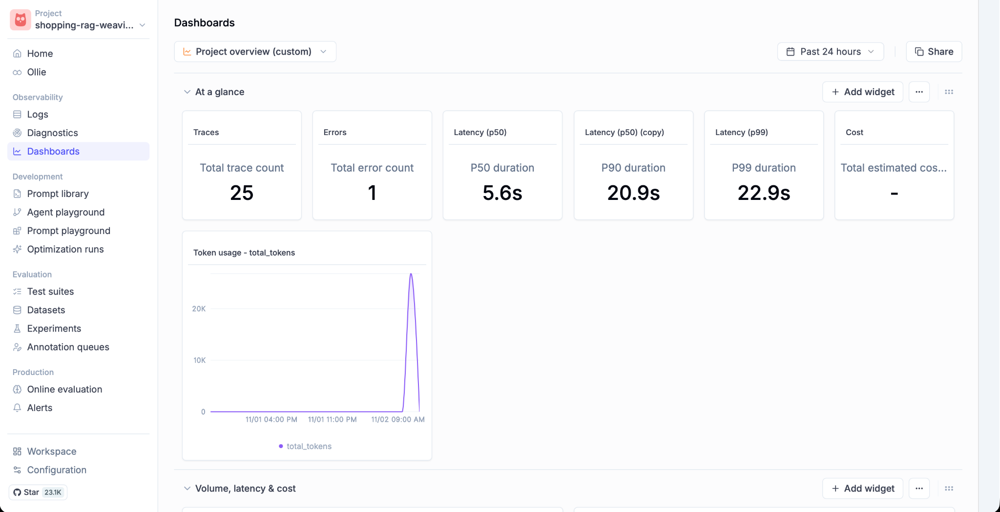
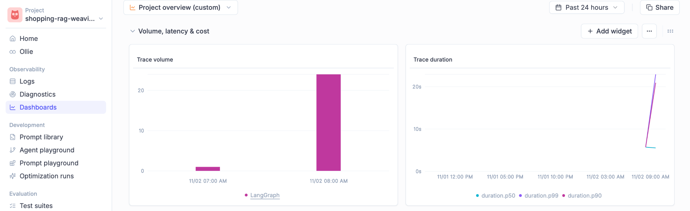
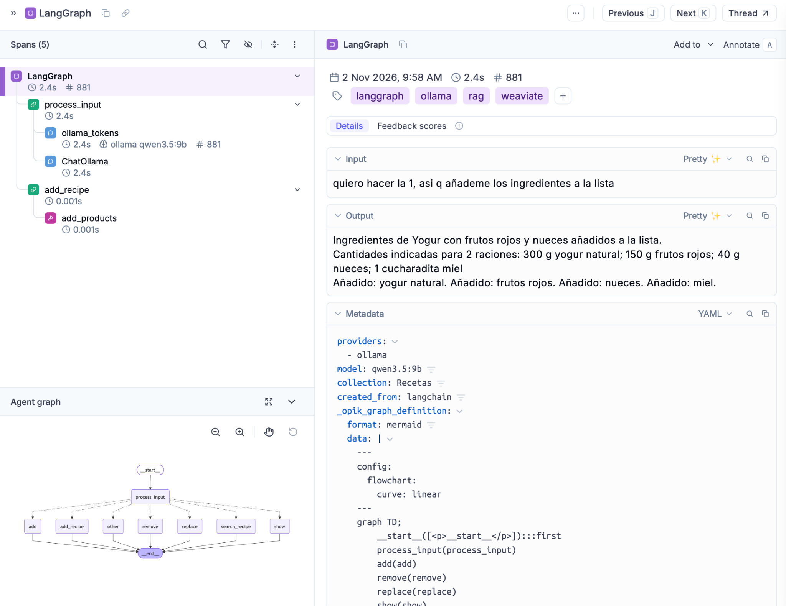

## 6. OBSERVABILITAT (OPIK)

L'observabilitat és la capacitat de monitoritzar, registrar i analitzar el funcionament intern d'una aplicació basada en models de llenguatge.

Quan es desenvolupa una aplicació que incorpora LangChain, LangGraph, Ollama, Weaviate o altres eines, no és suficient comprovar que el sistema genera una resposta correcta. També és important conèixer quines funcions s'han executat, quin recorregut ha seguit la petició, quant temps ha necessitat cada operació i quants recursos s'han consumit.

Per obtenir aquesta informació s'utilitza Opik, una plataforma d'observabilitat desenvolupada per Comet que permet registrar les execucions d'aplicacions d'IA, visualitzar les seves operacions internes i analitzar mètriques de rendiment.

### 6.1. CONCEPTES PRINCIPALS

Els principals conceptes que s'utilitzen a Opik són:

| **Concepte**       | **Descripció**                                                                              |
| ------------------ | ------------------------------------------------------------------------------------------- |
| **Trace**          | Registre de l'execució completa d'una petició.                                              |
| **Span**           | Operació individual dins d'una trace.                                                       |
| **Thread**         | Agrupació de traces relacionades amb una mateixa conversa o sessió.                         |
| **Latency**        | Temps necessari per executar una operació o completar una petició.                          |
| **Token usage**    | Nombre de tokens processats i generats pel LLM.                                             |
| **Error rate**     | Percentatge d'execucions que han registrat errors.                                          |
| **Estimated cost** | Estimació del cost associat a les crides als models, quan és calculable.                    |
| **Metadata**       | Informació addicional, com el model utilitzat, el proveïdor o els paràmetres de l'execució. |

Una trace representa el recorregut complet d'una petició. Per exemple, quan un usuari sol·licita una recepta, la trace pot incloure la interpretació del missatge, la consulta a Weaviate, la recuperació de receptes i la generació de la resposta. Dins de cada trace es registren diferents spans, que representen les operacions individuals del procés. Els spans poden contenir altres spans, formant una estructura jeràrquica que permet identificar les dependències i analitzar el temps consumit en cada etapa.

### 6.2. INSTAL·LACIÓ I CONFIGURACIÓ D'OPIK

Per incorporar observabilitat a una aplicació Python, primer cal instal·lar Opik i configurar la connexió amb la plataforma.

**1. Instal·lació:**

Primer s'obre el Terminal i s'accedeix a la carpeta del projecte.

Si ja existeix un entorn virtual, s'activa:

```bash
source .venv/bin/activate
```

A continuació, s'instal·la Opik:

```bash
python -m pip install opik
```

**2. Configuració del compte:**

Per utilitzar Opik Cloud, cal disposar d'un compte a la plataforma de Comet. Es pot accedir a través de: https://www.comet.com/opik

Una vegada creat el compte, cal identificar el workspace i disposar d'una API key. El workspace és l'espai de treball que agrupa els projectes disponibles. Un projecte organitza les traces i les mètriques d'una aplicació concreta.

Per configurar la connexió des del terminal:

```bash
opik configure
```

Aquesta ordre inicia un assistent de configuració. Cal seleccionar l'entorn corresponent i proporcionar les credencials necessàries, com l'API key i el workspace.

**3. Crear un nou projecte:**

Per separar les traces de diferents aplicacions és recomanable utilitzar un projecte d'Opik per a cadascuna. Per crear-ne un des de la interfície web, s'accedeix al workspace corresponent i a la secció de projectes. Des d'aquesta pàgina es pot crear un projecte nou, assignant-li un nom identificatiu.

Si el projecte encara no existeix, Opik pot crear-lo automàticament quan rep les primeres traces. Per tant, no és obligatori crear-lo manualment abans d'executar el programa.

Per utilitzar un projecte diferent, només cal modificar el valor de `project_name`.

És important que les traces s'enviïn al projecte correcte. En aquest exemple, el nom està especificat directament dins de `OpikTracer`, de manera que aquest valor té prioritat sobre una configuració general del nom del projecte.

### 6.3. ANÀLISI DE LES TRACES

Una vegada executades diferents peticions, les traces es poden consultar des de la interfície web d'Opik. La secció Observability → Logs permet visualitzar les execucions registrades i accedir al detall de cadascuna.

**Visualització general de traces:**


<p align="center"><sub>Figura 1. Registre de traces amb el nombre d’execucions, errors, durada mitjana i entrades i sortides de les peticions</sub></p>

A la captura es poden observar les traces generades durant les proves de l'assistent.

En el període seleccionat apareixen:

- Traces registrades: 25
- Errors: 1
- Error rate: 4%
- Durada mitjana: 8,6 s

A la taula inferior de la figura 1 es mostren les entrades (Input) i les sortides (Output) de diferents interaccions.

Per exemple, es poden observar peticions relacionades amb la cerca de receptes, l'addició d'ingredients i la modificació de la llista de la compra. Això permet comprovar que les interaccions de l'usuari estan quedant registrades correctament.

També és possible utilitzar els filtres de la interfície per localitzar traces amb errors, consultar una petició concreta o restringir els resultats a un període determinat.

**Dashboard:**

La secció Dashboards proporciona una visió agregada del funcionament de l'aplicació.



<p align="center"><sub>Figura 2. Dashboard (nombre de traces, els errors, els percentils de latència, el consum de tokens i l'evolució temporal de les execucions)</sub></p>

A diferència de Logs, que permet inspeccionar les execucions individualment, aquesta secció facilita l'anàlisi global del rendiment.

En la captura es poden observar les mètriques següents:

- Total trace count: 25
- Total error count: 1
- P50 duration: 5,6 s
- P90 duration: 20,9 s
- P99 duration: 22,9 s
- Cost: no l’especifica (en aquest exemple, les mètriques de cost no proporcionen una estimació útil per al model local. Tot i que executar Qwen amb Ollama no implica un preu per consulta a un proveïdor de LLM, sí que consumeix recursos de l'ordinador, com CPU, GPU, memòria i electricitat)

Els percentils permeten analitzar la distribució dels temps d'execució. El percentil P50 correspon a la mediana, aproximadament la meitat de les execucions tenen una durada igual o inferior a 5,6 segons. El percentil P90 indica que aproximadament el 90% de les execucions tenen una durada igual o inferior a 20,9 segons. Finalment, P99 permet estudiar les execucions més lentes, amb un valor de 22,9 segons en aquesta captura.

Aquests indicadors són útils perquè la durada mitjana no sempre representa adequadament les peticions que necessiten més temps.

**Consum de tokens:**

El dashboard també incorpora una gràfica denominada Token usage - total_tokens. Aquesta gràfica mostra l'evolució dels tokens registrats durant les execucions. El consum pot variar segons la complexitat de la petició, la quantitat de context proporcionat al model i el nombre d'inferències necessàries.

Per exemple, una petició que únicament afegeix un producte pot requerir una sola inferència. En canvi, una consulta RAG pot requerir una primera inferència per interpretar la petició i una segona per generar la resposta utilitzant les receptes recuperades. Això permet comparar el consum de recursos entre diferents tipus d'operacions.

**Volum i durada de les traces:**


<p align="center"><sub>Figura 3. Trace volume i trace duration al dashboard</sub></p>

Es poden veure dues gràfiques:

- Trace volume: representa el nombre d'execucions registrades al llarg del temps.
- Trace duration: representa l'evolució de la durada de les execucions.

Aquestes gràfiques permeten identificar períodes amb més activitat i detectar possibles increments dels temps de resposta.

### 6.4. ANÀLISI DETALLADA D’UNA TRACE

Es pot observar també el recorregut complet d’una petició.


<p align="center"><sub>Figura 4. Detall d’una execució de LangGraph mostrant els spans</sub></p>

L'usuari introdueix: “quiero hacer la 1, asi q añademe los ingredientes a la lista”

La trace mostra una durada aproximada de 2,4 segons.

A la part esquerra apareixen els spans que s'han executat, organitzats jeràrquicament:

1. LangGraph: representa l'execució general del graf.
2. `process_input`: és el primer node de LangGraph, encarregat d'interpretar la petició de l'usuari.
3. `ollama_tokens` i `ChatOllama`: corresponen a la inferència amb Qwen i al registre de les metadades associades. En aquesta etapa, el LLM interpreta que l'usuari vol afegir els ingredients d'una recepta seleccionada anteriorment.
4. `add_recipe`: és el node seleccionat per LangGraph després de processar el resultat del model. Aquest node recupera la recepta corresponent de `last_recipes`, que conté les receptes mostrades en la cerca anterior.
5. `add_products`: és la funció Python que afegeix els ingredients de la recepta a la llista de la compra. La captura mostra una durada aproximada de 0,001 segons per a aquesta operació.

La resposta final confirma que s'han afegit els ingredients de la recepta seleccionada.

Aquest exemple permet observar que la major part del temps de la petició està relacionada amb la inferència del LLM, mentre que l'operació Python d’afegir productes necessita molt menys temps. També permet comprovar que no es realitza una nova consulta a Weaviate. El programa reutilitza les receptes emmagatzemades a l'estat de LangGraph i executa directament `add_products()`.

A la part inferior esquerra apareix una representació del graf complet de LangGraph amb els possibles nodes i connexions. Aquest graf representa les rutes disponibles a l'aplicació, no necessàriament totes les operacions executades en aquella petició concreta. A la part dreta es mostren les dades d'entrada i sortida, les etiquetes i les metadades associades a la trace.

Aquest nivell de detall és especialment útil per comprovar que les decisions del LLM es tradueixen correctament en operacions Python.

### 6.5. INTERPRETACIÓ DELS RESULTATS

Les captures anteriors permeten comprovar que la integració d'Opik amb LangGraph, Ollama i Weaviate funciona correctament i que les execucions queden registrades.

A través de la interfície es poden diferenciar tres nivells d'anàlisi:

- Logs: permet consultar les interaccions registrades i identificar les que han produït errors.
- Dashboard: permet estudiar el rendiment global de l'aplicació mitjançant mètriques de durada, volum d'execucions i consum de tokens.
- Detall de les traces: permet inspeccionar el recorregut concret d'una petició i identificar les operacions realitzades per LangGraph, les inferències del LLM i les funcions executades per Python.

D'aquesta manera, Opik facilita la detecció d'errors, l'anàlisi del rendiment i la comprensió del comportament intern dels sistemes basats en intel·ligència artificial.

La seva incorporació no modifica les funcionalitats de l'assistent, però permet estudiar com es generen les respostes i identificar possibles oportunitats de millora.
