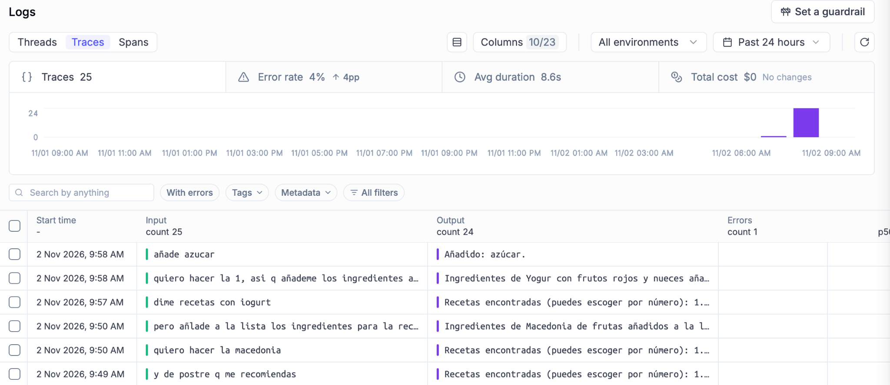
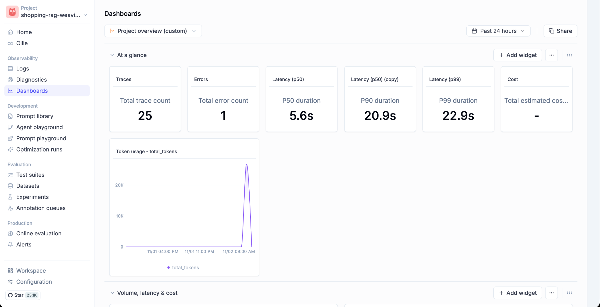
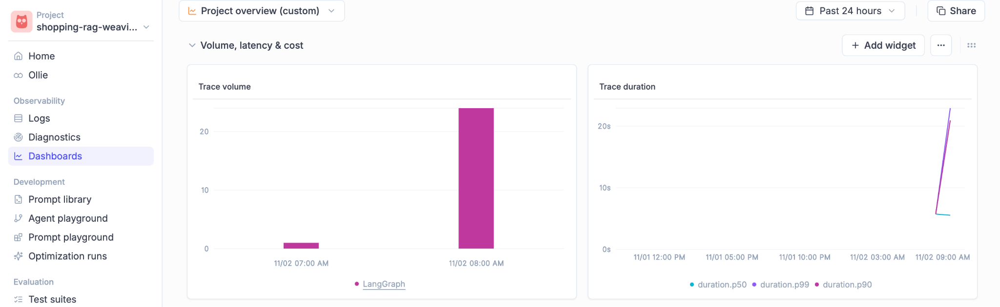
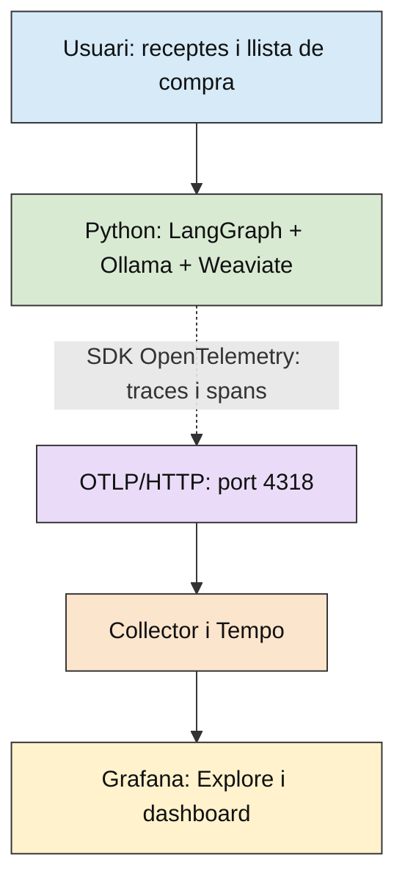

## 6. OBSERVABILITAT (OPIK I OPENTELEMETRY)

L'observabilitat és la capacitat de monitoritzar, registrar i analitzar el funcionament intern d'una aplicació basada en models de llenguatge.

Quan es desenvolupa una aplicació que incorpora LangChain, LangGraph, Ollama, Weaviate o altres eines, no és suficient comprovar que el sistema genera una resposta correcta. També és important conèixer quines funcions s'han executat, quin recorregut ha seguit la petició, quant temps ha necessitat cada operació i quants recursos s'han consumit.

En aquestes pràctiques s'exploren dues alternatives: **Opik**, una plataforma d'observabilitat desenvolupada per Comet que integra el registre i la visualització de les execucions d'IA, i **OpenTelemetry amb Grafana i Tempo**, que separa la instrumentació del programa, l'emmagatzematge de traces i el dashboard.

### 6.1. CONCEPTES PRINCIPALS

Els principals conceptes que s'utilitzen a Opik són:

| **Concepte**       | **Descripció**                                                                              |
| ------------------ | ------------------------------------------------------------------------------------------- |
| **Trace**          | Registre de l'execució completa d'una petició.                                              |
| **Span**           | Operació individual dins d'una trace.                                                       |
| **Thread**         | Agrupació de traces relacionades amb una mateixa conversa o sessió.                         |
| **Latency**        | Temps necessari per executar una operació o completar una petició.                          |
| **Token usage**    | Nombre de tokens processats i generats pel LLM.                                             |
| **Error rate**     | Percentatge d'execucions que han registrat errors.                                          |
| **Estimated cost** | Estimació del cost associat a les crides als models, quan és calculable.                    |
| **Metadata**       | Informació addicional, com el model utilitzat, el proveïdor o els paràmetres de l'execució. |

Una trace representa el recorregut complet d'una petició. Per exemple, quan un usuari sol·licita una recepta, la trace pot incloure la interpretació del missatge, la consulta a Weaviate, la recuperació de receptes i la generació de la resposta. Dins de cada trace es registren diferents spans, que representen les operacions individuals del procés. Els spans poden contenir altres spans, formant una estructura jeràrquica que permet identificar les dependències i analitzar el temps consumit en cada etapa.

### 6.2. INSTAL·LACIÓ I CONFIGURACIÓ D'OPIK

Per incorporar observabilitat a una aplicació Python, primer cal instal·lar Opik i configurar la connexió amb la plataforma.

**1. Instal·lació:**

Primer s'obre el Terminal i s'accedeix a la carpeta del projecte.

Si ja existeix un entorn virtual, s'activa:

```bash
source .venv/bin/activate
```

A continuació, s'instal·la Opik:

```bash
python -m pip install opik
```

**2. Configuració del compte:**

Per utilitzar Opik Cloud, cal disposar d'un compte a la plataforma de Comet. Es pot accedir a través de: https://www.comet.com/opik

Una vegada creat el compte, cal identificar el workspace i disposar d'una API key. El workspace és l'espai de treball que agrupa els projectes disponibles. Un projecte organitza les traces i les mètriques d'una aplicació concreta.

Per configurar la connexió des del terminal:

```bash
opik configure
```

Aquesta ordre inicia un assistent de configuració. Cal seleccionar l'entorn corresponent i proporcionar les credencials necessàries, com l'API key i el workspace.

**3. Crear un nou projecte:**

Per separar les traces de diferents aplicacions és recomanable utilitzar un projecte d'Opik per a cadascuna. Per crear-ne un des de la interfície web, s'accedeix al workspace corresponent i a la secció de projectes. Des d'aquesta pàgina es pot crear un projecte nou, assignant-li un nom identificatiu.

Si el projecte encara no existeix, Opik pot crear-lo automàticament quan rep les primeres traces. Per tant, no és obligatori crear-lo manualment abans d'executar el programa.

Per utilitzar un projecte diferent, només cal modificar el valor de `project_name`.

És important que les traces s'enviïn al projecte correcte. En aquest exemple, el nom està especificat directament dins de `OpikTracer`, de manera que aquest valor té prioritat sobre una configuració general del nom del projecte.

### 6.3. ANÀLISI DE LES TRACES

Una vegada executades diferents peticions, les traces es poden consultar des de la interfície web d'Opik. La secció Observability → Logs permet visualitzar les execucions registrades i accedir al detall de cadascuna.

**Visualització general de traces:**


<p align="center"><sub>Figura 1. Registre de traces amb el nombre d’execucions, errors, durada mitjana i entrades i sortides de les peticions</sub></p>

A la captura es poden observar les traces generades durant les proves de l'assistent.

En el període seleccionat apareixen:

- Traces registrades: 25
- Errors: 1
- Error rate: 4%
- Durada mitjana: 8,6 s

A la taula inferior de la figura 1 es mostren les entrades (Input) i les sortides (Output) de diferents interaccions.

Per exemple, es poden observar peticions relacionades amb la cerca de receptes, l'addició d'ingredients i la modificació de la llista de la compra. Això permet comprovar que les interaccions de l'usuari estan quedant registrades correctament.

També és possible utilitzar els filtres de la interfície per localitzar traces amb errors, consultar una petició concreta o restringir els resultats a un període determinat.

**Dashboard:**

La secció Dashboards proporciona una visió agregada del funcionament de l'aplicació.



<p align="center"><sub>Figura 2. Dashboard (nombre de traces, els errors, els percentils de latència, el consum de tokens i l'evolució temporal de les execucions)</sub></p>

A diferència de Logs, que permet inspeccionar les execucions individualment, aquesta secció facilita l'anàlisi global del rendiment.

En la captura es poden observar les mètriques següents:

- Total trace count: 25
- Total error count: 1
- P50 duration: 5,6 s
- P90 duration: 20,9 s
- P99 duration: 22,9 s
- Cost: no l’especifica (en aquest exemple, les mètriques de cost no proporcionen una estimació útil per al model local. Tot i que executar Qwen amb Ollama no implica un preu per consulta a un proveïdor de LLM, sí que consumeix recursos de l'ordinador, com CPU, GPU, memòria i electricitat)

Els percentils permeten analitzar la distribució dels temps d'execució. El percentil P50 correspon a la mediana, aproximadament la meitat de les execucions tenen una durada igual o inferior a 5,6 segons. El percentil P90 indica que aproximadament el 90% de les execucions tenen una durada igual o inferior a 20,9 segons. Finalment, P99 permet estudiar les execucions més lentes, amb un valor de 22,9 segons en aquesta captura.

Aquests indicadors són útils perquè la durada mitjana no sempre representa adequadament les peticions que necessiten més temps.

**Consum de tokens:**

El dashboard també incorpora una gràfica denominada Token usage - total_tokens. Aquesta gràfica mostra l'evolució dels tokens registrats durant les execucions. El consum pot variar segons la complexitat de la petició, la quantitat de context proporcionat al model i el nombre d'inferències necessàries.

Per exemple, una petició que únicament afegeix un producte pot requerir una sola inferència. En canvi, una consulta RAG pot requerir una primera inferència per interpretar la petició i una segona per generar la resposta utilitzant les receptes recuperades. Això permet comparar el consum de recursos entre diferents tipus d'operacions.

**Volum i durada de les traces:**


<p align="center"><sub>Figura 3. Trace volume i trace duration al dashboard</sub></p>

Es poden veure dues gràfiques:

- Trace volume: representa el nombre d'execucions registrades al llarg del temps.
- Trace duration: representa l'evolució de la durada de les execucions.

Aquestes gràfiques permeten identificar períodes amb més activitat i detectar possibles increments dels temps de resposta.

### 6.4. ANÀLISI DETALLADA D’UNA TRACE

Es pot observar també el recorregut complet d’una petició.


<p align="center"><sub>Figura 4. Detall d’una execució de LangGraph mostrant els spans</sub></p>

L'usuari introdueix: “quiero hacer la 1, asi q añademe los ingredientes a la lista”

La trace mostra una durada aproximada de 2,4 segons.

A la part esquerra apareixen els spans que s'han executat, organitzats jeràrquicament:

1. LangGraph: representa l'execució general del graf.
2. `process_input`: és el primer node de LangGraph, encarregat d'interpretar la petició de l'usuari.
3. `ollama_tokens` i `ChatOllama`: corresponen a la inferència amb Qwen i al registre de les metadades associades. En aquesta etapa, el LLM interpreta que l'usuari vol afegir els ingredients d'una recepta seleccionada anteriorment.
4. `add_recipe`: és el node seleccionat per LangGraph després de processar el resultat del model. Aquest node recupera la recepta corresponent de `last_recipes`, que conté les receptes mostrades en la cerca anterior.
5. `add_products`: és la funció Python que afegeix els ingredients de la recepta a la llista de la compra. La captura mostra una durada aproximada de 0,001 segons per a aquesta operació.

La resposta final confirma que s'han afegit els ingredients de la recepta seleccionada.

Aquest exemple permet observar que la major part del temps de la petició està relacionada amb la inferència del LLM, mentre que l'operació Python d’afegir productes necessita molt menys temps. També permet comprovar que no es realitza una nova consulta a Weaviate. El programa reutilitza les receptes emmagatzemades a l'estat de LangGraph i executa directament `add_products()`.

A la part inferior esquerra apareix una representació del graf complet de LangGraph amb els possibles nodes i connexions. Aquest graf representa les rutes disponibles a l'aplicació, no necessàriament totes les operacions executades en aquella petició concreta. A la part dreta es mostren les dades d'entrada i sortida, les etiquetes i les metadades associades a la trace.

Aquest nivell de detall és especialment útil per comprovar que les decisions del LLM es tradueixen correctament en operacions Python.

### 6.5. INTERPRETACIÓ DELS RESULTATS

Les captures anteriors permeten comprovar que la integració d'Opik amb LangGraph, Ollama i Weaviate funciona correctament i que les execucions queden registrades.

A través de la interfície es poden diferenciar tres nivells d'anàlisi:

- Logs: permet consultar les interaccions registrades i identificar les que han produït errors.
- Dashboard: permet estudiar el rendiment global de l'aplicació mitjançant mètriques de durada, volum d'execucions i consum de tokens.
- Detall de les traces: permet inspeccionar el recorregut concret d'una petició i identificar les operacions realitzades per LangGraph, les inferències del LLM i les funcions executades per Python.

D'aquesta manera, Opik facilita la detecció d'errors, l'anàlisi del rendiment i la comprensió del comportament intern dels sistemes basats en intel·ligència artificial.

La seva incorporació no modifica les funcionalitats de l'assistent, però permet estudiar com es generen les respostes i identificar possibles oportunitats de millora.

### 6.6. OPENTELEMETRY

OpenTelemetry (OTel) és un conjunt d'API, SDK i convencions obertes per instrumentar aplicacions i exportar dades d'observabilitat. Permet descriure operacions amb **traces** i **spans**, afegir atributs i transmetre'ls a altres sistemes. No proporciona, per si sol, un dashboard on consultar aquestes dades.

En l'exemple de receptes utilitzem aquesta arquitectura:



| Component                      | Paper en el sistema                                                                                   |
| ------------------------------ | ----------------------------------------------------------------------------------------------------- |
| **SDK OpenTelemetry (Python)** | Crea spans, els relaciona amb una trace i els afegeix atributs.                                       |
| **OTLP/HTTP**                  | Transporta les traces del programa al receptor HTTP, en aquest cas `http://localhost:4318/v1/traces`. |
| **OpenTelemetry Collector**    | Rep i encamina les dades d'observabilitat.                                                            |
| **Grafana Tempo**              | Emmagatzema les traces i permet cercar-les amb **TraceQL**.                                           |
| **Grafana**                    | Mostra les traces, els grafs dels spans i els panells del dashboard.                                  |

El programa **continua accedint a les receptes de Weaviate** i utilitza la col·lecció `Recetas`. OTel no substitueix Weaviate: només observa què fa l'aplicació. Tampoc decideix les rutes de LangGraph; les decisions continuen depenent del router i del LLM.

**Diferència entre els senyals d'observabilitat:**

- **Traces:** permeten reconstruir el recorregut d'una petició i la relació entre operacions.
- **Mètriques:** mostren valors numèrics agregats al llarg del temps, com el nombre de peticions o el consum de tokens.
- **Logs:** recullen esdeveniments textuals.

En aquest exercici, les dades que el codi exporta són **traces**. Els gràfics i els indicadors de tokens s'obtenen a Grafana mitjançant consultes de mètriques sobre traces amb TraceQL. És diferent de configurar un exportador OTel Metrics propi o de recollir mètriques a Prometheus.

### 6.7. TRACES, SPANS, RELACIONS I ATRIBUTS DEL RAG

Cada missatge de l'usuari crea una trace principal que comença a l'span `langgraph.invoke`. A partir d'aquí, s'instrumenten els nodes i eines que intervenen en la resposta:

| Span o atribut                                   | Què representa?                                               |
| ------------------------------------------------ | ------------------------------------------------------------- |
| `langgraph.invoke`                               | Execució completa d'una consulta de l'usuari.                 |
| `langgraph.node.process_input`                   | Node que interpreta la petició i decideix l'acció.            |
| `langgraph.node.search_recipe`                   | Node que inicia la recuperació de receptes.                   |
| `langgraph.node.add_recipe`                      | Node que afegeix ingredients d'una recepta ja mostrada.       |
| `tool.search_recipes`, `tool.add_products`, etc. | Eines Python executades dins dels nodes.                      |
| `weaviate_near_text`                             | Cerca semàntica a Weaviate.                                   |
| `ollama.clasificacion`                           | Inferència de Qwen per classificar la intenció.               |
| `ollama.generacion_rag`                          | Inferència per elaborar la resposta amb el context recuperat. |
| `langgraph.route`                                | Atribut que registra la decisió del router.                   |

Els spans es relacionen mitjançant un **Trace ID**, un **Span ID** i la relació pare-fill. En el programa s'utilitza la propagació de `traceparent` per conservar el context entre els nodes de LangGraph. Això és important perquè, si es fan operacions sense mantenir el context, el seu registre es podria fragmentar en traces independents i seria més difícil reconstruir l'execució.

El registre d'atributs també permet explicar per què una petició és més lenta que una altra. Per exemple, consultar receptes acostuma a requerir una crida de classificació, una consulta vectorial i una segona inferència de generació RAG. En canvi, afegir un producte a la llista és una acció Python més curta i no necessita consultar Weaviate.

**Atributs de consum de tokens:**

| Atribut del span d'Ollama    | Informació                                                             |
| ---------------------------- | ---------------------------------------------------------------------- |
| `gen_ai.usage.input_tokens`  | Tokens d'entrada del model.                                            |
| `gen_ai.usage.output_tokens` | Tokens generats pel model.                                             |
| `gen_ai.usage.total_tokens`  | Total de tokens, quan les metadades el proporcionen o es pot calcular. |
| `rag.tokens.total`           | Atribut propi utilitzat a les consultes del dashboard.                 |
| `gen_ai.request.model`       | Nom del model, com per exemple `qwen3.5:9b`.                           |
| `llm.etapa`                  | Fase de la inferència: `clasificacion` o `generacion_rag`.             |

### 6.8. INSTAL·LACIÓ LOCAL I CONNEXIÓ AMB GRAFANA

A diferència d'Opik Cloud, en aquesta pràctica la infraestructura d'observabilitat s'executa **localment** amb Docker. La imatge `grafana/otel-lgtm` inclou una instal·lació de prova amb Grafana, Tempo i el receptor OpenTelemetry. Les traces de l'aplicació Python s'envien per OTLP/HTTP al port 4318 i es consulten des del navegador al port 3000.

Els passos següents serveixen per a **macOS, Linux i Windows**. Quan els comandaments són diferents, s'indiquen **dins del mateix pas**, separant **macOS/Linux (Bash/Zsh)** i **Windows (PowerShell)**. Totes les ordres s'executen des de l'**arrel del repositori**, és a dir, la carpeta que conté `AI_Observability/`.

**1. Comprovar els requisits previs**

Abans de començar, cal tenir:

- Docker Desktop instal·lat i obert.
- Python i les biblioteques de LangChain, LangGraph, Weaviate i OpenTelemetry.
- Ollama en execució amb el model configurat.
- Una instància de Weaviate Cloud amb la col·lecció **`Recetas` ja creada i amb dades**, com a l'exemple 8.9.
- Les variables `WEAVIATE_URL` i `WEAVIATE_API_KEY` al fitxer `.env` del projecte.

Els comandaments següents són per a **macOS i Linux** amb bash/zsh i s'executen des de l'arrel del repositori, la carpeta que conté `AI_Observability/`.

Per comprovar la ubicació del terminal abans de començar:

**2. Crear el contenidor Docker la primera vegada**

Primer, es comprova que Docker està disponible. **Aquestes ordres són iguals als tres sistemes operatius:**

```bash
docker info
docker ps -a
```

`docker ps -a` mostra **tots** els contenidors, fins i tot els aturats. Si la llista ja conté un contenidor amb el nom **`grafana-lgtm`**, no cal tornar-lo a crear. Si ja el tenim creat, s'inicia amb `docker start grafana-lgtm`. Si ja està com a `Up`, no cal fer res.

**Només si el contenidor encara no existeix**, es descarrega la imatge. Aquesta ordre és comuna a tots els sistemes:

```bash
docker pull grafana/otel-lgtm:latest
```

**macOS/Linux (Bash/Zsh):**

```bash
docker run -d \
  --name grafana-lgtm \
  -p 3000:3000 \
  -p 4318:4318 \
  -v grafana-lgtm-data:/data \
  grafana/otel-lgtm:latest
```

**Windows (PowerShell):**

```powershell
docker run -d --name grafana-lgtm -p 3000:3000 -p 4318:4318 -v grafana-lgtm-data:/data grafana/otel-lgtm:latest
```

La configuració del contenidor és la mateixa en ambdós casos.

| Paràmetre                    | Funció                                                                        |
| ---------------------------- | ----------------------------------------------------------------------------- |
| `-d`                         | Executa el contenidor en segon pla.                                           |
| `--name grafana-lgtm`        | Dona un nom fix al contenidor, en lloc d'un d'aleatori.                       |
| `-p 3000:3000`               | Permet obrir la interfície web de Grafana a `http://localhost:3000`.          |
| `-p 4318:4318`               | Publica el receptor OTLP/HTTP, al qual Python envia les traces.               |
| `-v grafana-lgtm-data:/data` | Crea un volum per conservar dades entre recreacions en una instal·lació nova. |

Per comprovar si ha arrencat, en qualsevol dels tres sistemes:

```bash
docker ps
```

Després s'obre **[Grafana](http://localhost:3000)**. En una instal·lació de prova nova, l'usuari i la contrasenya inicials solen ser `admin` / `admin`. Grafana pot demanar canviar la contrasenya.

**3. Com aturar-lo i tornar-lo a arrencar un altre dia**

Aquestes ordres s'utilitzen després d'haver creat el contenidor i són **iguals** a macOS, Linux i Windows (PowerShell):

| Acció                                              | Comandament                          |
| -------------------------------------------------- | ------------------------------------ |
| Aturar Grafana quan acabem                         | `docker stop grafana-lgtm`           |
| Tornar-lo a iniciar després d'obrir Docker Desktop | `docker start grafana-lgtm`          |
| Reiniciar-lo                                       | `docker restart grafana-lgtm`        |
| Comprovar si està iniciat                          | `docker ps`                          |
| Veure'l encara que estigui aturat                  | `docker ps -a`                       |
| Consultar registres                                | `docker logs --tail 50 grafana-lgtm` |

La diferència és important: **`docker run` crea** un contenidor, **`docker start` inicia** un contenidor existent, **`docker stop` l'atura sense esborrar-lo**. No s'ha de fer servir `docker rm` per tancar, ja que esborraria el contenidor.

**4. Instal·lar les dependències del programa Python**

Si encara no s'ha creat un entorn virtual a l'arrel del projecte, cal seguir l'opció del sistema operatiu corresponent.

**macOS/Linux (Bash/Zsh):**

```bash
python3 -m venv .venv
source .venv/bin/activate
```

**Windows (PowerShell):**

```powershell
python --version
python -m venv .venv
.\.venv\Scripts\Activate.ps1
```

Si Windows no reconeix `python`, però té instal·lat el llançador de Python, es pot utilitzar `py -3 -m venv .venv`.

Amb l'entorn activat, les ordres per instal·lar les dependències són **iguals** en els tres sistemes:

```bash
python -m pip install -r requirements.txt
```

o bé

```bash
python -m pip install langchain langgraph langchain-ollama weaviate-client python-dotenv
python -m pip install opentelemetry-api opentelemetry-sdk opentelemetry-exporter-otlp-proto-http
```

Es comprova que Ollama té disponible el model. Les ordres d'Ollama també són iguals a macOS, Linux i Windows:

```bash
ollama list
```

Si el model encara no s'ha descarregat i l'ordinador té prou espai i memòria:

```bash
ollama pull qwen3.5:9b
```

**5. Configurar Weaviate i l'exportador de traces**

El programa continua utilitzant la mateixa base de dades de receptes. Al fitxer `.env` de l'arrel del repositori cal posar les credencials del teu clúster. Per obrir-lo des del terminal:

- **macOS/Linux (Bash/Zsh):** `nano .env` (o qualsevol editor de text).
- **Windows (PowerShell):** `notepad .env`. Cal desar-lo com a **`.env`**, no `.env.txt`.

Si el fitxer ja existeix, cal actualitzar o afegir aquestes claus **sense esborrar les altres configuracions**:

```dotenv
WEAVIATE_URL=https://EL_TEU_CLUSTER.weaviate.network
WEAVIATE_API_KEY=LA_TEVA_CLAU_REAL
OLLAMA_MODEL=qwen3.5:9b
```

Els dos primers valors s'han de substituir pels reals i **no s'ha de publicar `.env` al repositori**. No és necessari crear cap col·lecció a Grafana ni a OpenTelemetry: `Recetas` només pertany a Weaviate.

A continuació, **en el mateix terminal on s'executarà Python**, s'indica el nom del servei i el receptor de les traces.

**macOS/Linux (Bash/Zsh):**

```bash
export OTEL_CONSOLE_ONLY=0
export OTEL_EXPORTER_OTLP_TRACES_ENDPOINT=http://localhost:4318/v1/traces
export OTEL_SERVICE_NAME=shopping-rag-weaviate-otel
```

**Windows (PowerShell):**

```powershell
$env:OTEL_CONSOLE_ONLY = "0"
$env:OTEL_EXPORTER_OTLP_TRACES_ENDPOINT = "http://localhost:4318/v1/traces"
$env:OTEL_SERVICE_NAME = "shopping-rag-weaviate-otel"
```

Aquestes variables només s'apliquen a **la sessió actual del terminal**. Si es tanca la finestra i s'obre una altra, cal definir-les de nou abans d'executar l'exemple.

El valor `OTEL_CONSOLE_ONLY=0` fa que l'SDK exporti els spans a Grafana, en comptes d'imprimir-ne la representació completa per terminal.

**6. Executar el cas pràctic**

Primer s'ha de comprovar que Weaviate està ben configurat i després iniciar l'assistent. Els dos comandaments següents es poden executar en ordre.

**macOS/Linux (Bash/Zsh):**

```bash
python AI_Observability/code/src/11_shopping_list_weaviate_otel.py --check
python AI_Observability/code/src/11_shopping_list_weaviate_otel.py
```

**Windows (PowerShell):**

```powershell
python .\AI_Observability\code\src\11_shopping_list_weaviate_otel.py --check
python .\AI_Observability\code\src\11_shopping_list_weaviate_otel.py
```

**Atenció:** només s'ha d'executar la segona ordre quan la comprovació `--check` indiqui que la col·lecció **`Recetas`** és accessible. Si a Windows no s'ha pogut activar l'entorn, es pot utilitzar `.\.venv\Scripts\python.exe` en lloc de `python` en totes dues ordres.

Per generar traces de diferents rutes, es poden introduir aquestes peticions:

1. «Recomiéndame recetas con huevos y patatas en menos de 30 minutos».
2. «Añade los ingredientes de la segunda receta».
3. «Muéstrame la lista».
4. `exit` per acabar.

Cada missatge genera un span principal `langgraph.invoke`.

**7. Comprovar les traces a Grafana abans de fer el dashboard**

1. Obrir `http://localhost:3000` i entrar a **Explore**.
2. Seleccionar **Tempo** com a font de dades.
3. Seleccionar **TraceQL** i escriure:

   ```traceql
   { resource.service.name = "shopping-rag-weaviate-otel" }
   ```

4. Escollir un interval que inclogui les peticions acabades de fer (`Last 1 hour`, `Last 6 hours` o un rang absolut).
5. Prémer **Run query / Refresh**.

Si apareixen traces amb el nom `langgraph.invoke`, la connexió és correcta. Des d'aquesta mateixa pantalla es poden obrir les traces i revisar-ne els spans. **Només quan aquest pas funciona té sentit crear els panels del dashboard.** Aquests passos d'interfície són **els mateixos a macOS, Linux i Windows**.

### 6.9. CREACIÓ I CONFIGURACIÓ DEL DASHBOARD DE GRAFANA

Quan les traces ja arriben a Tempo, es pot construir un **dashboard** que combini el rendiment general de l'aplicació amb l'anàlisi individual de les traces. En aquest cas s'ha creat el dashboard `RAG recetas`.

Per començar:

1. Entrar a **Dashboards → New → New dashboard**.
2. Assignar-li el nom **RAG recetas**.
3. Seleccionar **+ Add panel**, que obre l'editor del primer panell.
4. Configurar **Data source: Tempo** i **Query type: TraceQL**.
5. Escollir la visualització de cada panell a **All visualizations** i desar els canvis amb **Save**.

Els noms de menús poden variar lleugerament segons la versió de Grafana. A les captures de la pràctica s'utilitza Grafana 13.3.

#### 6.9.1. Gràfics de rendiment

**A. Nombre d'execucions — RAG Executions**

- **Visualització:** `Time series`.
- **Títol:** `RAG Executions`.
- **Consulta TraceQL:**

```traceql
{ resource.service.name = "shopping-rag-weaviate-otel" && span:name = "langgraph.invoke" } | count_over_time()
```

Aquesta consulta compta les execucions de `langgraph.invoke` per interval temporal. En aquest codi, cada petició de l'usuari genera un d'aquests spans. El resultat mostra el **nombre d'execucions per interval**, no la taxa per segon que retornaria `rate()`.

**B. Durada de les execucions — Execution Duration**

- **Visualització:** `Time series`.
- **Títol:** `Execution Duration`.
- **Consulta TraceQL:**

```traceql
{ resource.service.name = "shopping-rag-weaviate-otel" && span:name = "langgraph.invoke" } | avg_over_time()
```

Mostra la durada mitjana de les peticions executades per LangGraph. A les opcions del panell, es pot configurar la unitat de l'eix vertical com a **segons (`s`)**.

**C. Temps consumit per Ollama — Ollama Duration**

- **Visualització:** `Time series`.
- **Títol:** `Ollama Duration`.
- **Consulta TraceQL:**

```traceql
{ resource.service.name = "shopping-rag-weaviate-otel" && span:name =~ "ollama.*" } | avg_over_time() by (span.llm.etapa)
```

El programa diferencia dues etapes: `clasificacion`, que interpreta la petició de l'usuari, i `generacion_rag`, que redacta la resposta amb les receptes trobades. La consulta permet observar la durada de cada etapa per separat. Una petició que només modifica la llista de la compra pot no tenir cap span de `generacion_rag`.

**D. Cerca semàntica — Weaviate Search Duration (near_text())**

- **Visualització:** `Time series`.
- **Títol:** `Weaviate Search Duration (near_text())`.
- **Consulta TraceQL:**

```traceql
{ resource.service.name = "shopping-rag-weaviate-otel" && span:name = "weaviate_near_text" } | avg_over_time()
```

Aquesta consulta mostra quant dura la cerca vectorial amb `near_text()` a la col·lecció `Recetas`. Si l'usuari únicament consulta o modifica una llista existent, pot no aparèixer cap punt nou: això és **normal** perquè no s'ha fet una cerca a Weaviate.


<p align="center"><sub>Figura 5. Dashboard RAG recetas: nombre d'execucions, durada total, durada d'Ollama i durada de les cerques a Weaviate.</sub></p>

En comparar aquests gràfics, es pot observar quina part de la petició consumeix més temps. En una cerca RAG, habitualment la inferència del model és més costosa que les operacions Python de gestió de la llista.

#### 6.9.2. Taula de traces

Els gràfics anteriors ofereixen una vista agregada. Per inspeccionar una petició concreta, s'afegeix una taula amb les traces registrades.

1. Des de l'edició del dashboard, seleccionar **+ Add panel**.
2. Escollir **Data source: Tempo** i **Query type: TraceQL**.
3. Escriure aquesta consulta:

   ```traceql
   { resource.service.name = "shopping-rag-weaviate-otel" && span:name = "langgraph.invoke" }
   ```

4. A **All visualizations**, seleccionar **Table**.
5. Posar el títol `Traces` i desar el panell.

La taula conté camps com **Trace ID**, **Start time**, **Service**, **Name** i **Duration**. També pot incloure el camp tècnic `nested`, que es pot ocultar si no és necessari. El camp intern `traceID`, en canvi, es necessita per construir l'enllaç al graf.


<p align="center"><sub>Figura 6. Taula de traces i graf de l'execució seleccionada en el dashboard.</sub></p>

Aquesta informació permet identificar consultes lentes, comparar execucions i seleccionar una trace per analitzar què ha fet LangGraph.

#### 6.9.3. Variable per seleccionar una trace

L'objectiu és que **el graf no estigui associat a un Trace ID fix**. Ha de mostrar la petició que es tria des de la taula.

Per crear el selector:

1. Tornar al dashboard i entrar a **Edit**.
2. Prémer **+ → Variable** a la barra lateral dreta.
3. Seleccionar **Textbox**, que permet introduir un identificador de trace.
4. Configurar la variable:

   | Camp              | Valor                                                        |
   | ----------------- | ------------------------------------------------------------ |
   | **Name**          | `TraceId`                                                    |
   | **Label**         | `Selected Trace`                                             |
   | **Default value** | Un Trace ID real de Tempo, com els que apareixen a la taula. |

5. Guardar la variable i el dashboard.

A la part superior apareixerà el camp **Selected Trace**.

#### 6.9.4. Graf de nodes d'una trace concreta

Per mostrar el recorregut de la trace seleccionada:

1. Afegir un panell nou.
2. Escollir **Tempo** com a font de dades.
3. Seleccionar **Query type: TraceQL** (no `Service Graph`).
4. Introduir la variable a la consulta:

   ```text
   ${TraceId}
   ```

5. Seleccionar **Node Graph** a **All visualizations**.
6. Escriure el títol `LangGraph - Nodes`.
7. Provar la visualització amb un Trace ID que existeixi abans de desar el panell.

La consulta és una **plantilla de Grafana**: perquè funcioni, Grafana ha de substituir `${TraceId}` pel valor escollit abans d'enviar la petició a Tempo. El valor final ha de ser un identificador hexadecimal real, no el text literal de la variable.

Per canviar de graf directament des de la taula:

1. Editar el panell `Traces`.
2. Obrir la configuració del camp **Trace ID → Data links → Add link**.
3. Escriure el títol **View execution graph**.
4. Introduir l'URL del mateix dashboard, passant-hi l'identificador de la fila:

   ```text
   /d/adkxzjf/rag-recetas?var-TraceId=${__data.fields["traceID"]}
   ```

5. **Substituir el camí `/d/adkxzjf/rag-recetas` pel del propi dashboard** si el seu UID o slug és diferent. Es pot copiar de la barra d'adreces del navegador.
6. Desar els canvis. En clicar un ID de la taula, seleccionar **View execution graph** i comprovar que `Selected Trace` canvia.

El camp visible `Trace ID` pot tenir el nom intern **`traceID`**. Si l'enllaç no canvia la variable, cal revisar el nom del camp a **Inspect → Data**.

**Què representa el Node Graph?** Cada cercle correspon a un span executat i les fletxes indiquen dependències pare-fill. No és el diagrama estàtic de tots els camins disponibles a LangGraph, sinó el recorregut de **la petició concreta**. Per exemple, una consulta RAG pot mostrar `process_input` → `search_recipe` → `search_recipes` → `weaviate_near_text`, mentre que afegir ingredients d'una recepta ja mostrada pot seguir una ruta diferent.

#### 6.9.5. Personalitzar el graf perquè es vegin només els noms

La visualització inicial pot mostrar durades i percentatges a l'interior dels cercles, que dificulten la lectura. En aquesta pràctica s'ha simplificat perquè quedin visibles els noms de les operacions.

1. Editar el panell **LangGraph - Nodes**.
2. Obrir **Transformations → Add transformation**.
3. Escollir **Filter fields by name**.
4. Al camp **Identifier / Regular expression pattern**, escriure:

   ```regex
   ^(id|subtitle|source|target)$
   ```

5. Comprovar que es mantenen els camps `id`, `subtitle`, `source` i `target` i guardar els canvis.


<p align="center"><sub>Figura 7. Node Graph simplificat: només es mostren els noms de les operacions, sota els cercles, sense durades ni percentatges interns.</sub></p>

#### 6.9.6. Consum de tokens: Input, Output i Total

El programa afegeix atributs numèrics als spans d'Ollama. Aquests atributs permeten construir tres indicadors que mostren els tokens consumits en el període de temps seleccionat.

Per a cada indicador:

1. Seleccionar **+ Add panel**.
2. Escollir **Tempo → TraceQL**.
3. Seleccionar la visualització **Stat**.
4. Configurar **Calculation = Total**, **Decimals = 0** i el títol corresponent.
5. Introduir la consulta i desar.

**Input Tokens:** suma els tokens que el model rep com a entrada.

```traceql
{ resource.service.name = "shopping-rag-weaviate-otel" && span:name =~ "ollama.*" } | sum_over_time(span.gen_ai.usage.input_tokens)
```

**Output Tokens:** suma els tokens que el model genera.

```traceql
{ resource.service.name = "shopping-rag-weaviate-otel" && span:name =~ "ollama.*" } | sum_over_time(span.gen_ai.usage.output_tokens)
```

**Total Tokens:** suma el consum total registrat en el camp propi `rag.tokens.total`.

```traceql
{ resource.service.name = "shopping-rag-weaviate-otel" && span:name =~ "ollama.*" } | sum_over_time(span.rag.tokens.total)
```


<p align="center"><sub>Figura 8. Input Tokens, Output Tokens i Total Tokens.</sub></p>

En aquest cas, es compleix `861 + 42 = 903`. Aquestes xifres són només un exemple: variaran amb el model, el text de les consultes i les respostes generades.

**Important:** els tres indicadors sumen els tokens de totes les inferències dins del rang temporal del dashboard.

#### 6.9.7. Interpretació final del dashboard

Les quatre zones permeten estudiar el comportament de l'assistent des de diferents perspectives:

- Els **gràfics de rendiment** indiquen quan s'han executat peticions i quines parts són més lentes.
- La **taula de traces** identifica cada consulta amb el seu ID, hora d'inici i durada.
- El **Node Graph** mostra els nodes, eines i inferències que s'han executat en una petició concreta.
- Els **panells de tokens** resumeixen el consum del model durant el període triat.

Per comprovar les rutes, es pot comparar una petició per **cercar receptes**, una per **afegir ingredients de la recepta seleccionada** i una tercera per **mostrar la llista de la compra**. Les traces haurien de mostrar seqüències diferents, perquè el router de LangGraph escull accions diferents.

OpenTelemetry registra el comportament de l'aplicació. És a dir, no modifica el resultat de les operacions Python ni les decisions del model. Això fa possible comprendre el flux del RAG i detectar oportunitats d'optimització sense alterar-ne la lògica.

### 6.10. COMPARACIÓ ENTRE OPIK I OPENTELEMETRY

| Aspecte                     | Opik                                                      | OpenTelemetry + Tempo + Grafana                                                                     |
| --------------------------- | --------------------------------------------------------- | --------------------------------------------------------------------------------------------------- |
| Enfocament                  | Plataforma integrada orientada a l'observabilitat de LLM. | Estàndard de codi obert amb components separats.                                                    |
| Instrumentació Python       | Integració d'Opik, callbacks o spans.                     | API/SDK OTel i spans manuals. Es poden afegir autoinstrumentacions.                                 |
| Emmagatzematge i interfície | Plataforma Opik.                                          | Tempo emmagatzema traces, Grafana les visualitza.                                                   |
| Visualització de la ruta    | Detall de traces i visualitzacions de l'aplicació.        | Explore i visualitzacions de spans.                                                                 |
| Tokens                      | Mètriques de LLM en la interfície, segons la integració.  | Atributs numèrics als spans i consultes TraceQL a Grafana.                                          |
| Execució local              | Requereix configurar el sistema Opik elegit.              | Es pot iniciar amb un contenidor.                                                                   |
| Adaptació                   | Centrada en casos d'ús d'IA/LLM.                          | Permet instrumentar també APIs, bases de dades i altres serveis amb el mateix llenguatge de traces. |

Cap de les alternatives millora automàticament les respostes del model. El seu valor és ajudar a entendre, explicar i optimitzar les execucions. Les diferències de detall, retenció o mètriques disponibles depenen de la configuració de cada projecte.

**Relació amb els exemples:** l'explicació detallada del codi i del flux es troba a l'[exemple 8.12](./08_examples.md#812-observabilitat-del-rag-amb-opentelemetry-i-grafana--11_shopping_list_weaviate_otelpy), i el [programa complet](../code/src/11_shopping_list_weaviate_otel.py).

**Referències tècniques:**

- [Grafana Labs: Docker OpenTelemetry LGTM](https://grafana.com/docs/opentelemetry/docker-lgtm/)
- [Grafana: visualització de traces en dashboards](https://grafana.com/docs/grafana/latest/visualizations/panels-visualizations/visualizations/traces/)
- [Grafana Tempo: funcions de TraceQL metrics](https://grafana.com/docs/tempo/latest/metrics-from-traces/metrics-queries/functions/)
- [Grafana: Data links i variables](https://grafana.com/docs/grafana/latest/visualizations/panels-visualizations/configure-data-links/)
- [OpenTelemetry: traces i spans](https://opentelemetry.io/docs/concepts/signals/traces/)
