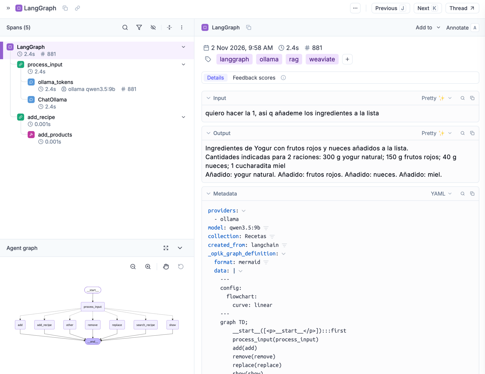
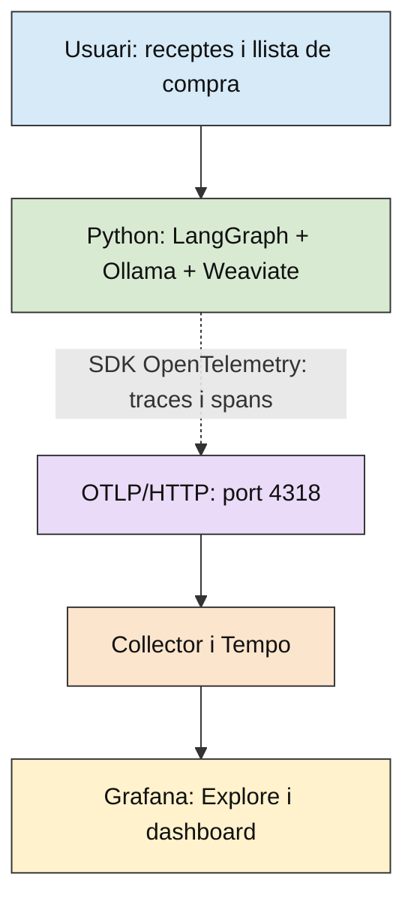
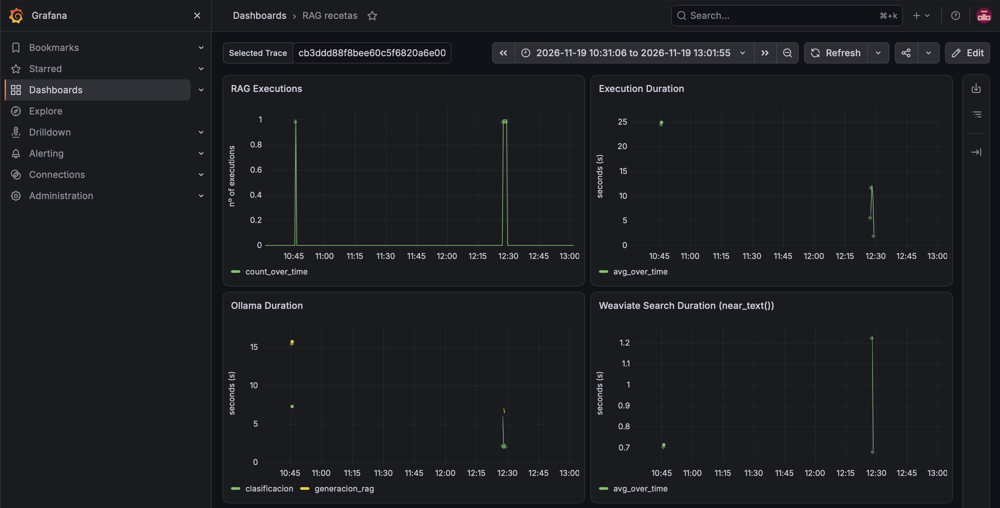
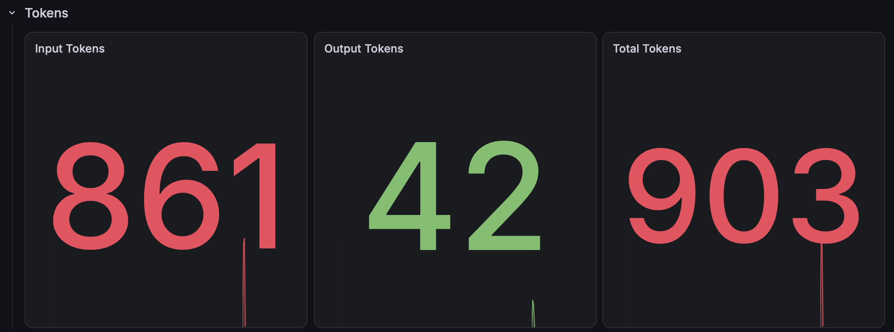

## 6. OBSERVABILITAT (OPIK)

L'observabilitat és la capacitat de monitoritzar, registrar i analitzar el funcionament intern d'una aplicació basada en models de llenguatge.

Quan es desenvolupa una aplicació que incorpora LangChain, LangGraph, Ollama, Weaviate o altres eines, no és suficient comprovar que el sistema genera una resposta correcta. També és important conèixer quines funcions s'han executat, quin recorregut ha seguit la petició, quant temps ha necessitat cada operació i quants recursos s'han consumit.

En aquestes pràctiques s'exploren dues alternatives: **Opik**, una plataforma d'observabilitat desenvolupada per Comet que integra el registre i la visualització de les execucions d'IA, i **OpenTelemetry amb Grafana i Tempo**, que separa la instrumentació del programa, l'emmagatzematge de traces i el dashboard.

### 6.1. CONCEPTES PRINCIPALS

Els principals conceptes que s'utilitzen a Opik són:

| **Concepte**       | **Descripció**                                                                              |
| ------------------ | ------------------------------------------------------------------------------------------- |
| **Trace**          | Registre de l'execució completa d'una petició.                                              |
| **Span**           | Operació individual dins d'una trace.                                                       |
| **Thread**         | Agrupació de traces relacionades amb una mateixa conversa o sessió.                         |
| **Latency**        | Temps necessari per executar una operació o completar una petició.                          |
| **Token usage**    | Nombre de tokens processats i generats pel LLM.                                             |
| **Error rate**     | Percentatge d'execucions que han registrat errors.                                          |
| **Estimated cost** | Estimació del cost associat a les crides als models, quan és calculable.                    |
| **Metadata**       | Informació addicional, com el model utilitzat, el proveïdor o els paràmetres de l'execució. |

Una trace representa el recorregut complet d'una petició. Per exemple, quan un usuari sol·licita una recepta, la trace pot incloure la interpretació del missatge, la consulta a Weaviate, la recuperació de receptes i la generació de la resposta. Dins de cada trace es registren diferents spans, que representen les operacions individuals del procés. Els spans poden contenir altres spans, formant una estructura jeràrquica que permet identificar les dependències i analitzar el temps consumit en cada etapa.

### 6.2. INSTAL·LACIÓ I CONFIGURACIÓ D'OPIK

Per incorporar observabilitat a una aplicació Python, primer cal instal·lar Opik i configurar la connexió amb la plataforma.

**1. Instal·lació:**

Primer s'obre el Terminal i s'accedeix a la carpeta del projecte.

Si ja existeix un entorn virtual, s'activa:

```bash
source .venv/bin/activate
```

A continuació, s'instal·la Opik:

```bash
python -m pip install opik
```

**2. Configuració del compte:**

Per utilitzar Opik Cloud, cal disposar d'un compte a la plataforma de Comet. Es pot accedir a través de: https://www.comet.com/opik

Una vegada creat el compte, cal identificar el workspace i disposar d'una API key. El workspace és l'espai de treball que agrupa els projectes disponibles. Un projecte organitza les traces i les mètriques d'una aplicació concreta.

Per configurar la connexió des del terminal:

```bash
opik configure
```

Aquesta ordre inicia un assistent de configuració. Cal seleccionar l'entorn corresponent i proporcionar les credencials necessàries, com l'API key i el workspace.

**3. Crear un nou projecte:**

Per separar les traces de diferents aplicacions és recomanable utilitzar un projecte d'Opik per a cadascuna. Per crear-ne un des de la interfície web, s'accedeix al workspace corresponent i a la secció de projectes. Des d'aquesta pàgina es pot crear un projecte nou, assignant-li un nom identificatiu.

Si el projecte encara no existeix, Opik pot crear-lo automàticament quan rep les primeres traces. Per tant, no és obligatori crear-lo manualment abans d'executar el programa.

Per utilitzar un projecte diferent, només cal modificar el valor de `project_name`.

És important que les traces s'enviïn al projecte correcte. En aquest exemple, el nom està especificat directament dins de `OpikTracer`, de manera que aquest valor té prioritat sobre una configuració general del nom del projecte.

### 6.3. ANÀLISI DE LES TRACES

Una vegada executades diferents peticions, les traces es poden consultar des de la interfície web d'Opik. La secció Observability → Logs permet visualitzar les execucions registrades i accedir al detall de cadascuna.

**Visualització general de traces:**


<p align="center"><sub>Figura 1. Registre de traces amb el nombre d’execucions, errors, durada mitjana i entrades i sortides de les peticions</sub></p>

A la captura es poden observar les traces generades durant les proves de l'assistent.

En el període seleccionat apareixen:

- Traces registrades: 25
- Errors: 1
- Error rate: 4%
- Durada mitjana: 8,6 s

A la taula inferior de la figura 1 es mostren les entrades (Input) i les sortides (Output) de diferents interaccions.

Per exemple, es poden observar peticions relacionades amb la cerca de receptes, l'addició d'ingredients i la modificació de la llista de la compra. Això permet comprovar que les interaccions de l'usuari estan quedant registrades correctament.

També és possible utilitzar els filtres de la interfície per localitzar traces amb errors, consultar una petició concreta o restringir els resultats a un període determinat.

**Dashboard:**

La secció Dashboards proporciona una visió agregada del funcionament de l'aplicació.


<p align="center"><sub>Figura 2. Dashboard (nombre de traces, els errors, els percentils de latència, el consum de tokens i l'evolució temporal de les execucions)</sub></p>

A diferència de Logs, que permet inspeccionar les execucions individualment, aquesta secció facilita l'anàlisi global del rendiment.

En la captura es poden observar les mètriques següents:

- Total trace count: 25
- Total error count: 1
- P50 duration: 5,6 s
- P90 duration: 20,9 s
- P99 duration: 22,9 s
- Cost: no l’especifica (en aquest exemple, les mètriques de cost no proporcionen una estimació útil per al model local. Tot i que executar Qwen amb Ollama no implica un preu per consulta a un proveïdor de LLM, sí que consumeix recursos de l'ordinador, com CPU, GPU, memòria i electricitat)

Els percentils permeten analitzar la distribució dels temps d'execució. El percentil P50 correspon a la mediana, aproximadament la meitat de les execucions tenen una durada igual o inferior a 5,6 segons. El percentil P90 indica que aproximadament el 90% de les execucions tenen una durada igual o inferior a 20,9 segons. Finalment, P99 permet estudiar les execucions més lentes, amb un valor de 22,9 segons en aquesta captura.

Aquests indicadors són útils perquè la durada mitjana no sempre representa adequadament les peticions que necessiten més temps.

**Consum de tokens:**

El dashboard també incorpora una gràfica denominada Token usage - total_tokens. Aquesta gràfica mostra l'evolució dels tokens registrats durant les execucions. El consum pot variar segons la complexitat de la petició, la quantitat de context proporcionat al model i el nombre d'inferències necessàries.

Per exemple, una petició que únicament afegeix un producte pot requerir una sola inferència. En canvi, una consulta RAG pot requerir una primera inferència per interpretar la petició i una segona per generar la resposta utilitzant les receptes recuperades. Això permet comparar el consum de recursos entre diferents tipus d'operacions.

**Volum i durada de les traces:**


<p align="center"><sub>Figura 3. Trace volume i trace duration al dashboard</sub></p>

Es poden veure dues gràfiques:

- Trace volume: representa el nombre d'execucions registrades al llarg del temps.
- Trace duration: representa l'evolució de la durada de les execucions.

Aquestes gràfiques permeten identificar períodes amb més activitat i detectar possibles increments dels temps de resposta.

### 6.4. ANÀLISI DETALLADA D’UNA TRACE

Es pot observar també el recorregut complet d’una petició.


<p align="center"><sub>Figura 4. Detall d’una execució de LangGraph mostrant els spans</sub></p>

L'usuari introdueix: “quiero hacer la 1, asi q añademe los ingredientes a la lista”

La trace mostra una durada aproximada de 2,4 segons.

A la part esquerra apareixen els spans que s'han executat, organitzats jeràrquicament:

1. LangGraph: representa l'execució general del graf.
2. `process_input`: és el primer node de LangGraph, encarregat d'interpretar la petició de l'usuari.
3. `ollama_tokens` i `ChatOllama`: corresponen a la inferència amb Qwen i al registre de les metadades associades. En aquesta etapa, el LLM interpreta que l'usuari vol afegir els ingredients d'una recepta seleccionada anteriorment.
4. `add_recipe`: és el node seleccionat per LangGraph després de processar el resultat del model. Aquest node recupera la recepta corresponent de `last_recipes`, que conté les receptes mostrades en la cerca anterior.
5. `add_products`: és la funció Python que afegeix els ingredients de la recepta a la llista de la compra. La captura mostra una durada aproximada de 0,001 segons per a aquesta operació.

La resposta final confirma que s'han afegit els ingredients de la recepta seleccionada.

Aquest exemple permet observar que la major part del temps de la petició està relacionada amb la inferència del LLM, mentre que l'operació Python d’afegir productes necessita molt menys temps. També permet comprovar que no es realitza una nova consulta a Weaviate. El programa reutilitza les receptes emmagatzemades a l'estat de LangGraph i executa directament `add_products()`.

A la part inferior esquerra apareix una representació del graf complet de LangGraph amb els possibles nodes i connexions. Aquest graf representa les rutes disponibles a l'aplicació, no necessàriament totes les operacions executades en aquella petició concreta. A la part dreta es mostren les dades d'entrada i sortida, les etiquetes i les metadades associades a la trace.

Aquest nivell de detall és especialment útil per comprovar que les decisions del LLM es tradueixen correctament en operacions Python.

### 6.5. INTERPRETACIÓ DELS RESULTATS

Les captures anteriors permeten comprovar que la integració d'Opik amb LangGraph, Ollama i Weaviate funciona correctament i que les execucions queden registrades.

A través de la interfície es poden diferenciar tres nivells d'anàlisi:

- Logs: permet consultar les interaccions registrades i identificar les que han produït errors.
- Dashboard: permet estudiar el rendiment global de l'aplicació mitjançant mètriques de durada, volum d'execucions i consum de tokens.
- Detall de les traces: permet inspeccionar el recorregut concret d'una petició i identificar les operacions realitzades per LangGraph, les inferències del LLM i les funcions executades per Python.

D'aquesta manera, Opik facilita la detecció d'errors, l'anàlisi del rendiment i la comprensió del comportament intern dels sistemes basats en intel·ligència artificial.

La seva incorporació no modifica les funcionalitats de l'assistent, però permet estudiar com es generen les respostes i identificar possibles oportunitats de millora.

### 6.6. OPENTELEMETRY

OpenTelemetry (OTel) és un conjunt d'API, SDK i convencions obertes per instrumentar aplicacions i exportar dades d'observabilitat. Permet descriure operacions amb **traces** i **spans**, afegir atributs i transmetre'ls a altres sistemes. No proporciona, per si sol, un dashboard on consultar aquestes dades.

En l'exemple de receptes utilitzem aquesta arquitectura:



| Component                      | Paper en el sistema                                                                                   |
| ------------------------------ | ----------------------------------------------------------------------------------------------------- |
| **SDK OpenTelemetry (Python)** | Crea spans, els relaciona amb una trace i els afegeix atributs.                                       |
| **OTLP/HTTP**                  | Transporta les traces del programa al receptor HTTP, en aquest cas `http://localhost:4318/v1/traces`. |
| **OpenTelemetry Collector**    | Rep i encamina les dades d'observabilitat.                                                            |
| **Grafana Tempo**              | Emmagatzema les traces i permet cercar-les amb **TraceQL**.                                           |
| **Grafana**                    | Mostra les traces, els grafs dels spans i els panells del dashboard.                                  |

El programa **continua accedint a les receptes de Weaviate** i utilitza la col·lecció `Recetas`. OTel no substitueix Weaviate: només observa què fa l'aplicació. Tampoc decideix les rutes de LangGraph; les decisions continuen depenent del router i del LLM.

**Diferència entre els senyals d'observabilitat:**

- **Traces:** permeten reconstruir el recorregut d'una petició i la relació entre operacions.
- **Mètriques:** mostren valors numèrics agregats al llarg del temps, com el nombre de peticions o el consum de tokens.
- **Logs:** recullen esdeveniments textuals.

En aquest exercici, les dades que el codi exporta són **traces**. Els gràfics i els indicadors de tokens s'obtenen a Grafana mitjançant consultes de mètriques sobre traces amb TraceQL. És diferent de configurar un exportador OTel Metrics propi o de recollir mètriques a Prometheus.

### 6.7. TRACES, SPANS, RELACIONS I ATRIBUTS DEL RAG

Cada missatge de l'usuari crea una trace principal que comença a l'span `langgraph.invoke`. A partir d'aquí, s'instrumenten els nodes i eines que intervenen en la resposta:

| Span o atribut                                   | Què representa?                                               |
| ------------------------------------------------ | ------------------------------------------------------------- |
| `langgraph.invoke`                               | Execució completa d'una consulta de l'usuari.                 |
| `langgraph.node.process_input`                   | Node que interpreta la petició i decideix l'acció.            |
| `langgraph.node.search_recipe`                   | Node que inicia la recuperació de receptes.                   |
| `langgraph.node.add_recipe`                      | Node que afegeix ingredients d'una recepta ja mostrada.       |
| `tool.search_recipes`, `tool.add_products`, etc. | Eines Python executades dins dels nodes.                      |
| `weaviate_near_text`                             | Cerca semàntica a Weaviate.                                   |
| `ollama.clasificacion`                           | Inferència de Qwen per classificar la intenció.               |
| `ollama.generacion_rag`                          | Inferència per elaborar la resposta amb el context recuperat. |
| `langgraph.route`                                | Atribut que registra la decisió del router.                   |

Els spans es relacionen mitjançant un **Trace ID**, un **Span ID** i la relació pare-fill. En el programa s'utilitza la propagació de `traceparent` per conservar el context entre els nodes de LangGraph. Això és important perquè, si es fan operacions sense mantenir el context, el seu registre es podria fragmentar en traces independents i seria més difícil reconstruir l'execució.

El registre d'atributs també permet explicar per què una petició és més lenta que una altra. Per exemple, consultar receptes acostuma a requerir una crida de classificació, una consulta vectorial i una segona inferència de generació RAG. En canvi, afegir un producte a la llista és una acció Python més curta i no necessita consultar Weaviate.

**Atributs de consum de tokens:**

| Atribut del span d'Ollama    | Informació                                                             |
| ---------------------------- | ---------------------------------------------------------------------- |
| `gen_ai.usage.input_tokens`  | Tokens d'entrada del model.                                            |
| `gen_ai.usage.output_tokens` | Tokens generats pel model.                                             |
| `gen_ai.usage.total_tokens`  | Total de tokens, quan les metadades el proporcionen o es pot calcular. |
| `rag.tokens.total`           | Atribut propi utilitzat a les consultes del dashboard.                 |
| `gen_ai.request.model`       | Nom del model, com per exemple `qwen3.5:9b`.                           |
| `llm.etapa`                  | Fase de la inferència: `clasificacion` o `generacion_rag`.             |

### 6.8. INSTAL·LACIÓ LOCAL I CONNEXIÓ AMB GRAFANA

Per practicar sense desplegar serveis individuals, es pot utilitzar la imatge de Docker `grafana/otel-lgtm`.

S'ha de tenir Docker Desktop descarregat i ja es pot crear el contenidor:

```bash
docker pull grafana/otel-lgtm:latest
docker run -d \
  --name grafana-lgtm \
  -p 3000:3000 \
  -p 4318:4318 \
  -v grafana-lgtm-data:/data \
  grafana/otel-lgtm:latest
```

**El comandament `docker run` només s'ha d'executar quan el contenidor encara no existeix.** Si ja existeix `grafana-lgtm`, s'inicia amb `docker start grafana-lgtm`.

Per a l'ús habitual:

```bash
# Aturar el contenidor:
docker stop grafana-lgtm

# Tornar-lo a arrencar:
docker start grafana-lgtm

# Consultar-ne l'estat:
docker ps -a
```

Els dos ports publicats tenen finalitats diferents:

- 3000: dona accés a Grafana des del navegador
- 4318: rep les traces exportades des del programa Python.

Amb les dependències instal·lades, l'entorn virtual activat i les credencials de Weaviate al `.env`, es configura OpenTelemetry i s'executa l'exemple des de l'arrel del repositori:

```bash
export OTEL_CONSOLE_ONLY=0
export OTEL_EXPORTER_OTLP_TRACES_ENDPOINT=http://localhost:4318/v1/traces
export OTEL_SERVICE_NAME=shopping-rag-weaviate-otel
python AI_Observability/code/src/11_shopping_list_weaviate_otel.py --check
python AI_Observability/code/src/11_shopping_list_weaviate_otel.py
```

La instal·lació de Python, el format exacte de `.env`, els passos del dashboard i la resolució d'errors es detallen a la [guia pràctica completa de Grafana i OpenTelemetry](./GRAFANA_OPENTELEMETRY_SETUP.md). El programa s'explica en detall a l'[exemple 8.12](./08_examples.md#812-observabilitat-del-rag-amb-opentelemetry-i-grafana--11_shopping_list_weaviate_otelpy).

### 6.9. DASHBOARD DE GRAFANA

Un cop les traces són visibles a **Explore → Tempo**, es crea el dashboard **`RAG recetas`**. La captura següent mostra quatre panels de rendiment:



<p align="center"><sub>Figura 5. Rendiment del RAG de receptes: nombre d'execucions i durada de LangGraph, Ollama i Weaviate.</sub></p>

Els panells utilitzen consultes sobre spans. Per exemple, el nombre d'execucions es calcula a partir de les peticions `langgraph.invoke`:

```traceql
{ resource.service.name = "shopping-rag-weaviate-otel" && span:name = "langgraph.invoke" } | count_over_time()
```

La durada mitjana es pot consultar amb `avg_over_time()`. Per estudiar Ollama i Weaviate s'aplica la mateixa funció als spans corresponents. Així es pot distingir el cost temporal de la inferència del temps de cerca vectorial.

**Taula de traces i graf de nodes:**


<p align="center"><sub>Figura 6. Taula de traces i visualització dels spans d'una execució seleccionada.</sub></p>

La taula Traces es configura amb Tempo, el tipus de consulta **TraceQL** i el panell Table. En seleccionar una petició, es pot veure el seu identificador i analitzar el recorregut al **Node Graph**, representat per cercles units segons les relacions pare-fill dels spans.

El Node Graph està pensat per representar l'execució que ha tingut lloc, no totes les transicions teòriques que LangGraph podria fer. Això és especialment útil per comprovar si el router ha escollit la branca de cerca de receptes o una operació directa sobre la llista de la compra.

Per llegir el graf més fàcilment s'ha simplificat la visualització amb la transformació **Filter fields by name**, conservant només `id`, `subtitle`, `source` i `target`:


<p align="center"><sub>Figura 7. Node Graph.</sub></p>

**Consum acumulat de tokens:**



<p align="center"><sub>Figura 8. Input Tokens, Output Tokens i Total Tokens.</sub></p>

La consulta següent suma els tokens totals de les inferències d'Ollama durant el període temporal seleccionat:

```traceql
{ resource.service.name = "shopping-rag-weaviate-otel" && span:name =~ "ollama.*" } | sum_over_time(span.rag.tokens.total)
```

La taula de traces i el Node Graph treballen amb traces individuals. Les targetes de tokens i els gràfics temporals resumeixen el període seleccionat. Escollir una trace al selector `Selected Trace` no significa que totes les targetes mostrin únicament els seus tokens.

### 6.10. COMPARACIÓ ENTRE OPIK I OPENTELEMETRY

| Aspecte                     | Opik                                                      | OpenTelemetry + Tempo + Grafana                                                                     |
| --------------------------- | --------------------------------------------------------- | --------------------------------------------------------------------------------------------------- |
| Enfocament                  | Plataforma integrada orientada a l'observabilitat de LLM. | Estàndard de codi obert amb components separats.                                                    |
| Instrumentació Python       | Integració d'Opik, callbacks o spans.                     | API/SDK OTel i spans manuals. Es poden afegir autoinstrumentacions.                                 |
| Emmagatzematge i interfície | Plataforma Opik.                                          | Tempo emmagatzema traces, Grafana les visualitza.                                                   |
| Visualització de la ruta    | Detall de traces i visualitzacions de l'aplicació.        | Explore i visualitzacions de spans.                                                                 |
| Tokens                      | Mètriques de LLM en la interfície, segons la integració.  | Atributs numèrics als spans i consultes TraceQL a Grafana.                                          |
| Execució local              | Requereix configurar el sistema Opik elegit.              | Es pot iniciar amb un contenidor.                                                                   |
| Adaptació                   | Centrada en casos d'ús d'IA/LLM.                          | Permet instrumentar també APIs, bases de dades i altres serveis amb el mateix llenguatge de traces. |

Cap de les alternatives millora automàticament les respostes del model. El seu valor és ajudar a entendre, explicar i optimitzar les execucions. Les diferències de detall, retenció o mètriques disponibles depenen de la configuració de cada projecte.

**Per reproduir la pràctica sencera:** consulta la [guia amb tots els comandaments Docker, consultes TraceQL i captures de pantalla](./GRAFANA_OPENTELEMETRY_SETUP.md), i després executa l'[exemple 11](../code/src/11_shopping_list_weaviate_otel.py) explicat a l'[apartat 8.12](./08_examples.md#812-observabilitat-del-rag-amb-opentelemetry-i-grafana--11_shopping_list_weaviate_otelpy).
