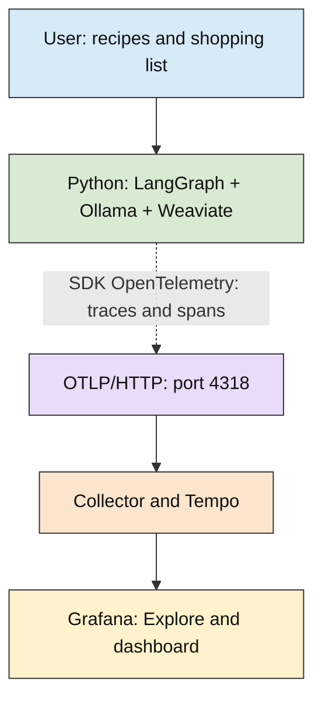
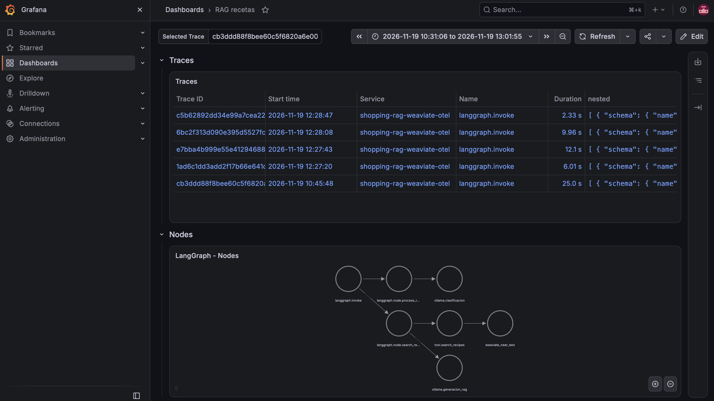
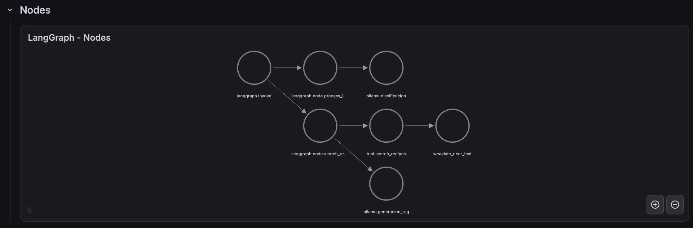
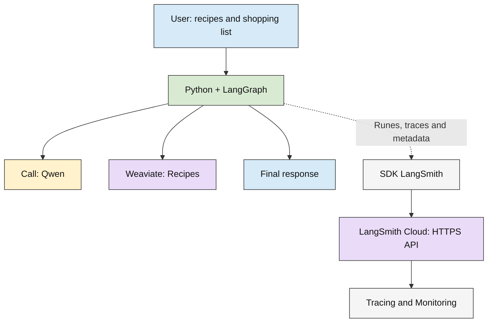
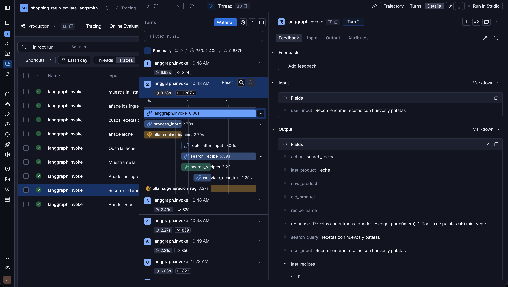
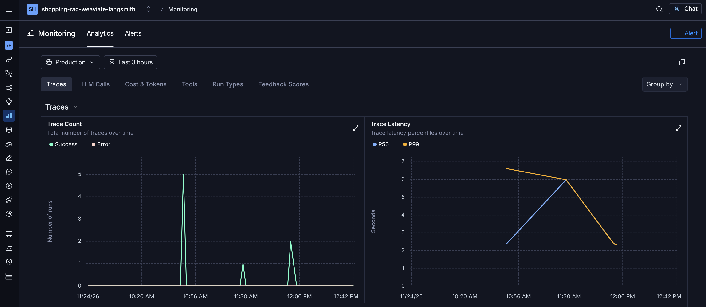
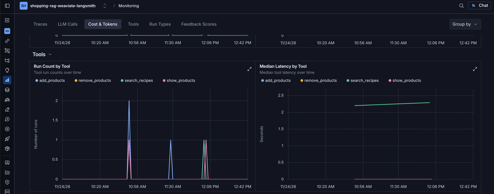
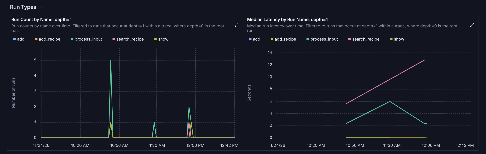

## 6. OBSERVABILITY (OPIK, OPENTELEMETRY AND LANGSMITH)

Observability is the ability to monitor, record, and analyze the inner workings of an application based on language models.

When developing an application that incorporates LangChain, LangGraph, Ollama, Weaviate or other tools, it is not enough to verify that the system generates a correct response. It is also important to know which functions have been executed, which route the request has followed, how much time each operation has required and how many resources have been consumed.

Three alternatives are explored in these practices: **Opik**, an observability platform developed by Comet that integrates logging and visualization of AI executions. **OpenTelemetry with Grafana and Tempo**, which separates the instrumentation of the program, the storage of traces and the dashboard. And **LangSmith**, an observability and evaluation platform with native integration with LangChain and LangGraph.

### 6.1. MAIN CONCEPTS

The main concepts used in Opik are:

| **Concept** | **Description** |
| ------------------ | ------------------------------------------------------------------------------------------- |
| **Trace** | Record of the complete execution of a request.                                              |
| **Span** | Individual operation within a trace.                                                       |
| **Thread** | Grouping of traces related to the same conversation or session.                         |
| **Latency** | Time required to execute an operation or complete a request.                          |
| **Token usage** | Number of tokens processed and generated by the LLM.                                             |
| **Error rate** | Percentage of runs that have logged errors.                                          |
| **Estimated cost** | Estimation of the cost associated with model calls, when calculable.                    |
| **Metadata** | Additional information, such as the model used, the vendor, or the parameters of the execution. |

A trace represents the complete path of a request. For example, when a user requests a recipe, the trace may include interpreting the message, querying Weaviate, retrieving recipes, and generating the response. Within each trace, different spans are recorded, which represent the individual operations of the process. Spans can contain other spans, forming a hierarchical structure that allows you to identify dependencies and analyze the time consumed in each stage.

### 6.2. OPIK INSTALLATION AND CONFIGURATION

To build observability into a Python application, you must first install Opik and configure the connection to the platform.

**1. Installation:**

The Python dependencies of the observability examples (Opik, OpenTelemetry, and LangSmith) are centralized in the repository file [`requirements.txt`](../code/src/requirements.txt). They are installed once in a virtual environment shared by the examples, as long as they are compatible with each other.

First you need to open the terminal in the root of the repository, i.e. the folder containing `AI_Observability/`. If the virtual environment `.venv` already exists, just activate it. Otherwise, you need to create it first.

**macOS/Linux (Bash/Zsh):**

```bash
# Only if .venv does not already exist
python3 -m venv .venv
source .venv/bin/activate
```

**Windows (PowerShell):**

```powershell
# Only if .venv does not already exist
python -m venv .venv
.\.venv\Scripts\Activate.ps1
```

With the environment activated, the following commands are the same on all three systems:

```bash
python -m pip install -r requirements.txt
python -m pip check
```

If there are no incompatibilities between the installed dependencies, the second command returns:

```text
No broken requirements found.
```

If the dependencies have already been successfully installed in a previous example, there is no need to run the installation again. Credentials and configuration for each platform, on the other hand, are prepared separately.

**2. Account Settings:**

To use Opik Cloud, you need an account on the Comet platform. It can be accessed through: https://www.comet.com/opik

Once the account has been created, it is necessary to identify the workspace and have an API key. The workspace is the workspace that groups the available projects. A project organizes the traces and metrics of a particular application.

To configure the connection from the terminal:

```bash
opik configure
```

This command starts a configuration wizard. You need to select the appropriate environment and provide the necessary credentials, such as API key and workspace.

**3. Create a new project:**

To separate the traces of different applications it is recommended to use an Opik project for each one. To create one from the web interface, access the corresponding workspace and the projects section. From this page you can create a new project, assigning it an identifying name.

If the project does not already exist, Opik can create it automatically when it receives the first traces. Therefore, it is not mandatory to create it manually before running the program.

To use a different project, just modify the value of `project_name`.

It is important that traces are sent to the correct project. In this example, the name is specified directly within the `OpikTracer`, so this value takes precedence over a general project name setting.

### 6.3. ANALYSIS OF THE TRACES

Once different requests have been executed, the traces can be consulted from the Opik web interface. The Observability → Logs section allows you to view the recorded executions and access the details of each one.

**Trace Overview:**


<p align="center"><sub>Figure 1. Trace log with the number of executions, errors, average duration and request inputs and outputs</sub></p>

In the screenshot you can see the traces generated during the tests of the assistant.

In the selected period appear:

- Traces registered: 25
- Errors: 1
- Error rate: 4%
- Average duration: 8.6 s

The lower table in Figure 1 shows the inputs (Input) and outputs (Output) of different interactions.

For example, you can see requests related to searching for recipes, adding ingredients, and modifying the shopping list. This allows you to verify that user interactions are being recorded correctly.

It is also possible to use the filters in the interface to locate traces with errors, query a specific request or restrict the results to a certain period.

**Dashboard:**

The Dashboards section provides an aggregated view of application performance.


<p align="center"><sub>Figure 2. Dashboard (number of traces, errors, latency percentiles, token consumption and time evolution of executions)</sub></p>

Unlike Logs, which allows you to inspect individual executions, this section facilitates overall performance analysis.

The following metrics can be observed in the capture:

- Total trace count: 25
- Total error count: 1
- P50 duration: 5.6 s
- P90 duration: 20.9 s
- P99 duration: 22.9 s
- Cost: not specified (in this example, the cost metrics do not provide a useful estimate for the local model. Although running Qwen with Ollama does not incur a price per query to an LLM provider, it does consume computer resources such as CPU, GPU, memory, and electricity)

Percentiles allow you to analyze the distribution of execution times. The P50 percentile corresponds to the median, with approximately half of the runs lasting 5.6 seconds or less. The P90 percentile indicates that approximately 90% of runs are 20.9 seconds or less. Finally, P99 allows you to study the slowest executions, with a value of 22.9 seconds in this capture.

These indicators are useful because the average duration does not always adequately represent the requests that take the longest.

**Token Consumption:**

The dashboard also incorporates a graphic called Token usage - total_tokens. This graph shows the evolution of tokens registered during executions. Consumption can vary depending on the complexity of the request, the amount of context provided to the model, and the number of inferences required.

For example, a request that only adds a product may require only one inference. In contrast, a RAG query may require a first inference to interpret the request and a second inference to generate the response using the retrieved recipes. This makes it possible to compare resource consumption between different types of operations.

**Volume and duration of traces:**


<p align="center"><sub>Figure 3. Trace volume and trace duration in the dashboard</sub></p>

Two graphics can be seen:

- Trace volume: represents the number of runs recorded over time.
- Trace duration: represents the evolution of the duration of the executions.

These graphs allow you to identify periods with more activity and detect possible increases in response times.

### 6.4. DETAILED ANALYSIS OF A TRACE

You can also observe the complete route of a request.


<p align="center"><sub>Figure 4. Detail of a LangGraph execution showing the spans</sub></p>

The user enters: "I want to make the first one, so add the ingredients to my list"

The trace shows an approximate duration of 2.4 seconds.

The spans that have been executed appear on the left, organized hierarchically:

1. LangGraph: Represents the general execution of the graph.
2. `process_input`: is the first LangGraph node, in charge of interpreting the user's request.
3. `ollama_tokens` and `ChatOllama`: Correspond to inference with Qwen and logging of associated metadata. At this stage, the LLM interprets that the user wants to add the ingredients of a previously selected recipe.
4. `add_recipe`: is the node selected by LangGraph after processing the model result. This node retrieves the corresponding recipe from `last_recipes`, which contains the recipes shown in the previous search.
5. `add_products`: is the Python function that adds the recipe ingredients to the shopping list. The capture shows an approximate duration of 0.001 seconds for this operation.

The final response confirms that the ingredients of the selected recipe have been added.

This example shows that most of the time of the request is related to the inference of the LLM, while the Python operation of adding products takes much less time. It also checks that a new query is not performed in Weaviate. The program reuses the recipes stored in the LangGraph state and executes directly `add_products()`.

At the bottom left is a representation of the complete LangGraph graph with possible nodes and connections. This graph represents the routes available to the application, not necessarily all the operations executed on that particular request. The right side shows the input and output data, tags and metadata associated with the trace.

This level of detail is particularly useful for checking that LLM decisions translate correctly into Python operations.

### 6.5. INTERPRETATION OF THE RESULTS

The above screenshots verify that Opik's integration with LangGraph, Ollama, and Weaviate is working correctly and that executions are logged.

Three levels of analysis can be differentiated through the interface:

- Logs: allows you to consult the recorded interactions and identify those that have produced errors.
- Dashboard: allows you to study the overall performance of the application using metrics of duration, volume of executions and token consumption.
- Trace detail: allows you to inspect the specific path of a request and identify the operations performed by LangGraph, the inferences of the LLM and the functions executed by Python.

In this way, Opik facilitates error detection, performance analysis and understanding of the internal behavior of artificial intelligence-based systems.

Its incorporation does not modify the functions of the assistant, but it allows to study how the answers are generated and to identify possible opportunities for improvement.

### 6.6. OPENTELEMETRY

OpenTelemetry (OTel) is a set of open APIs, SDKs, and conventions for instrumenting applications and exporting observability data. It allows describing operations with **traces** and **spans**, adding attributes and passing them to other systems. It does not provide, on its own, a dashboard to consult this data.

In the recipe example we use this architecture:



| Component | Role in the system |
| ------------------------------ | ----------------------------------------------------------------------------------------------------- |
| **OpenTelemetry SDK (Python)** | Create spans, relate them to a trace and add attributes to them.                                       |
| **OTLP/HTTP** | Transport traces of the program to the HTTP receiver, in this case `http://localhost:4318/v1/traces`. |
| **OpenTelemetry Collector** | Receive and route observability data.                                                            |
| **Grafana Tempo** | Stores the traces and allows them to be searched with **TraceQL**.                                           |
| **Grafana** | Show traces, span graphs and dashboard panels.                                  |

The program **continues to access Weaviate recipes** and uses the collection `Recetas`. OTel doesn't replace Weaviate - it just observes what the app does. It also does not decide LangGraph routes, the decisions are still dependent on the router and the LLM.

**Difference between observability signals:**

- **Traces:** allow to reconstruct the route of a request and the relationship between operations.
- **Metrics:** show numerical values ​​aggregated over time, such as number of requests or token consumption.
- **Logs:** collect textual events.

In this exercise, the data that the code exports is **traces**. Graphs and token indicators are obtained in Grafana by querying metrics on traces with TraceQL. It is different from setting up your own OTel Metrics exporter or collecting metrics in Prometheus.

### 6.7. TRACES, SPANS, RELATIONSHIPS AND ATTRIBUTES OF THE RAG

Each user message creates a main trace that starts at span `langgraph.invoke`. From here, the nodes and tools involved in the response are instrumented:

| Span or attribute | What does it represent?                                               |
| ------------------------------------------------ | ------------------------------------------------------------- |
| `langgraph.invoke`                               | Complete execution of a user query.                 |
| `langgraph.node.process_input`                   | Node that interprets the request and decides the action.            |
| `langgraph.node.search_recipe`                   | Node that initiates recipe retrieval.                   |
| `langgraph.node.add_recipe`                      | Node that adds the ingredients of an already displayed recipe to the shopping list.       |
| `tool.search_recipes`, `tool.add_products`, etc. | Python tools run inside nodes.                      |
| `weaviate_near_text`                             | Semantic search in Weaviate.                                   |
| `ollama.clasificacion`                           | Qwen inference to classify intent.               |
| `ollama.generacion_rag`                          | Inference to elaborate the answer with the retrieved context. |
| `langgraph.route`                                | Attribute that records the router's decision.                   |

Spans are related by a **Trace ID**, a **Span ID**, and the parent-child relationship. The program uses the propagation of `traceparent` to preserve context between LangGraph nodes. This is important because if operations are performed without maintaining the context, their log could be fragmented into independent traces and it would be more difficult to reconstruct the execution.

Attribute logging also helps explain why one request is slower than another. For example, querying recipes typically requires a classification call, a vector query, and a second RAG generation inference. In contrast, adding a product to the list is a shorter Python action and does not need to consult Weaviate.

**Token Consumption Attributes:**

| Ollama's span attribute | Information |
| ---------------------------- | ---------------------------------------------------------------------- |
| `gen_ai.usage.input_tokens`  | Model input tokens.                                            |
| `gen_ai.usage.output_tokens` | Tokens generated by the model.                                             |
| `gen_ai.usage.total_tokens`  | Total tokens, when provided by metadata or can be calculated. |
| `rag.tokens.total`           | Own attribute used in dashboard queries.                 |
| `gen_ai.request.model`       | Model name, such as `qwen3.5:9b`.                           |
| `llm.etapa`                  | Inference phase: `clasificacion` or `generacion_rag`.             |

### 6.8. LOCAL INSTALLATION AND CONNECTION WITH GRAFANA

Unlike Opik Cloud, in this practice the observability infrastructure runs **locally** with Docker. the image `grafana/otel-lgtm` includes a test installation with Grafana, Tempo and the OpenTelemetry receiver. Python application traces are sent over OTLP/HTTP on port 4318 and viewed from the browser on port 3000.

The following steps work for **macOS, Linux and Windows**. When the commands are different, they are listed **within the same step**, separating **macOS/Linux (Bash/Zsh)** and **Windows (PowerShell)**. All commands are run from the **repository root**, i.e. the folder containing `AI_Observability/`.

**1. Check prerequisites**

Before starting, you must have:

- Docker Desktop installed and open.
- Python and the LangChain, LangGraph, Weaviate, and OpenTelemetry libraries.
- Ollama running with configured model.
- One instance of Weaviate Cloud with collection **`Recetas` already created and with data**, as in example 8.9.
- The variables `WEAVIATE_URL` and `WEAVIATE_API_KEY` in the file `.env` of the project.

The following commands are for **macOS and Linux** with bash/zsh and run from the root of the repository, the folder containing `AI_Observability/`.

To check the terminal location before starting:

**2. Create the Docker container the first time**

First, it checks that Docker is available. **These commands are the same across all three operating systems:**

```bash
docker info
docker ps -a
```

`docker ps -a` shows **all** containers, even stopped ones. If the list already contains a container named **`grafana-lgtm`**, no need to recreate it. If we have already created it, it starts with `docker start grafana-lgtm`. If it is already like `Up`, no need to do anything.

**Only if the container does not already exist**, the image is downloaded. This command is common to all systems:

```bash
docker pull grafana/otel-lgtm:latest
```

**macOS/Linux (Bash/Zsh):**

```bash
docker run -d \
  --name grafana-lgtm \
  -p 3000:3000 \
  -p 4318:4318 \
  -v grafana-lgtm-data:/data \
  grafana/otel-lgtm:latest
```

**Windows (PowerShell):**

```powershell
docker run -d --name grafana-lgtm -p 3000:3000 -p 4318:4318 -v grafana-lgtm-data:/data grafana/otel-lgtm:latest
```

The container configuration is the same in both cases.

| Parameter | Function |
| ---------------------------- | ----------------------------------------------------------------------------- |
| `-d`                         | Runs the container in the background.                                           |
| `--name grafana-lgtm`        | Give the container a fixed name, instead of a random one.                       |
| `-p 3000:3000`               | Allows to open the Grafana web interface at `http://localhost:3000`.          |
| `-p 4318:4318`               | Publishes the OTLP/HTTP receiver, to which Python sends the traces.               |
| `-v grafana-lgtm-data:/data` | Creates a volume to preserve data between recreations on a new installation. |

To check if it has booted, on any of the three systems:

```bash
docker ps
```

Then it opens **[Grafana](http://localhost:3000)**. In a new test installation, the initial user and password are usually `admin` / `admin`. Grafana may ask to change your password.

**3. How to stop it and start it again another day**

These commands are used after the container has been created and are the **same** on macOS, Linux and Windows (PowerShell):

| Action | Command |
| -------------------------------------------------- | ------------------------------------ |
| Stop Grafana when we're done | `docker stop grafana-lgtm`           |
| Restart it after opening Docker Desktop | `docker start grafana-lgtm`          |
| Restart it | `docker restart grafana-lgtm`        |
| Check if it is started | `docker ps`                          |
| View it even if stopped | `docker ps -a`                       |
| Consult records | `docker logs --tail 50 grafana-lgtm` |

The difference is important: **`docker run` creates** a container, **`docker start` starts** an existing container, **`docker stop` stops it without deleting it**. Do not use `docker rm` to stop the container, as this would delete it.

**4. Install Python Program Dependencies**

If a virtual environment has not yet been created at the root of the project, the appropriate operating system option must be followed.

**macOS/Linux (Bash/Zsh):**

```bash
python3 -m venv .venv
source .venv/bin/activate
```

**Windows (PowerShell):**

```powershell
python --version
python -m venv .venv
.\.venv\Scripts\Activate.ps1
```

If Windows does not recognize `python`, but it has the Python launcher installed, it can be used `py -3 -m venv .venv`.

With the environment activated, the commands to install the dependencies are **the same** on all three systems:

```bash
python -m pip install -r requirements.txt
```

or else

```bash
python -m pip install langchain langgraph langchain-ollama weaviate-client python-dotenv
python -m pip install opentelemetry-api opentelemetry-sdk opentelemetry-exporter-otlp-proto-http
```

Checking that Ollama has the model available. Ollama's commands are also the same on macOS, Linux, and Windows:

```bash
ollama list
```

If the model has not yet been downloaded and your computer has enough space and memory:

```bash
ollama pull qwen3.5:9b
```

**5. Set up Weaviate and the trace exporter**

The program continues to use the same recipe database. In the file `.env` of the repository root you need to enter your cluster credentials. To open it from the terminal:

- **macOS/Linux (Bash/Zsh):** `nano .env` (or any text editor).
- **Windows (PowerShell):** `notepad .env`. Need to save as **`.env`**, no `.env.txt`.

If the file already exists, you need to update or add these keys **without deleting the other settings**:

```dotenv
WEAVIATE_URL=https://EL_TEU_CLUSTER.weaviate.network
WEAVIATE_API_KEY=LA_TEVA_CLAU_REAL
OLLAMA_MODEL=qwen3.5:9b
```

The first two values should be replaced with the actual ones and **the `.env` file must not be published in the repository**. There is no need to create any collections in Grafana or OpenTelemetry: `Recetas` belongs to Weaviate only.

Then, **in the same terminal where Python will run**, the service name and receiver of the traces are given.

**macOS/Linux (Bash/Zsh):**

```bash
export OTEL_CONSOLE_ONLY=0
export OTEL_EXPORTER_OTLP_TRACES_ENDPOINT=http://localhost:4318/v1/traces
export OTEL_SERVICE_NAME=shopping-rag-weaviate-otel
```

**Windows (PowerShell):**

```powershell
$env:OTEL_CONSOLE_ONLY = "0"
$env:OTEL_EXPORTER_OTLP_TRACES_ENDPOINT = "http://localhost:4318/v1/traces"
$env:OTEL_SERVICE_NAME = "shopping-rag-weaviate-otel"
```

These variables only apply to **the current terminal session**. If the window is closed and another window is opened, you need to redefine them before running the example.

The value `OTEL_CONSOLE_ONLY=0` causes the SDK to export the spans to Grafana, instead of printing the full representation to the terminal.

**6. Run the case study**

First check that Weaviate is properly configured and then start the assistant. The following two commands can be executed in order.

**macOS/Linux (Bash/Zsh):**

```bash
python AI_Observability/code/src/11_shopping_list_weaviate_opentelemetry.py --check
python AI_Observability/code/src/11_shopping_list_weaviate_opentelemetry.py
```

**Windows (PowerShell):**

```powershell
python .\AI_Observability\code\src\11_shopping_list_weaviate_opentelemetry.py --check
python .\AI_Observability\code\src\11_shopping_list_weaviate_opentelemetry.py
```

**Caution:** Only the second command should be executed when the check `--check` indicates that the collection **`Recetas`** is accessible. If the environment could not be activated in Windows, it can be used `.\.venv\Scripts\python.exe` instead of `python` in both commands.

To generate traces of different routes, these requests can be entered:

1. "Recommend recipes with eggs and potatoes in less than 30 minutes".
2. «Add the ingredients of the second recipe».
3. «Show me the list».
4. `exit` to finish.

Each message generates a main span `langgraph.invoke`.

**7. Check the traces in Grafana before making the dashboard**

1. Open `http://localhost:3000` and enter **Explore**.
2. Select **Tempo** as the data source.
3. Select **TraceQL** and write:

   ```traceql
   { resource.service.name = "shopping-rag-weaviate-otel" }
   ```

4. Choose an interval that includes the requests just made (`Last 1 hour`, `Last 6 hours` or an absolute range).
5. Press **Run query / Refresh**.

If traces appear with the name `langgraph.invoke`, the connection is successful. From this same screen you can open the traces and review the spans. **Only when this step works does it make sense to create the dashboard panels.** These interface steps are **the same on macOS, Linux and Windows**.

### 6.9. CREATION AND CONFIGURATION OF THE GRAFANA DASHBOARD

Once the traces arrive in Tempo, a **dashboard** can be built that combines overall application performance with individual trace analysis. In this case the dashboard has been created `RAG recetas`.

To get started:

1. Enter **Dashboards → New → New dashboard**.
2. Name it **RAG recetas**.
3. Select **+ Add panel**, which opens the editor of the first panel.
4. Configure **Data source: Tempo** and **Query type: TraceQL**.
5. Choose the visualization of each panel in **All visualizations** and save the changes with **Save**.

Menu names may vary slightly depending on the version of Grafana. Grafana 13.3 is used in exercise screenshots.

#### 6.9.1. Performance graphs

**A. Number of Executions — RAG Executions**

- **Display:** `Time series`.
- **Title:** `RAG Executions`.
- **Query TraceQL:**

```traceql
{ resource.service.name = "shopping-rag-weaviate-otel" && span:name = "langgraph.invoke" } | count_over_time()
```

This query counts executions of `langgraph.invoke` by time interval. In this code, each user request generates one of these spans. The result shows the **number of executions per interval**, not the rate per second it would return `rate()`.

**B. Execution Duration**

- **Display:** `Time series`.
- **Title:** `Execution Duration`.
- **Query TraceQL:**

```traceql
{ resource.service.name = "shopping-rag-weaviate-otel" && span:name = "langgraph.invoke" } | avg_over_time()
```

Shows the average duration of requests executed by LangGraph. In the panel options, the unit of the vertical axis can be set to **seconds (`s`)**.

**C. Time consumed by Ollama — Ollama Duration**

- **Display:** `Time series`.
- **Title:** `Ollama Duration`.
- **Query TraceQL:**

```traceql
{ resource.service.name = "shopping-rag-weaviate-otel" && span:name =~ "ollama.*" } | avg_over_time() by (span.llm.etapa)
```

The program differentiates between two stages: `clasificacion`, which interprets the user's request, and `generacion_rag`, which writes the response with the recipes found. The query allows you to observe the duration of each stage separately. A request that only modifies the shopping list may not have a `generacion_rag` span.

**D. Semantic Search — Weaviate Search Duration (near_text())**

- **Display:** `Time series`.
- **Title:** `Weaviate Search Duration (near_text())`.
- **Query TraceQL:**

```traceql
{ resource.service.name = "shopping-rag-weaviate-otel" && span:name = "weaviate_near_text" } | avg_over_time()
```

This query shows how long the vector search takes with `near_text()` in the collection `Recetas`. If the user only queries or modifies an existing list, no new points may appear - this is **normal** because no search has been done in Weaviate.


<p align="center"><sub>Figure 5. Dashboard RAG recetas: number of executions, total duration, duration of Ollama and duration of searches in Weaviate.</sub></p>

By comparing these graphs, you can see which part of the request consumes the most time. In a RAG search, model inference is usually more expensive than list management Python operations.

#### 6.9.2. Trace table

The charts above provide an aggregated view. To inspect a particular request, a table with the recorded traces is added.

1. From the dashboard edition, select **+ Add panel**.
2. Choose **Data source: Tempo** and **Query type: TraceQL**.
3. Type this query:

   ```traceql
   { resource.service.name = "shopping-rag-weaviate-otel" && span:name = "langgraph.invoke" }
   ```

4. In **All visualizations**, select **Table**.
5. Put the title `Traces` and save the panel.

The table contains fields such as **Trace ID**, **Start time**, **Service**, **Name** and **Duration**. It can also include the technical field `nested`, which can be hidden if not needed. The internal field `traceID`, on the other hand, is needed to build the link in the graph.



<p align="center"><sub>Figure 6. Table of traces and graph of the execution selected in the dashboard.</sub></p>

This information allows you to identify slow queries, compare executions, and select a trace to analyze what LangGraph has done.

#### 6.9.3. Variable to select a trace

The goal is that **the graph is not associated with a fixed Trace ID**. It should show the request that is chosen from the table.

To create the selector:

1. Return to the dashboard and enter **Edit**.
2. Press **+ → Variable** on the right sidebar.
3. Select **Textbox**, which allows you to enter a trace identifier.
4. Set the variable:

   | Field | Value |
   | ----------------- | ------------------------------------------------------------ |
   | **Name** | `TraceId`                                                    |
   | **Label** | `Selected Trace`                                             |
   | **Default value** | A real Tempo Trace ID, like the ones in the table. |

5. Save the variable and the dashboard.

The **Selected Trace** field will appear at the top.

#### 6.9.4. Node graph of a specific trace

To show the route of the selected trace:

1. Add a new panel.
2. Choose **Tempo** as the data source.
3. Select **Query type: TraceQL** (no `Service Graph`).
4. Enter the variable in the query:

   ```text
   ${TraceId}
   ```

5. Select **Node Graph** in **All visualizations**.
6. Write the title `LangGraph - Nodes`.
7. Test the display with a Trace ID that exists before saving the panel.

The query is a **Grafana template**: to work, Grafana must replace `${TraceId}` for the value chosen before sending the request to Tempo. The final value must be an actual hexadecimal identifier, not the literal text of the variable.

To change graph directly from the table:

1. Edit panel `Traces`.
2. Open the configuration of the field **Trace ID → Data links → Add link**.
3. Write the title **View execution graph**.
4. Enter the URL of the same dashboard, passing the row identifier:

   ```text
   /d/adkxzjf/rag-recetas?var-TraceId=${__data.fields["traceID"]}
   ```

5. **Replace the path `/d/adkxzjf/rag-recetas` for the dashboard itself** if its UID or slug is different. It can be copied from the address bar of the browser.
6. Save the changes. By clicking on a table ID, select **View execution graph** and check that `Selected Trace` changes.

The visible field `Trace ID` may have internal name **`traceID`**. If the link does not change the variable, you need to review the field name in **Inspect → Data**.

**What does the Node Graph represent?** Each circle corresponds to an executed span and the arrows indicate parent-child dependencies. It is not the static diagram of all paths available in LangGraph, but the path of **the specific request**. For example, a RAG query may show `process_input` → `search_recipe` → `search_recipes` → `weaviate_near_text`, while adding ingredients from an already displayed recipe can follow a different route.

#### 6.9.5. Customize the graph to show only the names

Initial display may show durations and percentages inside circles, making them difficult to read. In this practice it has been simplified so that the names of the operations are visible.

1. Edit the **LangGraph - Nodes** panel.
2. Open **Transformations → Add transformation**.
3. Choose **Filter fields by name**.
4. In the **Identifier / Regular expression pattern** field, write:

   ```regex
   ^(id|subtitle|source|target)$
   ```

5. Check that the fields are maintained `id`, `subtitle`, `source` and `target` and save the changes.



<p align="center"><sub>Figure 7. Simplified Node Graph: only the names of the operations are shown, below the circles, without internal durations or percentages.</sub></p>

#### 6.9.6. Token consumption: Input, Output and Total

The program adds numeric attributes to Ollama spans. These attributes allow the construction of three indicators that show the tokens consumed in the selected time period.

For each indicator:

1. Select **+ Add panel**.
2. Choose **Tempo → TraceQL**.
3. Select the **Stat** view.
4. Set **Calculation = Total**, **Decimals = 0** and the corresponding title.
5. Enter the query and save.

**Input Tokens:** sums the tokens that the model receives as input.

```traceql
{ resource.service.name = "shopping-rag-weaviate-otel" && span:name =~ "ollama.*" } | sum_over_time(span.gen_ai.usage.input_tokens)
```

**Output Tokens:** sums the tokens that the model generates.

```traceql
{ resource.service.name = "shopping-rag-weaviate-otel" && span:name =~ "ollama.*" } | sum_over_time(span.gen_ai.usage.output_tokens)
```

**Total Tokens:** adds up the total consumption recorded in the custom field `rag.tokens.total`.

```traceql
{ resource.service.name = "shopping-rag-weaviate-otel" && span:name =~ "ollama.*" } | sum_over_time(span.rag.tokens.total)
```


<p align="center"><sub>Figure 8. Input Tokens, Output Tokens and Total Tokens.</sub></p>

In this case, `861 + 42 = 903`. These figures are just an example: they will vary with the model, the text of the queries and the responses generated.

**Important:** the three indicators sum the tokens of all inferences within the time range of the dashboard.

#### 6.9.7. Final interpretation of the dashboard

The four zones make it possible to study the assistant's behavior from different perspectives:

- The **performance graphs** show when requests have been executed and which parts are the slowest.
- The **trace table** identifies each query with its ID, start time and duration.
- The **Node Graph** shows the nodes, tools, and inferences that have been run on a particular request.
- The **token panels** summarize the model's consumption during the chosen period.

To check the routes, you can compare a request to **search for recipes**, one to **add ingredients of the selected recipe** and a third to **show shopping list**. The traces should show different sequences, because the LangGraph router chooses different actions.

OpenTelemetry records application behavior. That is, it does not modify the result of Python operations or model decisions. This makes it possible to understand the flow of the RAG and detect opportunities for optimization without altering its logic.

### 6.10. REFERENCES AND EXAMPLE OF OPENTELEMETRY

**Relation to examples:** detailed code and flow explanation is in [example 8.12](./08_examples.md#812-observability-of-the-rag-with-opentelemetry-and-grafana--11_shopping_list_weaviate_opentelemetrypy), and the [full program](../code/src/11_shopping_list_weaviate_opentelemetry.py).

**Technical references:**

- [Grafana Labs: Docker OpenTelemetry LGTM](https://grafana.com/docs/opentelemetry/docker-lgtm/)
- [Grafana: visualization of traces in dashboards](https://grafana.com/docs/grafana/latest/visualizations/panels-visualizations/visualizations/traces/)
- [Grafana Tempo: TraceQL metrics functions](https://grafana.com/docs/tempo/latest/metrics-from-traces/metrics-queries/functions/)
- [Grafana: Data links and variables](https://grafana.com/docs/grafana/latest/visualizations/panels-visualizations/configure-data-links/)
- [OpenTelemetry: traces and spans](https://opentelemetry.io/docs/concepts/signals/traces/)

### 6.11. LANGSMITH: CONCEPTS, INSTALLATION AND CONFIGURATION

LangSmith is an AI application observability and evaluation platform developed by LangChain. It allows you to log the executions of an agent, inspect calls to the model, tools, and nodes, and analyze performance metrics from a web interface.

This exercise uses LangSmith Cloud as a third alternative to Opik and OpenTelemetry with Grafana. The program continues to run locally with Python, LangGraph, and Ollama, and preserves the collection `Recetas` by Weaviate Cloud. **No need to Docker or deploy the agent to LangSmith** - only observability data is sent.



| Concept | Description |
| ------------------- | ---------------------------------------------------------------------------------------------- |
| **Trace** | Registration of a complete request. In this program, the root run is `langgraph.invoke`.       |
| **Run** | Single operation, conceptually equivalent to a span. He can have many children.                |
| **Run type** | Type of operation: `chain`, `llm`, `tool`, among others.                                        |
| **Thread** | Grouping related requests using a conversation ID.                   |
| **Tracing project** | Destination of traces identified by `LANGSMITH_PROJECT`.                                 |
| **Metadata** | Additional information, such as collection, LLM stage or number of recipes retrieved. |
| **Feedback** | Evaluation of an execution. It is different from automatically logging latency or errors.             |

Integration with LangChain and LangGraph allows automatic registration of graph, nodes, router, tools `@tool` and the calls to `ChatOllama`. Instead, the direct call to the Weaviate client is explicitly instrumented with `ls.trace()` to separate the duration of the vector search from the rest of the tool. No LLM inference is added to record traces.

#### 6.11.1. Installation and configuration

Commands are launched **from the repository root `Visual_tools_for_AI`**, the folder containing `AI_Observability/`. Each step shows the macOS/Linux and Windows variants when different. The full program is [`12_shopping_list_weaviate_langsmith.py`](../code/src/12_shopping_list_weaviate_langsmith.py).

**1. Create a free account and get the API key:**

Access [LangSmith](https://smith.langchain.com/) or in the [European region](https://eu.smith.langchain.com/) and create a personal account with the **Developer** plan. According to the [official rates](https://www.langchain.com/pricing), includes one user and up to 5,000 monthly basic traces, with 14-day basic retention. Limits and fees are subject to change. No need to activate Plus, Engine, Agent Server or automatic evaluators. Don't add a payment method if you just want to do the free practice.

In the interface, go to **Settings → API Keys** and create a tracing key (or a personal key authorized to send traces). Copy it to the file `.env` local. Don't post it or show it in screenshots.

**2. Prepare the virtual environment and install the dependencies:**

If the environment `.venv` already exists, just activate it. If it doesn't exist, create it first.

**macOS/Linux (Bash/Zsh):**

```bash
# Only if .venv does not already exist
python3 -m venv .venv
# Activation
source .venv/bin/activate
```

**Windows (PowerShell):**

```powershell
# Only if .venv does not already exist
python -m venv .venv
# Activation
.\.venv\Scripts\Activate.ps1
```

With the environment activated, the same file is used `requirements.txt` of the repository than in the previous sections. If the dependencies have already been installed as indicated in section 6.2, there is no need to repeat the installation. Otherwise, from the repository root:

```bash
python -m pip install -r requirements.txt
python -m pip check
```

If there are no incompatibilities, `python -m pip check` returns `No broken requirements found.` Otherwise, check the listed packages and version restrictions before modifying dependencies. Once installed, just prepare the external services and configure the account and add to the file `.env` the reference to LangSmith.

**3. Prepare Ollama and Weaviate:**

You must have Ollama running and a Weaviate Cloud instance with the collection `Recetas` already populated, same as in example 8.9. To check the installed model:

```bash
ollama list
```

If the chosen model is not yet available, it can be downloaded, provided there is enough memory and space on the device:

```bash
ollama pull qwen3.5:9b
```

If Ollama is not started, run `ollama serve` in another terminal (not necessary if the application is already running). There is no need to re-create the recipe collection or start Grafana.

**4. Configure the file `.env`:**

The program executes `load_dotenv()` to load the variables. Create or edit `.env` in the root of the repository. If you already have Weaviate credentials, keep them and add only the LangSmith blog. The template [`.env.example`](../code/src/.env.example), contains the necessary fields without secrets (you must put what you touch in each place).

What should be in the .env is the following:

```dotenv
# Weaviate
WEAVIATE_URL=https://EL_TEU_CLUSTER.weaviate.network
WEAVIATE_API_KEY=LA_TEVA_CLAU_WEAVIATE

# Ollama
OLLAMA_MODEL=qwen3.5:9b

# LangSmith
LANGSMITH_TRACING=true
LANGSMITH_API_KEY=LA_TEVA_CLAU_LANGSMITH
LANGSMITH_ENDPOINT=https://eu.api.smith.langchain.com
LANGSMITH_PROJECT=shopping-rag-weaviate-langsmith
```

| Variable | Function |
| -------------------- | ------------------------------------------------------------------- |
| `WEAVIATE_URL`       | URL of the cluster it is on `Recetas`.                              |
| `WEAVIATE_API_KEY`   | Cluster access credential.                                      |
| `OLLAMA_MODEL`       | Local model used to classify and generate the response. |
| `LANGSMITH_TRACING`  | Activate (`true`) or disable (`false`) sending traces.        |
| `LANGSMITH_API_KEY`  | Credential to send traces to LangSmith account.            |
| `LANGSMITH_ENDPOINT` | Account Region API URL.                                |
| `LANGSMITH_PROJECT`  | Name of the project that groups the executions.                         |

Replace the sample values ​​with your own credentials. If multiple workspaces are used, check that the key has access to the correct workspace.

Do not post `.env` on GitHub. Check that `.gitignore` includes `.env` and preserves only `.env.example` with sample values. If a key has been exposed, revoke it and create a new one. In addition, `LANGSMITH_TRACING=true` can enable automatic tracing in other LangChain programs that load the same `.env`.
**Put it in `false` when you want to try Opik or OpenTelemetry independently, and return it to `true` for example 12**. The program context controls its own invocations, but does not modify the behavior of all other scripts.

**5. Run the program and receive the first traces:**

**macOS/Linux (Bash/Zsh):**

```bash
python AI_Observability/code/src/12_shopping_list_weaviate_langsmith.py --check
python AI_Observability/code/src/12_shopping_list_weaviate_langsmith.py
```

**Windows (PowerShell):**

```powershell
python .\AI_Observability\code\src\12_shopping_list_weaviate_langsmith.py --check
python .\AI_Observability\code\src\12_shopping_list_weaviate_langsmith.py
```

`--check` only checks Weaviate and the collection, not LangSmith or Ollama. When you run the assistant, you should see `[LANGSMITH] Project: shopping-rag-weaviate-langsmith`. enter `Add milk` and then `Recommend recipes with eggs and potatoes`. write `exit` to exit.

**6. Locate traces in the web interface:**

The project can be created automatically upon receiving the first traces, depending on the account settings. In the current practice interface, go to **All agents** or **Tracing** and search `shopping-rag-weaviate-langsmith`.

Select the destination that receives the new traces and its environment, if a selector appears (in the screenshots of this practice, `Production`). This name corresponds to the LangSmith trace destination, it does not imply that Ollama or Python are running on a production server. There is no need to manually create a second agent with the same name. Check the time range and refresh the page.

### 6.12. ANALYSIS OF TRACES AND EXECUTION FLOW

**Overview of tracks:**

Go to **Tracing**, select the environment containing the traces (in this example, `Production`), brand `Traces` and choose the time range `Last 1 day`.


<p align="center"><sub>Figure 9. LangSmith project trace listing with inputs, actions, latencies, and token consumption.</sub></p>

Figure 9 shows **9 correct traces** (`langgraph.invoke`). Each row represents a user request. The columns allow you to query the input message (`Input`), the selected action (`Output`, in this view), errors, start time, duration (`Latency`), the tokens and the time to the first token (`First Token`), when available.

Actions can be identified in this test `add`, `remove`, `show`, `search_recipe` and `add_recipe`. The two recipe searches record durations of 8.38s and 18.57s, with approximately 1,267 and 2,386 tokens respectively. Operations that reuse a recipe or display the list take less time in these executions, around 2–2.4s. The two requests to add milk take 6.62 s and 6.03 s: inference times can also vary in simple operations.

The colors in the latency column help identify the slowest requests. A value in red does not necessarily imply an error. The status of the trace is indicated separately with the green check mark.

**Detail of a trace and a thread:**

Open an execution `langgraph.invoke` corresponding to a recipe search and select **Details**. Expand nodes to view inferences, tools, and vector search. the view `Threads` allows you to group requests that share `thread_id`.


<p align="center"><sub>Figure 10. Detail of the request "Recommend recipes with eggs and potatoes" with the LangGraph, Ollama, and Weaviate runs.</sub></p>

The capture shows an execution time of 8.38s and a consumption of 1267 tokens. Operations are recorded hierarchically:

| Run | Duration | Tokens | Function |
| ----------------------- | -----: | -----: | -------------------------------------------- |
| `langgraph.invoke`      | 8.38 s |  1,267 | Complete execution.                           |
| `process_input`         | 2.79 s |      — | Node that interprets the request.              |
| `ollama.clasificacion`  | 2.79 s |    847 | Inference to determine action.           |
| `route_after_input`     | 0.00 s |      — | Selection of the branch of the graph.              |
| `search_recipe`         | 5.59 s |      — | RAG search and generation node.               |
| `search_recipes`        | 2.22 s |      — | Tool that retrieves and validates recipes.     |
| `weaviate_near_text`    | 1.29 s |      — | Manually instrumented vector query. |
| `ollama.generacion_rag` | 3.37 s |    420 | Inference writing the answer.          |

Ranking and generation total 847 + 420 = 1267 tokens. The durations of the child runs are already included in those of the parents. Therefore, all rows do not need to be added together to calculate the total time.

On the right side, `Input`, `Output` and `Attributes` allow you to consult the original message, the selected action (`action=search_recipe`), the response and status, including recipes retrieved into `last_recipes`. The run `route_after_input` allows you to inspect the router's decision. LLM-type runs display inputs, outputs, and tokens when the model provides this data. the message `[LANGSMITH] Tokens ...` from the terminal is not what feeds the dashboard: LangChain automatically records the inferences.

**Timeline View (Waterfall):**

Within the trace detail itself, press **Waterfall**, at the top of the center column.



<p align="center"><sub>Figure 11. Temporal distribution of RAG search runs using Waterfall.</sub></p>

Unlike the hierarchical tree, this view represents operations on a time axis. The classification occupies the first 2.79 s. Then it runs `search_recipe` for 5.59s. Within this node we see recipe retrieval (2.22s, including 1.29s vector query) and response generation (3.37s). This makes it easier to locate bottlenecks and distinguish LLM time from data retrieval time.

### 6.13. MONITORING AND INTERPRETATION OF THE RESULTS

Go to **Monitoring → Analytics**, select the project and a time interval that includes the tests. In the following captures it is used `Last 3 hours`. Unlike the Grafana panels in Section 6.9, LangSmith provides aggregate visualizations without having to write TraceQL queries.

**Trace volume and latency (Traces):**



<p align="center"><sub>Figure 12. Trace Count and Trace Latency in LangSmith Monitoring.</sub></p>

`Trace Count` represents the number of successful and failed traces per time interval. In the screenshot there are several peaks of activity, with a visible maximum of five correct traces in an interval. `Trace Latency` shows P50 (median) and P99 percentiles. Variations allow you to detect intervals with slower responses. The time range and updating of the metrics may cause the graphs to not exactly match the counts in the trace table.

**Execution of the tools (Tools):**

Select the section `Tools` from Monitoring or scroll to its charts.



<p align="center"><sub>Figure 13. Run Count by Tool and Median Latency by Tool.</sub></p>

`Run Count by Tool` shows the execution frequency of `add_products`, `remove_products`, `search_recipes` and `show_products`. `Median Latency by Tool` allows you to compare the time of each tool. On capture, `search_recipes` has a median latency of about 2.2–2.3s, while direct list operations stay very close to zero seconds. The difference is because search involves remote access to Weaviate and processing the results, while the other tools modify or query an in-memory list.

**Execution of nodes (Run Types):**

Select `Run Types` and locate the graphics with `depth=1`.



<p align="center"><sub>Figure 14. Run Count by Name and Median Latency by Run Name for Depth 1 runs.</sub></p>

The filter `depth=1` selects the direct children of the root run (`depth=0`). In this example it allows to study the LangGraph nodes: `process_input`, `add`, `add_recipe`, `search_recipe` and `show`, among others. `process_input` is executed before the action is selected, while the other nodes appear when their branch is chosen. The latencies graph shows that `search_recipe` is more expensive than direct operations on the list in these tests. Its median is about 5.6 s in one interval and about 12.8 s in another.

This visualization helps to study the frequency of router branches and the performance of each node, without confusing the node count with the total number of traces.

**Other metrics available:**

| Tab | What does it allow to analyze?                                                        |
| ------------------- | ---------------------------------------------------------------------------- |
| **Traces** | Number of successful and failed traces, duration percentiles and error rate. |
| **LLM Calls** | Frequency and latency of inferences.                                    |
| **Cost & Tokens** | Token consumption and estimated cost when the corresponding data is available.  |
| **Tools** | Number of calls and performance of Python tools.                            |
| **Run Types** | Distribution and latency of runs according to name or type.                      |
| **Feedback Scores** | Run ratings available.                                   |

Token consumption can also be seen directly in Figures 9 and 10. The model's estimated monetary cost does not equate to local resource cost or LangSmith fees. The time range and `Group by` allow you to study the metrics according to the available options. With small samples, percentiles are unrepresentative, tests should be repeated before general performance conclusions can be drawn.

The **Dashboards** section of the workspace can allow you to create custom views based on the interface plan and version. Monitoring is sufficient in this practice. A custom dashboard has not been configured or automatic assessors have been activated. Manual feedback can be added to check if the router chooses the expected action and if the response respects the retrieved recipes. Automated assessments may have additional costs or requirements.

**Relation to code:** the [example 8.13](./08_examples.md#813-observability-of-rag-with-langsmith--12_shopping_list_weaviate_langsmithpy) explains assistant instrumentation, nodes, model calls, and tests. The [snippet](../code/snippets/12_shopping_list_weaviate_langsmith_snippet.py) collects the main parts of the program.

**Technical references:** [LangSmith prices and limits](https://www.langchain.com/pricing), [LangSmith's Python SDK](https://reference.langchain.com/python/langsmith), [tracing_context](https://reference.langchain.com/python/langsmith/run_helpers/tracing_context).

### 6.14. COMPARISON BETWEEN OPIK, OPENTELEMETRY AND LANGSMITH

All three examples use the same recipe assistant with LangGraph, Ollama and Weaviate. The functionality of the application remains, but the way to record, store and display observability data changes.

| Aspect | Opik | OpenTelemetry + Tempo + Grafana | LangSmith |
| ----------------------------------- | ---------------------------------------------------------------------------------- | ------------------------------------------------------------------------------------------------------------------------------------------------ | ----------------------------------------------------------------------------------------------------------------------------------- |
| **Approach** | Platform for observability and evaluation of AI applications.                        | Open standard for instrumentation and export of traces, metrics and logs. It requires other components to store and display data. | AI application observability and evaluation platform, with native integration with LangChain and LangGraph.                        |
| **Python Instrumentation** | Integration with `OpikTracer`, custom callbacks and spans with `@track`.        | OpenTelemetry SDK, manual creation of spans and context propagation in our example.                                                      | Automatic tracing of LangChain and LangGraph with `ls.tracing_context()`. manual instrumentation of external functions with `ls.trace()`. |
| **Trace Storage** | Opik Cloud in this practice.                                                    | Grafana Tempo, running locally with Docker in this practice.                                                                                | LangSmith Cloud in this practice.                                                                                                |
| **Display of executions** | Logs and hierarchical tree of spans.                                                   | Explore, trace table and Node Graph configured in Grafana.                                                                                      | Tracing, hierarchical tree of runs, Waterfall and grouping by threads.                                                                |
| **Performance Metrics** | Number of traces, errors and latency percentiles.                                 | TraceQL queries on the spans to get the metrics and plot them in Grafana dashboards.                                            | Monitoring with number of traces, errors, latencies, calls to the LLM, tools and nodes.                                                   |
| **Token Consumption** | Token logging using integration and model metadata.             | Numeric attributes in Ollama spans and TraceQL queries.                                                                                        | Automatic registration of calls to `ChatOllama` when usage metadata is available.                                              |
| **Dashboard** | Dashboard with predefined metrics.                                              | Custom dashboard built manually with panels and queries.                                                                                | Predefined Monitoring graphs. Customization options by plan and interface.                                        |
| **Initial Setup** | Configure API key and workspace after installing common dependencies. | Start Docker, configure the OTLP/HTTP exporter and build the Grafana panels.                                                               | Configure API key, endpoint and project in `.env` after installing common dependencies.                             |
| **Docker in this practice** | It is not necessary.                                                                   | Yes, to run `grafana/otel-lgtm`.                                                                                                            | It is not necessary.                                                                                                                    |
| **Free use in this practice** | Free Opik Cloud plan, subject to its limits.                                | Open source tools run locally, without trace quota of a Cloud service. They consume computer resources.                          | Free LangSmith Cloud plan, subject to usage and retention limits.                                                                  |
| **Evaluation of answers** | Feedback tools and response evaluation.                                        | It does not incorporate specific LLM assessors on its own. You need to implement them or integrate other tools.                                               | Feedback, datasets, experiments and evaluators. Some options may have additional costs.                                       |
| **Main Advantage** | Facilitate LLM observability with an integrated platform.                     | Great flexibility and control over instrumentation, data and visualizations. Also applicable to other types of services.                 | It automatically logs much of the LangGraph flow, with little additional instrumentation.                                        |
| **Main Limitation** | In the Cloud service, dependence on the limits and conditions of the platform.     | More configuration and maintenance of infrastructure and dashboards.                                                                          | In the Cloud service, reliance on limits, retention and platform conditions.                                         |

**Interpretation of comparison:**

- **Opik** enables analyzing AI applications through a specialized interface that integrates traces and performance metrics.
- **OpenTelemetry with Tempo and Grafana** allows you to control the instrumentation in more detail and build visualizations adapted to the needs of the system. OpenTelemetry is not a dashboard: it generates and exports the data, Tempo stores it and Grafana visualizes it.
- **LangSmith** especially facilitates the observability of programs developed with LangChain and LangGraph by automatically registering supported nodes, router, tools and inferences. External operations, such as directly querying Weaviate, can be manually instrumented.

**LangGraph**, which defines and executes the agent flow, must be distinguished from **LangSmith**, which observes executions. LangGraph remains the same in all three examples, it is not an alternative to Opik or OpenTelemetry as an observability platform.

None of the three integrations on their own change router decisions or automatically improve LLM responses. Its purpose is to facilitate understanding of inner workings, error detection and performance analysis. The choice depends on the degree of customization, available infrastructure, data privacy and ease of integration with the application.
