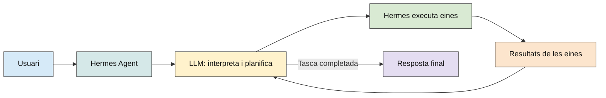

# 7. HERMES

## 7.1. QUÈ ÉS HERMES?

Hermes Agent és un agent d'IA de codi obert dissenyat per executar tasques de manera autònoma mitjançant l'ús de models de llenguatge (LLM), eines externes i mecanismes de memòria.

A diferència d'un LLM convencional, que principalment interpreta instruccions i genera respostes, Hermes pot planificar accions, seleccionar eines, executar operacions i analitzar els resultats per completar una tasca.

Per exemple, mentre que un model de llenguatge pot explicar com analitzar un projecte Python, Hermes pot, si disposa dels permisos necessaris, accedir als fitxers del projecte, examinar-ne el codi, executar proves i generar un informe amb els resultats.

Hermes no és un model de llenguatge en si mateix, sinó un sistema que utilitza un LLM com a motor de raonament. Pot funcionar amb models allotjats al núvol o amb models executats localment mitjançant plataformes com Ollama.

Una de les seves característiques principals és la capacitat de conservar informació entre sessions i crear _skills_ reutilitzables a partir dels procediments que ha utilitzat anteriorment. Això permet millorar progressivament la seva manera d'executar determinades tasques, sense que sigui necessari reentrenar els pesos del model de llenguatge.

### Diferències amb LangChain i LangGraph

Tot i que les tres tecnologies permeten desenvolupar aplicacions basades en agents d'intel·ligència artificial, tenen finalitats i graus de desenvolupament diferents.

| **Tecnologia** | **Finalitat**                                           | **Característiques principals**                                                                                                                                   |
| -------------- | ------------------------------------------------------- | ----------------------------------------------------------------------------------------------------------------------------------------------------------------- |
| **LangChain**  | Framework per construir aplicacions basades en LLM      | Proporciona components per connectar models amb eines, bases de dades, documents i serveis externs. El desenvolupador programa com s'utilitzen aquests components |
| **LangGraph**  | Framework per organitzar i controlar el flux d'execució | Permet definir nodes, transicions, condicions i gestionar l'estat de l'aplicació. El desenvolupador controla explícitament el comportament dels agents            |
| **Hermes**     | Agent d'IA ja implementat per executar tasques          | Incorpora sistemes de planificació, execució d'eines i memòria. Permet delegar tasques sense programar tota l'arquitectura de l'agent des de zero                 |

Per tant, mentre que LangChain i LangGraph són eines per construir i controlar aplicacions agentives, Hermes és un agent que ja disposa de moltes d'aquestes capacitats integrades.

Aquestes tecnologies **no són excloents**, sinó que es poden combinar. Per exemple, en una aplicació desenvolupada amb LangGraph es pot afegir un node que invoqui Hermes per realitzar una tasca específica. En aquest cas, LangGraph continua controlant el flux general de l'aplicació, mentre que Hermes s'encarrega de resoldre la tasca que se li ha delegat.

## 7.2. QUÈ PERMET FER?

Les principals funcionalitats d'Hermes són:

- **Execució autònoma de tasques:** pot descompondre una petició complexa en diferents passos i executar-los successivament.
- **Utilització d'eines:** pot executar ordres de terminal, consultar informació, llegir fitxers i modificar codi, segons les eines i els permisos configurats.
- **Memòria persistent:** pot conservar informació rellevant entre diferents sessions.
- **Skills:** permet crear, guardar i reutilitzar procediments per resoldre tasques recurrents.
- **Integració amb MCP:** pot connectar-se a servidors Model Context Protocol per accedir a eines i serveis externs.
- **Subagents:** pot delegar parts d'una tasca a altres agents especialitzats.
- **Automatització:** permet programar tasques que s'executin de manera periòdica.
- **Integració amb aplicacions:** es pot utilitzar des de la terminal, una aplicació d'escriptori o plataformes de missatgeria.

El funcionament general segueix un procés iteratiu:

1. L'usuari introdueix una petició.
2. Hermes envia la informació al LLM configurat.
3. El model interpreta la petició i determina les accions necessàries.
4. Hermes executa les eines seleccionades.
5. Els resultats es retornen al model perquè els analitzi.
6. El procés es repeteix, si és necessari, fins a obtenir una resposta final.



<p align="center"><sub>Figura 1. Flux general de funcionament d'Hermes Agent</sub></p>

Aquesta arquitectura permet desenvolupar aplicacions en què l'agent no es limita a respondre preguntes, sinó que participa activament en l'execució de les tasques.

## 7.3. INSTAL·LACIÓ

Hermes Agent és compatible amb diferents sistemes operatius, principalment macOS, Linux i Windows. Disposa d'una aplicació d'escriptori amb interfície gràfica i d'una versió de terminal (CLI), especialment útil per integrar-lo amb altres programes.

La instal·lació mitjançant terminal permet executar Hermes com una aplicació independent i invocar-lo des de scripts Python sense necessitat de mantenir oberta la interfície gràfica.

### 7.3.1. INSTAL·LACIÓ A macOS

**Pas 1. Instal·lar Hermes**

Executar al terminal:

```bash
curl -fsSL https://hermes-agent.nousresearch.com/install.sh | bash
```

L'instal·lador descarrega el codi d'Hermes i prepara les dependències necessàries per al seu funcionament.

La instal·lació estàndard crea el directori del programa a `~/.hermes/hermes-agent/` i l'executable de terminal a `~/.local/bin/hermes`.

**Pas 2. Configurar el PATH**

Una vegada finalitzada la instal·lació, actualitzar la configuració del terminal:

```bash
source ~/.zshrc
```

Comprovar que Hermes es reconeix correctament:

```bash
hermes --version
```

Si apareix l'error `zsh: command not found: hermes`, incorporar la carpeta de l'executable al `PATH`:

```bash
export PATH="$HOME/.local/bin:$PATH"
```

Per mantenir aquesta configuració en futures sessions:

```bash
echo 'export PATH="$HOME/.local/bin:$PATH"' >> ~/.zshrc
source ~/.zshrc
```

**Pas 3. Executar Hermes**

Per iniciar l'agent, executar:

```bash
hermes
```

S'obrirà la interfície interactiva des de la qual es poden introduir peticions en llenguatge natural.

**Pas 4. Configurar els models de llenguatge**

Executar:

```bash
hermes model
```

Aquest comandament permet seleccionar un proveïdor de models i configurar-ne les dades de connexió. Hermes pot treballar amb models allotjats al núvol o amb models locals executats mitjançant Ollama. En aquest últim cas, cal seleccionar un model que ja es tingui instal·lat.

Per comprovar els models d'Ollama disponibles:

```bash
ollama list
```

Per gestionar les eines disponibles:

```bash
hermes tools
```

Per comprovar que la instal·lació i la configuració són correctes:

```bash
hermes -z "Hola, respon únicament OK"
```

### 7.3.2. INSTAL·LACIÓ A LINUX

**Pas 1. Instal·lar Hermes**

Executar al terminal:

```bash
curl -fsSL https://hermes-agent.nousresearch.com/install.sh | bash
```

L'instal·lador prepara l'entorn d'Hermes, incloent les versions gestionades de Python, Node.js i altres dependències necessàries.

**Pas 2. Configurar el PATH**

Si s'utilitza Bash:

```bash
source ~/.bashrc
```

Si s'utilitza Zsh:

```bash
source ~/.zshrc
```

Comprovar la instal·lació:

```bash
hermes --version
```

Si no es reconeix el comandament, afegir-lo temporalment al `PATH`:

```bash
export PATH="$HOME/.local/bin:$PATH"
```

Per conservar el canvi en Bash:

```bash
echo 'export PATH="$HOME/.local/bin:$PATH"' >> ~/.bashrc
source ~/.bashrc
```

Per conservar el canvi en Zsh:

```bash
echo 'export PATH="$HOME/.local/bin:$PATH"' >> ~/.zshrc
source ~/.zshrc
```

**Pas 3. Executar Hermes**

```bash
hermes
```

S'obrirà la interfície interactiva des de la qual es poden introduir peticions en llenguatge natural.

**Pas 4. Configurar els models de llenguatge**

```bash
hermes model
```

Aquest comandament permet seleccionar un proveïdor de models i configurar-ne les dades de connexió. Hermes pot treballar amb models al núvol o amb models locals executats mitjançant Ollama.

Per consultar els models d'Ollama instal·lats:

```bash
ollama list
```

Per gestionar les eines disponibles:

```bash
hermes tools
```

Per comprovar la configuració:

```bash
hermes -z "Hola, respon únicament OK"
```

### 7.3.3. INSTAL·LACIÓ A WINDOWS

**Pas 1. Instal·lar Hermes**

Executar al PowerShell:

```powershell
iex (irm https://hermes-agent.nousresearch.com/install.ps1)
```

Aquest comandament descarrega i executa l'instal·lador de Windows.

El programa s'instal·la habitualment a `%LOCALAPPDATA%\hermes\` i l'executable es configura al directori `%LOCALAPPDATA%\hermes\bin\`.

**Pas 2. Configurar el PATH**

Quan finalitzi el procés, tancar PowerShell i obrir una terminal nova perquè s'actualitzi el `PATH`.

Executar:

```powershell
hermes --version
```

Si Windows reconeix el comandament, la instal·lació s'ha completat correctament.

**Pas 3. Executar Hermes**

```powershell
hermes
```

S'obrirà la interfície interactiva des de la qual es poden introduir peticions en llenguatge natural.

**Pas 4. Configurar els models de llenguatge**

```powershell
hermes model
```

Aquest comandament permet seleccionar un proveïdor de models i configurar-ne les dades de connexió. Hermes pot treballar amb models al núvol o amb models locals executats mitjançant Ollama.

Per comprovar els models d'Ollama instal·lats:

```powershell
ollama list
```

Per gestionar les eines disponibles:

```powershell
hermes tools
```

Per comprovar la instal·lació i la configuració:

```powershell
hermes -z "Hola, respon únicament OK"
```
