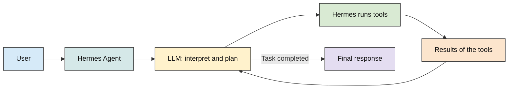

# 7. HERMES

## 7.1. WHAT IS HERMES?

Hermes Agent is an open source AI agent designed to execute tasks autonomously by using language models (LLMs), external tools, and memory mechanisms.

Unlike a conventional LLM, which mainly interprets instructions and generates responses, Hermes can plan actions, select tools, execute operations and analyze the results to complete a task.

For example, while a language model can explain how to analyze a Python project, Hermes can, if it has the necessary permissions, access the project files, examine the code, run tests, and generate a report with the results.

Hermes is not a language model itself, but a system that uses an LLM as a reasoning engine. It can work with models hosted in the cloud or with models running locally using platforms like Ollama.

One of its main features is the ability to retain information between sessions and create reusable _skills_ from procedures you've previously used. This makes it possible to progressively improve the way it performs certain tasks, without the need to retrain the language model's weights.

### Differences with LangChain and LangGraph

Although all three technologies allow the development of applications based on artificial intelligence agents, they have different purposes and degrees of development.

| **Technology** | **Purpose** | **Main Features** |
| -------------- | ------------------------------------------------------- | ----------------------------------------------------------------------------------------------------------------------------------------------------------------- |
| **LangChain** | Framework for building applications based on LLM | It provides components to connect models with external tools, databases, documents, and services. The developer programs how these components are used |
| **LangGraph** | Framework for organizing and controlling execution flow | Allows you to define nodes, transitions, conditions, and manage application state. The developer explicitly controls the behavior of agents |
| **Hermes** | AI agent already implemented to execute tasks | It incorporates planning systems, tool execution and memory. It allows you to delegate tasks without programming the entire agent architecture from scratch |

So, while LangChain and LangGraph are tools for building and controlling agentive applications, Hermes is an agent that already has many of these capabilities built-in.

These technologies are **not exclusive**, but can be combined. For example, in an application developed with LangGraph you can add a node that invokes Hermes to perform a specific task. In this case, LangGraph continues to control the overall flow of the application, while Hermes takes care of solving the task delegated to it.

## 7.2. WHAT DOES IT ALLOW TO DO?

The main functions of Hermes are:

- **Autonomous execution of tasks:** can break down a complex request into different steps and execute them sequentially.
- **Using Tools:** can execute terminal commands, query information, read files, and modify code, depending on the tools and permissions configured.
- **Persistent Memory:** can retain relevant information between different sessions.
- **Skills:** allows you to create, save and reuse procedures to solve recurring tasks.
- **Integration with MCP:** can connect to Model Context Protocol servers to access external tools and services.
- **Subagents:** can delegate parts of a task to other specialized agents.
- **Automation:** allows you to schedule tasks to run periodically.
- **Integration with applications:** can be used from the terminal, a desktop application or messaging platforms.

The general operation follows an iterative process:

1. The user enters a request.
2. Hermes sends the information to the configured LLM.
3. The model interprets the request and determines the necessary actions.
4. Hermes runs the selected tools.
5. The results are returned to the model for analysis.
6. The process is repeated, if necessary, until a final answer is obtained.



<p align="center"><sub>Figure 1. General flow of operation of Hermes Agent</sub></p>

This architecture makes it possible to develop applications in which the agent is not limited to answering questions, but actively participates in the execution of tasks.

## 7.3. INSTALLATION

Hermes Agent is compatible with different operating systems, mainly macOS, Linux and Windows. It has a desktop application with a graphical interface and a terminal version (CLI), especially useful for integrating it with other programs.

Terminal installation allows Hermes to be run as a standalone application and invoked from Python scripts without the need to keep the GUI open.

### 7.3.1. INSTALLATION ON macOS

**Step 1. Install Hermes**

Run in terminal:

```bash
curl -fsSL https://hermes-agent.nousresearch.com/install.sh | bash
```

The installer downloads the Hermes code and prepares the necessary dependencies for its operation.

The standard installation creates the program directory a `~/.hermes/hermes-agent/` and the terminal executable a `~/.local/bin/hermes`.

**Step 2. Set the PATH**

Once the installation is complete, update the terminal configuration:

```bash
source ~/.zshrc
```

Check that Hermes is recognized correctly:

```bash
hermes --version
```

If the error appears `zsh: command not found: hermes`, incorporate the folder of the executable in the `PATH`:

```bash
export PATH="$HOME/.local/bin:$PATH"
```

To keep this setting in future sessions:

```bash
echo 'export PATH="$HOME/.local/bin:$PATH"' >> ~/.zshrc
source ~/.zshrc
```

**Step 3. Run Hermes**

To start the agent, run:

```bash
hermes
```

This will open the interactive interface from which requests can be entered in natural language.

**Step 4. Configure Language Models**

Run:

```bash
hermes model
```

This command allows you to select a model provider and configure its connection data. Hermes can work with models hosted in the cloud or with local models executed through Ollama. In the latter case, you must select a model that is already installed.

To check available Ollama models:

```bash
ollama list
```

To manage available tools:

```bash
hermes tools
```

To verify that the installation and configuration is correct:

```bash
hermes -z "Hello, respond with OK only"
```

### 7.3.2. INSTALLATION IN LINUX

**Step 1. Install Hermes**

Run in terminal:

```bash
curl -fsSL https://hermes-agent.nousresearch.com/install.sh | bash
```

The installer prepares the Hermes environment, including managed versions of Python, Node.js, and other required dependencies.

**Step 2. Set the PATH**

If using Bash:

```bash
source ~/.bashrc
```

If using Zsh:

```bash
source ~/.zshrc
```

Check installation:

```bash
hermes --version
```

If the command is not recognized, temporarily add it to the `PATH`:

```bash
export PATH="$HOME/.local/bin:$PATH"
```

To save the change in Bash:

```bash
echo 'export PATH="$HOME/.local/bin:$PATH"' >> ~/.bashrc
source ~/.bashrc
```

To save the change in Zsh:

```bash
echo 'export PATH="$HOME/.local/bin:$PATH"' >> ~/.zshrc
source ~/.zshrc
```

**Step 3. Run Hermes**

```bash
hermes
```

This will open the interactive interface from which requests can be entered in natural language.

**Step 4. Configure Language Models**

```bash
hermes model
```

This command allows you to select a model provider and configure its connection data. Hermes can work with models in the cloud or with local models run through Ollama.

To check the installed Ollama models:

```bash
ollama list
```

To manage available tools:

```bash
hermes tools
```

To check the settings:

```bash
hermes -z "Hello, respond with OK only"
```

### 7.3.3. INSTALLATION ON WINDOWS

**Step 1. Install Hermes**

Run in PowerShell:

```powershell
iex (irm https://hermes-agent.nousresearch.com/install.ps1)
```

This command downloads and runs the Windows installer.

The program is usually installed on `%LOCALAPPDATA%\hermes\` and the executable is set to the directory `%LOCALAPPDATA%\hermes\bin\`.

**Step 2. Set the PATH**

When the process is complete, close PowerShell and open a new terminal to update the `PATH`.

Run:

```powershell
hermes --version
```

If Windows recognizes the command, the installation completed successfully.

**Step 3. Run Hermes**

```powershell
hermes
```

This will open the interactive interface from which requests can be entered in natural language.

**Step 4. Configure Language Models**

```powershell
hermes model
```

This command allows you to select a model provider and configure its connection data. Hermes can work with models in the cloud or with local models run through Ollama.

To check the installed Ollama models:

```powershell
ollama list
```

To manage available tools:

```powershell
hermes tools
```

To check the installation and configuration:

```powershell
hermes -z "Hello, respond with OK only"
```
