# 8. EXEMPLES D’ÚS EN PROGRAMES DE PYTHON

Aquest apartat reuneix **onze exemples progressius (del `00` al `10`)** per entendre com s'integren Python, Ollama, LangChain, LangGraph, Weaviate, Opik i Hermes. L'objectiu és veure què fa cada programa, en quin punt intervé un LLM, què executa Python i com es connecten els components.

## 8.0. Com utilitzar aquests exemples

Cada exemple inclou:

1. **Programa complet:** el fitxer `.py` de [`code/src/`](../code/src/), amb els imports, la configuració i la lògica necessària per executar-lo.
2. **Snippet:** un fragment de [`code/snippets/`](../code/snippets/) que destaca les peces necessàries per entendre l'exemple: configuració → eina o node → connexió amb l'agent o el graf → execució. Alguns fragments mostren el recorregut complet; d'altres ometen funcions auxiliars o part de les connexions. **Per executar els exemples, cal fer servir els programes de `code/src/`.**
3. **Explicació i flux:** el paper del LLM i de Python, un diagrama del flux d'execució i el comandament d'execució.

> **Com executar-los:** tots els comandaments `python` d'aquest document es llancen **des de l'arrel del repositori `Visual_tools_for_AI`**, amb l'entorn virtual activat i les dependències instal·lades. Cal tenir Ollama disponible i haver descarregat el model que utilitza cada exemple. Els programes que incorporen Weaviate, Opik o Hermes requereixen, a més, la configuració corresponent.

### Accés directe al codi i als snippets

| Exemple       | Què s'hi aprèn?                            | Programa complet                                                       | Snippet destacat                                                                                                                                              |
| :------------ | :----------------------------------------- | :--------------------------------------------------------------------- | :------------------------------------------------------------------------------------------------------------------------------------------------------------ |
| **8.1 · 00**  | Primera consulta d'Ollama                  | [Codi complet](../code/src/00_test_ollama.py)                          | [Snippet](../code/snippets/00_test_ollama_snippet.py)                                                                                                         |
| **8.2 · 01**  | Agent amb eina meteorològica               | [Codi complet](../code/src/01_simple_agent.py)                         | [Snippet](../code/snippets/01_simple_agent_snippet.py)                                                                                                        |
| **8.3 · 02**  | Supervisor i subagents especialitzats      | [Codi complet](../code/src/02_multi_agent.py)                          | [Snippet](../code/snippets/02_multi_agent_snippet.py)                                                                                                         |
| **8.4 · 03**  | Càlculs deterministes d'una missió de dron | [Codi complet](../code/src/03_my_drone_mission_agent.py)               | [Snippet](../code/snippets/03_my_drone_mission_agent_snippet.py)                                                                                              |
| **8.5 · 04**  | Flux i routers de LangGraph                | [Codi complet](../code/src/04_langgraph_drone_mission_agent.py)        | [Snippet](../code/snippets/04_langgraph_drone_mission_agent_snippet.py)                                                                                       |
| **8.6 · 05**  | Avaluació i replanificació de missions     | [Codi complet](../code/src/05_langgraph_autonomous_mission_planner.py) | [Snippet](../code/snippets/05_langgraph_autonomous_mission_planner_snippet.py)                                                                                |
| **8.7 · 06**  | Llista de compra amb eines LangChain       | [Codi complet](../code/src/06_shopping_list.py)                        | [Snippet](../code/snippets/06_shopping_list_snippet.py)                                                                                                       |
| **8.8 · 07**  | Llista de compra controlada per LangGraph  | [Codi complet](../code/src/07_shopping_list_langgraph.py)              | [Snippet](../code/snippets/07_shopping_list_langgraph_snippet.py)                                                                                             |
| **8.9 · 08**  | Cerca semàntica i RAG amb Weaviate         | [Codi complet](../code/src/08_shopping_list_weaviate.py)               | [Snippet](../code/snippets/08_shopping_list_weaviate_snippet.py)                                                                                              |
| **8.10 · 09** | Traces i tokens amb Opik                   | [Codi complet](../code/src/09_shopping_list_weaviate_opik.py)          | [Snippet](../code/snippets/09_shopping_list_weaviate_opik_snippet.py)                                                                                         |
| **8.11 · 10** | Integració d'Hermes                        | [Codi complet](../code/src/10_shopping_list_weaviate_opik_hermes.py)   | [Hermes CLI](../code/snippets/10_shopping_list_weaviate_opik_hermes_snippet.py) · [Ingredients](../code/snippets/10_calculate_missing_ingredients_snippet.py) |

---

### 8.1. Primera consulta al LLM — `00_test_ollama.py`

**Programa complet:** [Obrir `00_test_ollama.py`](../code/src/00_test_ollama.py)  
**Snippet:** [Obrir `00_test_ollama_snippet.py`](../code/snippets/00_test_ollama_snippet.py)  
**Què cal observar al snippet:** la configuració de `ChatOllama` i la primera crida a `llm.invoke()`. En aquest cas, el fragment coincideix amb el programa complet.

Aquest primer exemple permet comprovar que Python es pot comunicar correctament amb Ollama i generar respostes utilitzant el model Qwen.

**Funcionament del codi:**

```python
from langchain_ollama import ChatOllama

llm = ChatOllama(
    model="qwen3.5:9b",
    temperature=0,
)

response = llm.invoke("Explícame qué es LangChain en dos frases.")

print(response.content)
```

**Intervenció del LLM:**

El model intervé quan Python executa `response = llm.invoke(...)`. En aquest moment, LangChain envia la consulta a Ollama, que utilitza el model configurat per generar una resposta.

**Operacions de Python:**

Python s'encarrega de preparar la consulta, executar `invoke()`, rebre el resultat i mostrar-lo amb `print()`. En aquest exemple no hi ha eines ni agents. El model únicament genera text.

**Flux d'execució:**

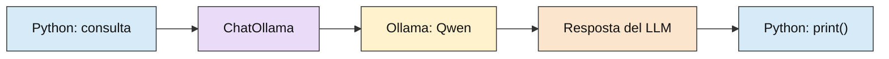

<p align="center">
  <sub>Figura 1. Flux d’execució de la prova d’Ollama</sub>
</p>

**Execució (des de l’arrel del repositori):**

```bash
python AI_Observability/code/src/00_test_ollama.py
```

Si apareix una resposta, es comprova que la comunicació entre Python, LangChain, Ollama i Qwen funciona correctament.

### 8.2. Agent amb una eina — `01_simple_agent.py`

**Programa complet:** [Obrir `01_simple_agent.py`](../code/src/01_simple_agent.py)  
**Snippet:** [Obrir `01_simple_agent_snippet.py`](../code/snippets/01_simple_agent_snippet.py)  
**Què cal observar al snippet:** les quatre etapes: configurar `ChatOllama`, definir `get_weather()`, crear l'agent amb `create_agent(tools=[get_weather])` i fer una consulta amb `agent.invoke()`. El LLM pot sol·licitar l'eina, però és Python qui l'executa. Les dades meteorològiques són simulades.

Aquest exemple introdueix el concepte de tool calling, que permet que el model sol·liciti l'execució de funcions Python.

L'agent disposa d'una eina anomenada `get_weather()` que retorna informació meteorològica simulada.

**Components del codi:**

La funció Python és:

```python
def get_weather(city: str) -> str:
    """Get weather for a given city."""

    print(
        f"[TOOL EXECUTED] get_weather(city={city})"
    )

    return f"It's always sunny in {city}!"
```

Aquesta funció rep el nom d'una ciutat i retorna una resposta fictícia.

Posteriorment, es crea l'agent:

```python
agent = create_agent(
    model=llm,
    tools=[get_weather],
    system_prompt="You are a helpful assistant",
)
```

Amb `tools=[get_weather]` s'indica que l'agent pot utilitzar aquesta funció.

**En quin moment intervé el LLM?**

Quan es crida `result = agent.invoke(...)`.

LangChain envia al LLM la pregunta de l'usuari, les instruccions del sistema i la descripció de les eines disponibles. El model interpreta la pregunta i pot decidir sol·licitar `get_weather()`.

Per exemple, si l'usuari pregunta _"What's the weather in San Francisco?"_, el model pot demanar:

`get_weather(city="San Francisco")`

**Què fa Python?**

LangChain rep la sol·licitud del model i executa la funció Python.

La funció retorna el text simulat `It's always sunny in San Francisco!`. Aquest resultat es torna a proporcionar al LLM, que el pot utilitzar per redactar una resposta final.

**Flux d'execució:**

El LLM interpreta la pregunta i, si necessita informació meteorològica, LangChain executa `get_weather()`. Python retorna la dada simulada, que el model pot utilitzar per generar la resposta final.

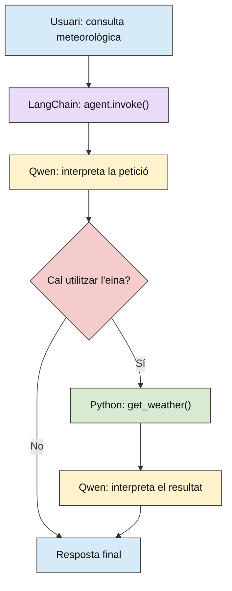

<p align="center">
  <sub>Figura 2. Flux d’execució de l’agent simple</sub>
</p>

**Execució (des de l’arrel del repositori):**

```bash
python AI_Observability/code/src/01_simple_agent.py
```

La traça [TOOL EXECUTED] permet comprovar que la funció s'ha executat realment.

Aquest exemple mostra com el LLM pren la decisió d'utilitzar una eina, mentre que Python realitza l'operació.

### 8.3. Supervisor i subagents — `02_multi_agent.py`

**Programa complet:** [Obrir `02_multi_agent.py`](../code/src/02_multi_agent.py)  
**Snippet:** [Obrir `02_multi_agent_snippet.py`](../code/snippets/02_multi_agent_snippet.py)  
**Què cal observar al snippet:** es creen `weather_agent` i `flight_agent` amb eines diferents, `ask_flight_agent()` delega una petició a l'especialista i `supervisor_agent` es crea amb les dues eines de delegació. El supervisor s'executa amb `supervisor_agent.invoke()`.

Aquest exemple amplia l'anterior introduint una arquitectura multiagent. El programa utilitza un **supervisor** que coordina dos agents especialitzats: un en meteorologia i un altre en càlculs de temps de vol. Tots tres utilitzen Qwen mitjançant Ollama, però tenen instruccions i eines diferents. És a dir, són tres agents, no tres models de llenguatge diferents.

Els tres agents són:

- **Supervisor Agent:** rep la pregunta de l'usuari i decideix a quin agent especialitzat ha de delegar cada tasca.
- **Weather Agent:** s'encarrega de respondre preguntes meteorològiques mitjançant la funció `get_weather()`.
- **Flight Agent:** calcula el temps de vol d'un dron mitjançant la funció `calculate_flight_time()`.

**Components del codi:**

Primer es configura el model mitjançant `ChatOllama`, de la mateixa manera que en l'exemple anterior.

A continuació, es defineixen els agents especialitzats:

- **weather_agent:** disposa de la funció Python `get_weather(city)`, que retorna informació meteorològica simulada d'una ciutat.
- **flight_agent:** disposa de la funció `calculate_flight_time(distance_km, speed_kmh)`, que calcula el temps de vol d'un dron a partir de la distància i la velocitat.

El temps de vol es calcula amb la fórmula:

$$
t_{\mathrm{min}} = \frac{d_{\mathrm{km}}}{v_{\mathrm{km/h}}} \cdot 60
$$

Aquest càlcul es realitza directament amb Python. El LLM no calcula el resultat numèric, sinó que interpreta la petició i determina si necessita executar l'eina.

Per permetre que el supervisor utilitzi aquests agents, es defineixen dues funcions intermèdies decorades amb `@tool`:

```python
@tool
def ask_weather_agent(query: str) -> str:
    """Delegate weather-related questions to the weather specialist agent."""

    result = weather_agent.invoke({
        "messages": [
            {"role": "user", "content": query}
        ]
    })

    return result["messages"][-1].content
```

La funció [`ask_flight_agent()`](../code/snippets/02_multi_agent_snippet.py) funciona de la mateixa manera, però invoca `flight_agent`. Aquest és el fragment seleccionat del repositori.

Aquestes funcions són importants perquè el supervisor no disposa directament de `get_weather()` ni de `calculate_flight_time()`. En canvi, té accés a `ask_weather_agent()` i `ask_flight_agent()`, que deleguen les tasques als agents especialitzats.

Es crea el supervisor:

```python
supervisor_agent = create_agent(
    model=llm,
    tools=[
        ask_weather_agent,
        ask_flight_agent,
    ],
    system_prompt=(
        "You are a supervisor agent "
        "that coordinates specialized agents."
    ),
)
```

La instrucció `system_prompt` estableix que el supervisor ha d'identificar les tasques de l'usuari, delegar-les a l'agent corresponent i combinar els resultats.

**Flux d’execució:**

Suposem que l'usuari introdueix la petició següent: “I want to fly a drone in Barcelona. Tell me the weather and calculate how long it would take to fly 12 km at 40 km/h.”

El recorregut és el següent:

- **Entrada de l'usuari:** Python envia la petició al supervisor executant `supervisor_agent.invoke()`. Aquesta instrucció inicia una inferència del LLM mitjançant LangChain i Ollama.
- **Interpretació del supervisor:** Qwen analitza la petició i identifica que conté dues tasques diferents: consultar la meteorologia i calcular el temps de vol. El model pot generar dues sol·licituds d'eina, una per a cada agent especialitzat.
- **Delegació als agents:** LangChain rep les sol·licituds i executa les funcions Python `ask_weather_agent()` i `ask_flight_agent()`. Aquestes funcions criden els agents corresponents mitjançant `.invoke()`.
- **Execució dels agents especialitzats:** cada agent realitza una nova inferència amb Qwen. El Weather Agent pot sol·licitar `get_weather(city="Barcelona")`, mentre que el Flight Agent pot sol·licitar `calculate_flight_time(distance_km=12, speed_kmh=40)`.
- **Execució de les funcions Python:** LangChain executa les eines sol·licitades. `get_weather()` retorna informació meteorològica fictícia i `calculate_flight_time()` calcula un temps de 18 minuts.
- **Retorn dels resultats:** els resultats de Python es proporcionen als agents especialitzats, que poden utilitzar el LLM per generar una resposta. Les funcions intermèdies retornen aquestes respostes al supervisor.
- **Resposta final:** el supervisor rep les dues respostes i utilitza novament Qwen per combinar-les en un únic missatge que es mostra a l'usuari.

És important destacar que el LLM intervé tant en el supervisor com en cadascun dels agents especialitzats, mentre que les funcions Python són les encarregades de proporcionar les dades i realitzar els càlculs.

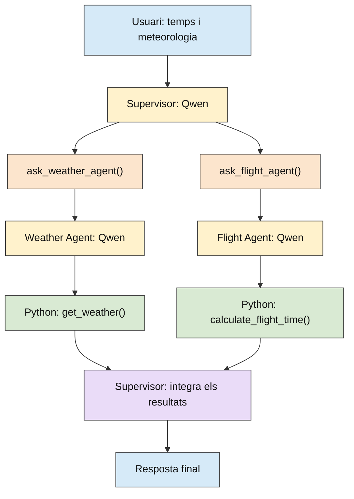

<p align="center">
  <sub>Figura 3. Flux d’execució multiagent</sub>
</p>

**Execució (des de l’arrel del repositori):**

```bash
python AI_Observability/code/src/02_multi_agent.py
```

**Què cal comprovar:** les peticions que combinen meteorologia i temps de vol poden provocar la delegació a dos especialistes. A més, el càlcul numèric es realitza amb Python. Les traces del tipus `[SUBAGENT CALLED]` ajuden a identificar la delegació.

### 8.4. Anàlisi d'una missió de dron — `03_my_drone_mission_agent.py`

**Programa complet:** [Obrir `03_my_drone_mission_agent.py`](../code/src/03_my_drone_mission_agent.py)  
**Snippet:** [Obrir `03_my_drone_mission_agent_snippet.py`](../code/snippets/03_my_drone_mission_agent_snippet.py)  
**Què cal observar al snippet:** `check_wind_safety()` aplica una regla de seguretat de Python i `analyse_mission()` la crida directament amb `.invoke()`. El LLM només apareix en la ruta explicativa d'`answer_question()`, no decideix quan executar les comprovacions.

Aquest exemple implementa un assistent capaç d'analitzar la viabilitat d'una missió de dron a partir de diferents paràmetres, com la distància, la velocitat, la direcció del vol, el vent i la bateria disponible.

A diferència dels exemples anteriors, el programa no utilitza el LLM per decidir quines funcions executar. La lògica principal està programada en Python, mentre que el model s'utilitza per respondre preguntes i explicar els resultats dels càlculs.

**Components del codi:**

El programa defineix una estructura `MissionState` que emmagatzema els paràmetres de la missió. Aquesta estructura permet que l'usuari introdueixi la informació progressivament i que el programa conservi els valors entre diferents missatges.

La funció `update_state()` analitza el text introduït per l'usuari i actualitza els paràmetres corresponents. Per identificar els valors utilitza expressions regulars de Python, mitjançant la biblioteca `re`. Per exemple, si l'usuari introdueix una distància de 10 km i una velocitat de 40 km/h, Python identifica els nombres i les unitats a partir de patrons predefinits. Aquesta extracció no requereix una inferència del LLM.

Un cop es disposa de la informació necessària, la funció `analyse_mission()` coordina tres eines:

- **`calculate_flight_time()`:** calcula les components del vent, la velocitat efectiva del dron i el temps de vol.
- **[`check_wind_safety()`](../code/snippets/03_my_drone_mission_agent_snippet.py):** comprova si les condicions de vent respecten els límits de seguretat. És la funció destacada al snippet.
- **`check_battery()`:** determina si la bateria disponible és suficient per completar la missió mantenint la reserva exigida.

Aquestes funcions estan decorades amb `@tool`, però són invocades directament pel codi Python, sense que el LLM decideixi quan executar-les.

Per exemple:

```python
flight_result = calculate_flight_time.invoke({
    "distance_km": state.distance_km,
    "drone_speed_kmh": state.drone_speed_kmh,
    "wind_speed_kmh": state.wind_speed_kmh,
    "flight_bearing_deg": state.flight_bearing_deg,
    "wind_direction_from_deg": state.wind_direction_from_deg,
})
```

En aquest cas, `.invoke()` executa una **eina de Python**, no el model Qwen. La distinció és important perquè el mateix mètode `invoke()` es pot utilitzar amb diferents components de LangChain.

**Flux d’execució:**

- **Entrada de l'usuari:** l'usuari introdueix una descripció de la missió al terminal. La funció `main()` rep el text i determina com s'ha de processar.
- **Actualització de l'estat:** si el missatge conté paràmetres, `update_state()` els identifica mitjançant expressions regulars i els guarda a `MissionState`.
- **Selecció de l'operació:** el programa comprova si l'usuari ha proporcionat dades noves, ha demanat una anàlisi, vol consultar els passos de càlcul o ha formulat una pregunta.
- **Anàlisi de la missió:** quan correspon realitzar una anàlisi, Python executa `analyse_mission()`. Aquesta funció comprova quines dades estan disponibles i crida les eines de vol, vent i bateria quan disposa dels paràmetres necessaris.
- **Generació de l'informe:** Python recull els resultats de les comprovacions i construeix un informe. També genera una traça amb les operacions efectuades, que permet consultar posteriorment com s'han obtingut els resultats.
- **Intervenció del LLM:** si l'usuari formula una pregunta explicativa, com “Why is my mission not feasible?”, el programa executa `answer_question()`. Aquesta funció prepara un prompt amb l'estat de la missió, l'últim informe i la traça dels càlculs, i crida `llm.invoke()`.
- **Resposta final:** Qwen utilitza la informació proporcionada per generar una explicació en llenguatge natural, sense modificar els paràmetres ni tornar a calcular els resultats de seguretat.

Per tant, existeixen dues rutes principals: una ruta de càlcul, executada íntegrament amb Python, i una ruta d'explicació, en què intervé el LLM.

Si l'usuari únicament demana visualitzar la traça dels càlculs, tampoc no és necessari executar Qwen, ja que aquesta informació està guardada al programa.

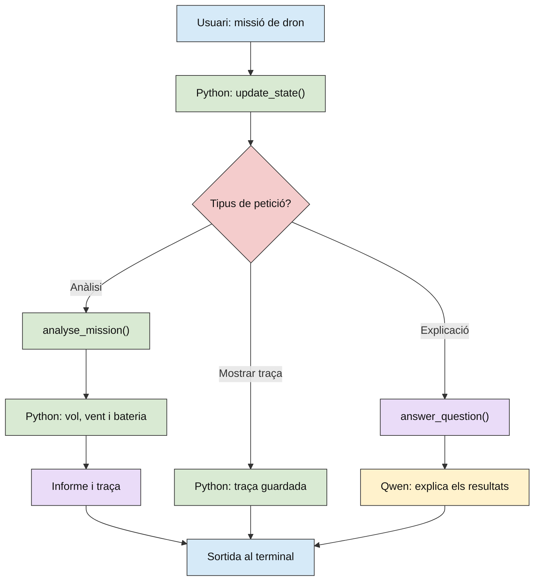

<p align="center">
  <sub>Figura 4. Flux d’execució de l’agent de missió</sub>
</p>

**Execució (des de l’arrel del repositori):**

```bash
python AI_Observability/code/src/03_my_drone_mission_agent.py
```

### 8.5. Missió de dron amb LangGraph — `04_langgraph_drone_mission_agent.py`

**Programa complet:** [Obrir `04_langgraph_drone_mission_agent.py`](../code/src/04_langgraph_drone_mission_agent.py)  
**Snippet:** [Obrir `04_langgraph_drone_mission_agent_snippet.py`](../code/snippets/04_langgraph_drone_mission_agent_snippet.py)  
**Què cal observar al snippet:** `route_after_input()` decideix el següent node segons l'estat, `StateGraph` connecta els nodes i les transicions, `compile()` prepara el graf i `drone_mission_graph.invoke()` l'executa. El router és codi Python, no un LLM.

Aquest exemple implementa les funcionalitats de l'assistent de dron anterior, però reorganitza el programa mitjançant LangGraph. La principal diferència és que el flux d'execució es defineix com un graf format per nodes i connexions. Cada node executa una operació concreta i les connexions condicionals determinen quin serà el següent pas.

D'aquesta manera, LangGraph permet separar la lògica d'interpretació, els càlculs, la generació d'informes i les respostes del LLM.

**Components del codi:**

L'estat compartit del graf es defineix mitjançant `DroneMissionState`, que conté els paràmetres de la missió, els resultats de les comprovacions i les variables de control necessàries per seleccionar les operacions.

Per conservar la informació entre diferents execucions s'utilitza `InMemorySaver`, un mecanisme de memòria que permet recuperar l'estat associat a una mateixa sessió.

El primer node és `process_input_node()`. Aquest node rep el missatge de l'usuari, executa `extract_updates()` per identificar els paràmetres i actualitza l'estat de la missió. També determina si l'usuari vol iniciar una anàlisi, consultar els passos de càlcul o formular una pregunta.

Posteriorment, el router `route_after_input()` decideix quin camí seguir. Aquesta funció consulta els valors de l'estat i retorna el nom del següent node.

Els principals nodes disponibles són:

- **flight_check_node():** executa `calculate_flight_time()`.
- **wind_check_node():** executa `check_wind_safety()`.
- **battery_check_node():** executa `check_battery()`.
- **final_report_node():** prepara l'informe final.
- **show_trace_node():** mostra els passos dels càlculs.
- **answer_question_node():** utilitza el LLM per respondre preguntes sobre la missió.

Els nodes de càlcul utilitzen funcions Python. Només `answer_question_node()` realitza una inferència amb Qwen.

**Flux d'execució:**

- **Entrada de l'usuari:** la funció `main()` rep el missatge i inicia l'execució del graf mitjançant `drone_mission_graph.invoke()`.
- **Processament de l'entrada:** LangGraph executa `process_input_node()`. Python interpreta les dades, actualitza l'estat i identifica quines comprovacions s'han de realitzar.
- **Selecció de la ruta:** LangGraph consulta `route_after_input()`. Aquest router és una funció Python que selecciona el node següent segons les condicions de l'estat. No utilitza el LLM.
- **Execució dels nodes de càlcul:** si la missió requereix una anàlisi, el graf passa pels nodes corresponents de vol, vent i bateria. Cada node executa la seva eina Python i guarda el resultat a l'estat compartit.
- **Transicions condicionals:** després de cada comprovació, els routers `route_after_flight()` i `route_after_wind()` determinen si cal executar un altre node o passar directament a l'informe.
- **Generació de l'informe:** `final_report_node()` recupera els resultats disponibles i construeix la resposta que es mostra al terminal.
- **Ruta alternativa del LLM:** si l'usuari formula una pregunta, `route_after_input()` selecciona `answer_question_node()`. Aquest node prepara la informació de la missió i executa `llm.invoke()` perquè Qwen generi una explicació.

El programa també pot reutilitzar resultats ja calculats. Quan l'usuari modifica un paràmetre, `process_input_node()` identifica els camps que han canviat i determina quines comprovacions s'han de repetir. D'aquesta manera s'evita executar operacions innecessàries.

És important remarcar que `drone_mission_graph.invoke()` no significa executar directament el LLM. Aquesta instrucció inicia el graf i LangGraph va executant els nodes. Només es realitza una inferència si el recorregut arriba a un node que crida Qwen.

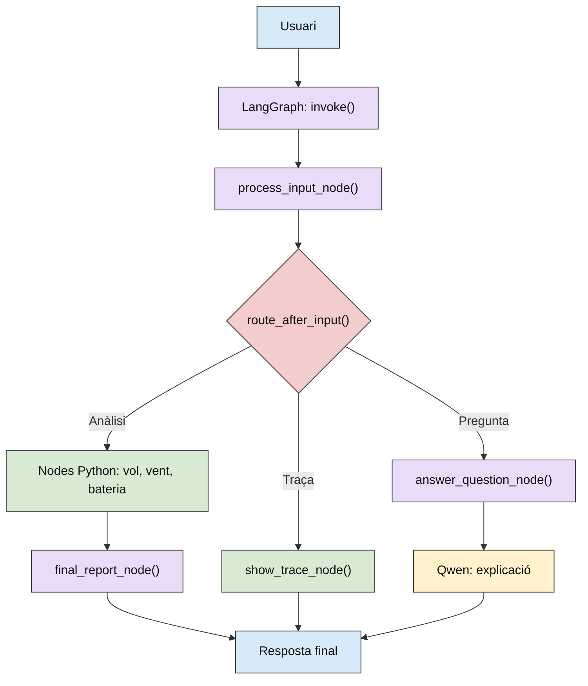

<p align="center">
  <sub>Figura 5. Flux d’execució amb LangGraph</sub>
</p>

Aquest exemple mostra com LangGraph facilita l'organització de processos que disposen de diferents camins d'execució, permetent conservar l'estat i separar les responsabilitats de cada funció.

**Execució (des de l’arrel del repositori):**

```bash
python AI_Observability/code/src/04_langgraph_drone_mission_agent.py
```

### 8.6. Planificació i replanificació — `05_langgraph_autonomous_mission_planner.py`

**Programa complet:** [Obrir `05_langgraph_autonomous_mission_planner.py`](../code/src/05_langgraph_autonomous_mission_planner.py)  
**Snippet:** [Obrir `05_langgraph_autonomous_mission_planner_snippet.py`](../code/snippets/05_langgraph_autonomous_mission_planner_snippet.py)  
**Què cal observar al snippet:** `route_after_evaluation()` tria `replan` o `report` segons el resultat de l'avaluació, i `StateGraph` connecta `evaluate_plan` amb `replanner` o `final_report`. El snippet mostra només aquesta part del graf, la resta de transicions són al codi complet.

Aquest exemple amplia el sistema anterior incorporant la planificació, l'avaluació i la proposta de replanificació d'una missió de dron. L'aplicació no es limita a comprovar si una missió és viable, sinó que també identifica les causes que poden impedir completar-la i prepara possibles accions correctives.

El sistema s'organitza mitjançant LangGraph, que controla el recorregut entre les diferents etapes de planificació i validació.

**Components del codi:**

El programa defineix un estat compartit, `AutonomousMissionState`, que emmagatzema els paràmetres de la missió, el pla actual, la versió del pla, els resultats de les comprovacions i les possibles accions de replanificació.

El graf incorpora diversos nodes:

- **process_input_node():** interpreta les dades de l'usuari i actualitza l'estat.
- **mission_planner_node():** construeix el pla de missió a partir dels paràmetres disponibles.
- **flight_check_node(), wind_check_node() i battery_check_node():** executen les comprovacions corresponents.
- **evaluate_plan_node():** determina l'estat global de la missió.
- **replanner_node():** proposa accions correctives si la missió no és viable.
- **final_report_node():** genera l'informe final.
- **answer_question_node():** utilitza el LLM per explicar els resultats.

El node `evaluate_plan_node()` pot classificar la missió amb els estats següents:

- **Feasible:** les comprovacions disponibles indiquen que la missió és viable.
- **Not Feasible:** s'ha detectat alguna condició que impedeix considerar-la viable.
- **Undetermined:** falta informació o alguna comprovació necessària.
- **Invalid:** s'ha detectat alguna dada o resultat invàlid.

La selecció de la ruta de replanificació es realitza mitjançant una condició Python dins de `route_after_evaluation()`:

```python
def route_after_evaluation(
    state: AutonomousMissionState,
) -> Literal["replan", "report"]:
    if state.get("mission_status") == "NOT FEASIBLE":
        return "replan"

    return "report"
```

Això significa que, quan l'estat és NOT FEASIBLE, LangGraph dirigeix l'execució cap a `replanner_node()`.

**Flux d'execució:**

- **Entrada i interpretació:** l'usuari introdueix els paràmetres de la missió. Python inicia el graf i `process_input_node()` identifica i actualitza les dades.
- **Planificació:** el router selecciona `mission_planner_node()`, que construeix una descripció del pla i actualitza la versió quan correspon. Aquesta etapa utilitza funcions Python.
- **Comprovacions:** LangGraph executa els nodes necessaris per calcular el temps de vol, avaluar el vent i comprovar la bateria. Els càlculs els efectuen les eines Python, no Qwen.
- **Avaluació:** `evaluate_plan_node()` recupera els resultats, comprova les condicions i determina l'estat global de la missió.
- **Decisió de replanificació:** `route_after_evaluation()` consulta l'estat obtingut. Si la missió és NOT FEASIBLE, selecciona `replanner_node()`. En els altres casos, el graf continua cap a l'informe.
- **Proposta d'accions correctives:** `replanner_node()` analitza els problemes detectats i prepara possibles solucions mitjançant regles Python. Per exemple, pot proposar revisar les condicions de vent, augmentar la disponibilitat de bateria o modificar la ruta. Aquestes propostes no s'apliquen automàticament ni impliquen tornar a executar indefinidament els càlculs.
- **Generació de l'informe:** `final_report_node()` recull el pla, les comprovacions i les possibles accions correctives, i construeix el resultat final.
- **Explicació mitjançant el LLM:** si posteriorment l'usuari formula una pregunta sobre el pla o els resultats, LangGraph executa `answer_question_node()`, que proporciona aquesta informació a Qwen mitjançant `llm.invoke()`.

En aquest exemple, la planificació i la replanificació són processos programats en Python. El LLM s'utilitza per respondre preguntes explicatives, no per calcular la viabilitat ni determinar les accions correctives.

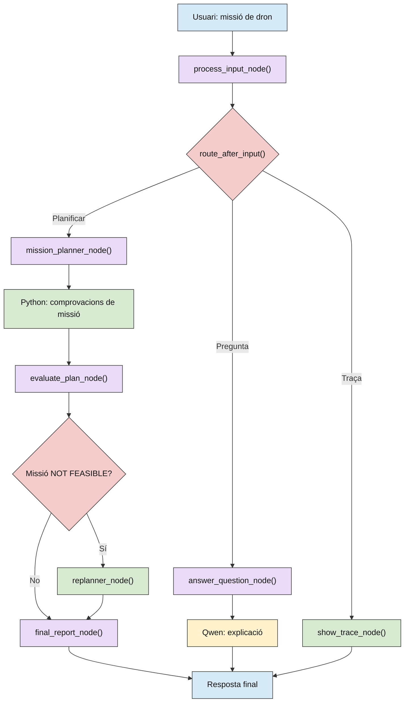

<p align="center">
  <sub>Figura 6. Flux d’execució del planificador autònom</sub>
</p>

Aquest exemple demostra com construir un procés de planificació amb diferents etapes, condicions i rutes alternatives mitjançant LangGraph.

**Execució (des de l’arrel del repositori):**

```bash
python AI_Observability/code/src/05_langgraph_autonomous_mission_planner.py
```

### 8.7. Llista de la compra amb LangChain — `06_shopping_list.py`

**Programa complet:** [Obrir `06_shopping_list.py`](../code/src/06_shopping_list.py)  
**Snippet:** [Obrir `06_shopping_list_snippet.py`](../code/snippets/06_shopping_list_snippet.py)  
**Què cal observar al snippet:** es configura `ChatOllama`, es defineix l'eina `add_product()`, es crea l'agent amb les quatre eines de la llista i s'executa `agent.invoke()` conservant l'historial de missatges. La llista real la modifica Python.

Aquest exemple implementa un assistent per gestionar una llista de la compra mitjançant llenguatge natural. L'usuari pot afegir, eliminar, substituir o consultar productes sense necessitat d'escriure instruccions amb una sintaxi específica.

El programa utilitza un agent LangChain que interpreta les peticions amb Qwen i disposa de diferents funcions Python per modificar la llista.

**Components del codi:**

La llista de la compra es representa mitjançant una variable Python: `shopping_list = []`.

A continuació, es defineixen quatre eines decorades amb `@tool`:

- **[`add_product()`](../code/snippets/06_shopping_list_snippet.py):** afegeix un producte (funció destacada al snippet).
- **`remove_product()`:** elimina un producte.
- **`replace_product()`:** substitueix un producte per un altre.
- **`show_list()`:** mostra la llista actual.

Aquestes eines realitzen les operacions sobre la variable `shopping_list` utilitzant instruccions Python, com `append()`, `remove()` o l'accés als elements per índex.

Posteriorment es crea l'agent amb `create_agent()`, proporcionant-li les quatre eines i un `system_prompt` que defineix el comportament de l'assistent.

Entre les instruccions s'estableix que els noms dels productes s'han de traduir al castellà abans de cridar les eines, que s'han de conservar els detalls dels productes i que les correccions de l'usuari s'han de gestionar amb `replace_product()`.

El programa també conserva un historial de missatges. Aquest historial permet que el model disposi del context de les interaccions anteriors.

**Flux d'execució:**

Suposem que l'usuari introdueix: “Add milk”

- **Entrada de l'usuari:** Python afegeix el missatge a l'historial i crida `agent.invoke()`.
- **Interpretació del LLM:** LangChain envia a Qwen el missatge, les instruccions i les descripcions de les eines. El model interpreta que l'usuari vol afegir un producte, el tradueix al castellà i pot generar la sol·licitud d'eina `add_product(product="leche")`.
- **Execució de Python:** LangChain rep la sol·licitud i executa `add_product()`. La funció normalitza el nom, comprova si el producte ja existeix i l'afegeix amb `shopping_list.append()`.
- **Retorn del resultat:** la funció retorna un missatge de confirmació. LangChain proporciona aquest resultat al LLM.
- **Resposta final:** Qwen genera una resposta per a l'usuari i Python actualitza l'historial de missatges.

Si posteriorment l'usuari escriu “pero quería leche de soja”, el model pot utilitzar el context anterior per interpretar que es tracta d'una correcció. En aquest cas, sol·licita `replace_product()` i Python substitueix el producte original.

El model és qui interpreta la intenció i selecciona la funció, però la llista real només es modifica quan s'executa l'eina Python.

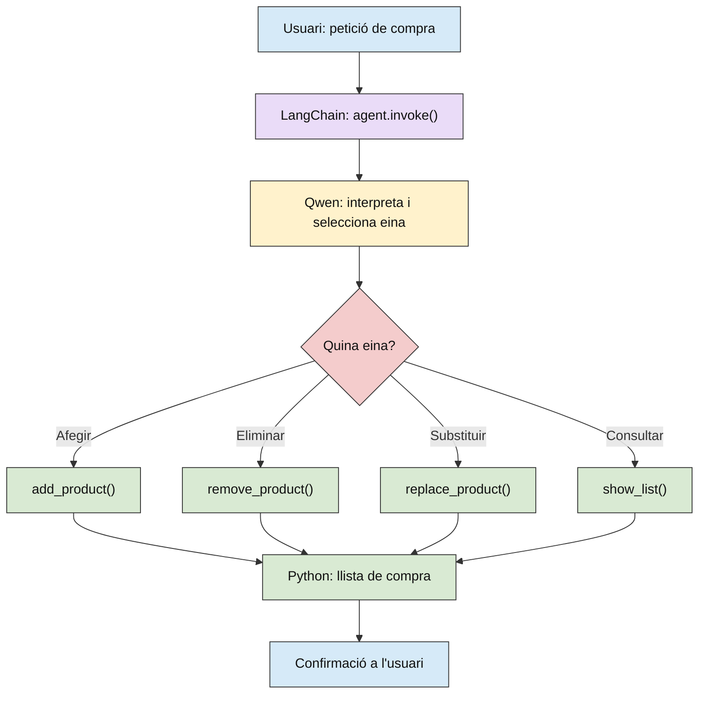

<p align="center">
  <sub>Figura 7. Flux del gestor de la llista de la compra</sub>
</p>

Aquest exemple introdueix la gestió d'informació modificable mitjançant tool calling. També mostra la importància de conservar l'historial per interpretar referències i correccions de l'usuari.

**Execució (des de l’arrel del repositori):**

```bash
python AI_Observability/code/src/06_shopping_list.py
```

### 8.8. Llista de la compra amb LangGraph — `07_shopping_list_langgraph.py`

**Programa complet:** [Obrir `07_shopping_list_langgraph.py`](../code/src/07_shopping_list_langgraph.py)  
**Snippet:** [Obrir `07_shopping_list_langgraph_snippet.py`](../code/snippets/07_shopping_list_langgraph_snippet.py)  
**Què cal observar al snippet:** Qwen interpreta la petició en JSON, `route_after_input()` selecciona el camí, `add_node()` executa una eina Python i `StateGraph` connecta, compila i executa el graf. És important diferenciar la classificació del LLM de l'encaminament de LangGraph.

Aquest exemple implementa la mateixa funcionalitat de llista de la compra, però utilitzant LangGraph per organitzar les operacions en nodes.

La diferència principal respecte a l'exemple anterior és que el LLM no sol·licita directament l'execució de les eines de gestió. En aquest cas, el model interpreta la petició i retorna una estructura JSON amb l'acció que s'ha de realitzar. Posteriorment, un router Python selecciona el node corresponent.

**Components del codi:**

El programa defineix `ShoppingState`, una estructura que conté la llista de la compra, el missatge de l'usuari, l'últim producte afegit i els camps necessaris per descriure una operació. També utilitza `InMemorySaver` per conservar l'estat entre les diferents interaccions de la sessió.

El primer node és `process_input_node()`, que prepara un prompt amb les instruccions del sistema i executa:

```python
response = llm.invoke([
    ("system", system_prompt),
    ("human", state["user_input"]),
])
```

Aquesta és la crida al LLM. Qwen interpreta la petició i retorna un JSON amb els camps `action`, `products`, `old_product` i `new_product`.

Per exemple, si l'usuari escriu “añade huevos y harina”, el model pot retornar:

```json
{
  "action": "add",
  "products": ["huevos", "harina"],
  "old_product": "",
  "new_product": ""
}
```

Python interpreta aquest resultat amb `json.loads()`, comprova que els camps siguin vàlids i els guarda a l'estat.

A continuació, la funció `route_after_input()` consulta el valor d'`action`:

```python
def route_after_input(state: ShoppingState) -> Literal["add", "remove", "replace", "show", "other"]:
    action = state.get("action", "other")
    print(f"[ROUTER] {action}")
    return action
```

El router pot seleccionar els nodes `add`, `remove`, `replace`, `show` o `other`.

Cada node executa la funció Python corresponent, com `add_products()`, `remove_products()`, `replace_product()` o `show_products()`.

**Flux d'execució:**

- **Entrada de l'usuari:** la funció `main()` rep el missatge i inicia el graf amb `shopping_graph.invoke()`.
- **Interpretació del LLM:** LangGraph executa `process_input_node()`, que crida Qwen mitjançant `llm.invoke()`. El model identifica la intenció de l'usuari i genera una resposta JSON.
- **Processament del JSON:** Python executa `json.loads()`, valida els camps i actualitza l'estat compartit.
- **Selecció del node:** LangGraph executa `route_after_input()`, que consulta el camp `action` i retorna el nom del node que s'ha d'executar. Aquesta decisió es basa en el valor del JSON i no requereix una nova inferència.
- **Execució de l'operació:** el node seleccionat executa una funció Python. Per exemple, `add_node()` invoca `add_products()`, que afegeix els productes a la llista.
- **Actualització de l'estat:** la funció retorna la llista actualitzada i un missatge de confirmació. LangGraph guarda els resultats a l'estat i finalitza l'execució.
- **Resposta final:** Python mostra la resposta i el contingut real de la llista al terminal, sense necessitat de tornar a consultar el LLM.

Per tant, en aquest exemple Qwen decideix què vol fer l'usuari, el router determina quin node executar i Python realitza l'operació.

Aquesta arquitectura és diferent de [`06_shopping_list.py`](../code/src/06_shopping_list.py), on el LLM utilitzava directament el mecanisme de _tool calling_ de LangChain. Aquí la intenció es transforma primer en JSON i després és LangGraph qui controla explícitament el recorregut.

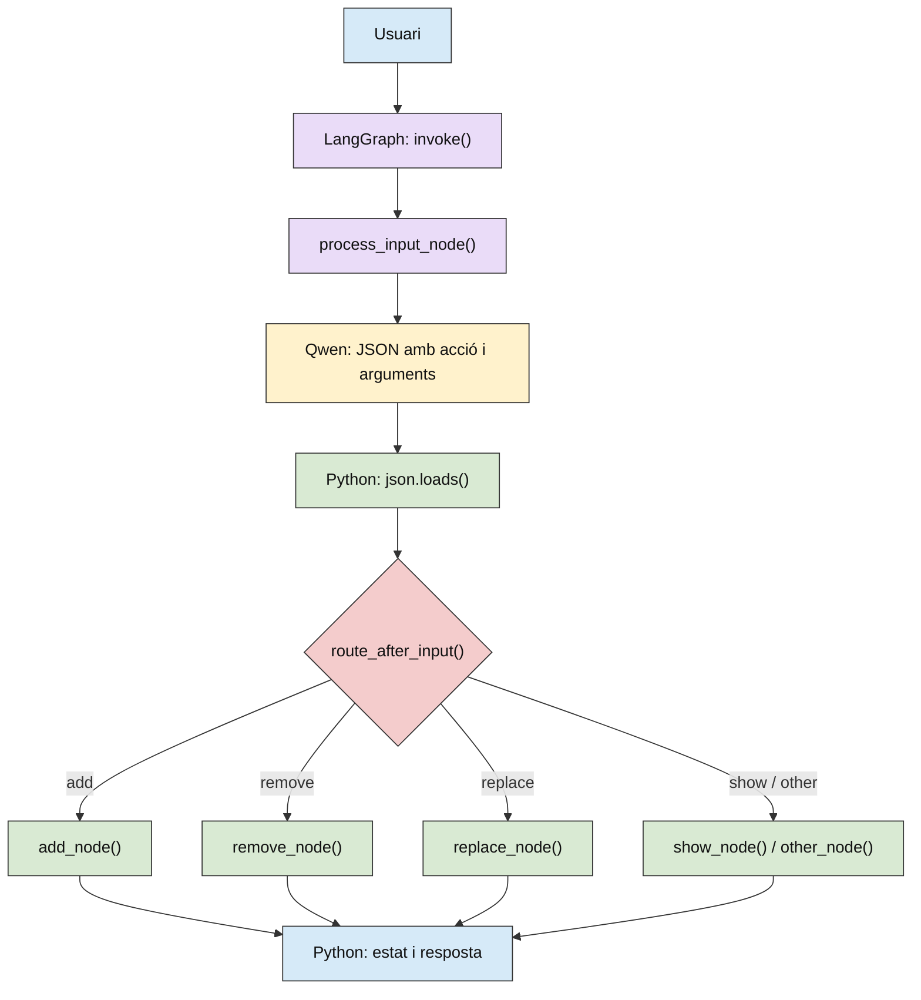

<p align="center">
  <sub>Figura 16. Flux d’execució de la llista amb LangGraph</sub>
</p>

Aquest exemple permet entendre la diferència entre la decisió del model i l'encaminament del graf, així com el paper dels nodes i de l'estat compartit.

**Execució (des de l’arrel del repositori):**

```bash
python AI_Observability/code/src/07_shopping_list_langgraph.py
```

**Prova suggerida:** escriure «añade huevos y harina» i després «quita harina». Les traces `[ROUTER]` i `[NODE]` permeten distingir la selecció del camí i l'execució de l'operació.

### 8.9. Cerca de receptes i RAG — `08_shopping_list_weaviate.py`

**Programa complet:** [Obrir `08_shopping_list_weaviate.py`](../code/src/08_shopping_list_weaviate.py)  
**Snippet:** [Obrir `08_shopping_list_weaviate_snippet.py`](../code/snippets/08_shopping_list_weaviate_snippet.py)  
**Què cal observar al snippet:** el primer `ChatOllama` interpreta la petició, `near_text()` recupera receptes, `has_required_ingredients()` filtra amb Python i el segon `ChatOllama` genera la resposta RAG a partir del context recuperat.

Aquest exemple amplia l'assistent de llista de la compra incorporant una connexió amb Weaviate Cloud, una base de dades vectorial que permet recuperar informació mitjançant cerques semàntiques.

L'aplicació continua permetent gestionar productes, però incorpora la possibilitat de buscar receptes i afegir els seus ingredients a la llista de la compra. La informació es treu de la col·lecció Recetas de Weaviate.

**Components del codi:**

El programa utilitza dos objectes `ChatOllama` amb finalitats diferents:

```python
llm = ChatOllama(
    model="qwen3.5:9b",
    temperature=0,
    format="json",
    reasoning=False,
)

rag_llm = ChatOllama(
    model="qwen3.5:9b",
    temperature=0,
    reasoning=False,
)
```

Tots dos utilitzen el mateix model, però es configuren per a dues tasques diferents. El primer objecte (`llm`) interpreta les peticions de l'usuari i genera una estructura JSON. El segon (`rag_llm`) genera explicacions en llenguatge natural a partir de les receptes recuperades.

El programa incorpora la funció `weaviate_connection()`, que prepara la connexió amb Weaviate Cloud. Per consultar les receptes, [`search_recipes()`](../code/snippets/08_shopping_list_weaviate_snippet.py) executa la cerca semàntica següent:

```python
result = collection.query.near_text(**kwargs)
```

Aquesta operació permet recuperar receptes relacionades amb el significat de la consulta, encara que no continguin exactament les mateixes paraules.

El programa també aplica condicions addicionals. Si l'usuari estableix un temps màxim, Weaviate rep un filtre sobre `tiempoMin` (temps en minuts). Posteriorment, Python executa `has_required_ingredients()` per comprovar que les receptes continguin **tots** els ingredients obligatoris. Per tant, es combina una cerca vectorial amb un filtre numèric a Weaviate i una comprovació exacta d'ingredients en Python.

**Flux d'execució:**

Suposem que l'usuari introdueix: “Quiero recetas con huevos y patatas que se preparen en menos de 30 minutos.”

El flux seria el següent:

- **Entrada de l'usuari:** Python rep el missatge i inicia el graf de LangGraph.
- **Primera inferència del LLM:** `process_input_node()` envia la petició a Qwen, que identifica l'acció `search_recipe`, genera una consulta semàntica i extreu els filtres. El JSON pot contenir `required_ingredients = ["huevos", "patatas"]` i `max_minutes = 30`.
- **Selecció de la ruta:** Python interpreta el JSON i el router selecciona `search_recipe_node()`.
- **Consulta a Weaviate:** el node executa `search_recipes()`. Aquesta funció obre una connexió amb Weaviate Cloud i realitza la cerca amb `near_text()`, aplicant el filtre de temps.
- **Filtratge amb Python:** el programa examina les receptes recuperades i comprova amb `has_required_ingredients()` que continguin tots els ingredients obligatoris.
- **Segona inferència del LLM:** si s'han trobat receptes, `search_recipe_node()` prepara un prompt amb la pregunta original i les dades recuperades. Després executa `rag_llm.invoke()` perquè Qwen generi una explicació basada en aquestes receptes.
- **Resposta final:** LangGraph guarda les receptes a `last_recipes` i Python mostra al terminal els resultats numerats i l'explicació generada.

Aquesta segona inferència és un exemple de RAG (Retrieval-Augmented Generation), ja que el model genera la resposta utilitzant informació recuperada d'una font externa.

El procés també permet una altra interacció. Si l'usuari escriu “añade los ingredientes de la segunda receta”, el primer LLM interpreta l'acció `add_recipe` i identifica el número de recepta.

En aquest cas, `add_recipe_node()` recupera la segona recepta de `last_recipes`, extreu els ingredients de `ingredientesClave` i executa `add_products()` per actualitzar la llista. No cal repetir la cerca a Weaviate ni executar el segon LLM per generar una nova explicació.

Així, el primer LLM interpreta les instruccions, Weaviate proporciona les dades, Python aplica els filtres i modifica la llista, i el segon LLM explica les receptes recuperades.

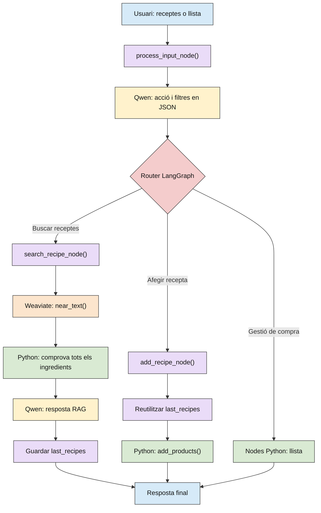

<p align="center">
  <sub>Figura 17. Flux d’execució amb Weaviate</sub>
</p>

Aquest exemple mostra com integrar una base de dades vectorial amb un assistent basat en LLM per respondre consultes utilitzant informació externa al model.

**Execució (des de l’arrel del repositori):**

```bash
python AI_Observability/code/src/08_shopping_list_weaviate.py
```

**Prova suggerida:** buscar receptes amb dos ingredients obligatoris i un temps màxim; després, demanar afegir els ingredients d'una de les receptes mostrades. Així es comprova la recuperació de Weaviate, el filtratge de Python i la memòria `last_recipes`.

### 8.10. Observabilitat amb Opik — `09_shopping_list_weaviate_opik.py`

**Programa complet:** [Obrir `09_shopping_list_weaviate_opik.py`](../code/src/09_shopping_list_weaviate_opik.py)  
**Snippet:** [Obrir `09_shopping_list_weaviate_opik_snippet.py`](../code/snippets/09_shopping_list_weaviate_opik_snippet.py)  
**Què cal observar al snippet:** `invoke_with_opik_usage()` embolcalla la crida al LLM i registra tokens, `weaviate_near_text()` registra les consultes semàntiques i `track_langgraph()` connecta el graf amb `OpikTracer`.

Aquest exemple incorpora Opik a l'assistent de llista de la compra amb Weaviate. L'objectiu és afegir observabilitat, és a dir, la capacitat de registrar i analitzar les diferents operacions que es produeixen durant una execució.

El funcionament principal de l'assistent es manté com en l'exemple anterior, però ara és possible observar les crides al LLM, les consultes a Weaviate, els temps d'execució i les mètriques de consum disponibles.

**Components del codi:**

El programa incorpora `OpikTracer` i `track_langgraph()`, que permeten instrumentar el graf de LangGraph.

També defineix una funció per registrar el consum del model:

```python
@track(
    name="ollama_tokens",
    type="llm",
    capture_input=False,
    capture_output=False
)
def invoke_with_opik_usage(
    model,
    messages,
    etapa: str
):
    answer = model.invoke(messages)
    usage = answer.usage_metadata or {}
    if usage:
        opik_context.update_current_span(
            model=MODEL,
            provider="ollama",
            metadata={"etapa": etapa},
            usage={
                "prompt_tokens":
                    usage.get("input_tokens", 0),
                "completion_tokens":
                    usage.get("output_tokens", 0),
                "total_tokens":
                    usage.get("total_tokens", 0),
            },
        )

    return answer
```

Així, si cliquem una trace al dashboard veurem el següent:

<p align="center">
  
</p>

<p align="center">
  <sub>Figura 18. Consum de tokens</sub>
</p>

Aquesta funció executa el model i recupera les metadades de consum proporcionades per Ollama. Els tokens es poden diferenciar entre els utilitzats per processar l'entrada i els generats a la sortida.

També s'utilitza la funció `weaviate_near_text()` per registrar les consultes semàntiques a la base de dades.

La integració amb LangGraph es realitza mitjançant:

```python
shopping_graph = track_langgraph(
    shopping_graph,
    opik_tracer
)
```

Això permet associar les execucions del graf amb les traces registrades a Opik.

**Flux d’execució:**

- **Entrada de l'usuari:** Python rep la petició i inicia el graf LangGraph instrumentat amb Opik.
- **Interpretació del LLM:** `process_input_node()` executa Qwen a través de `invoke_with_opik_usage()`. El model genera el JSON amb l'acció corresponent, mentre que Opik registra les metadades de la invocació.
- **Selecció del node:** LangGraph utilitza el router per determinar l'operació necessària. Opik permet observar el recorregut del graf i els components instrumentats.
- **Execució de les eines:** si l'usuari sol·licita receptes, Python executa la consulta a Weaviate. `weaviate_near_text()` permet registrar aquesta operació i el seu temps d'execució.
- **Generació RAG:** quan hi ha receptes recuperades, el programa executa el segon LLM mitjançant `invoke_with_opik_usage()`, indicant l'etapa generacion_rag.
- **Resposta final:** Python mostra les receptes i l'explicació generada. Paral·lelament, Opik disposa de les traces que permeten analitzar les operacions registrades.
- **Finalització:** quan es tanca el programa, `opik_tracer.flush()` envia les traces pendents a Opik i el codi intenta tancar les connexions HTTP d'Ollama.

La diferència principal és que Opik no intervé en la interpretació de la pregunta ni en la selecció de les eines. El seu paper és observar i registrar el funcionament de l'aplicació.

A partir de les traces es pot estudiar, per exemple, si el temps total d'una consulta prové principalment de la primera inferència de Qwen, de la cerca a Weaviate o de la generació de la resposta RAG. Les mètriques de tokens es registren quan Ollama proporciona les metadades corresponents.

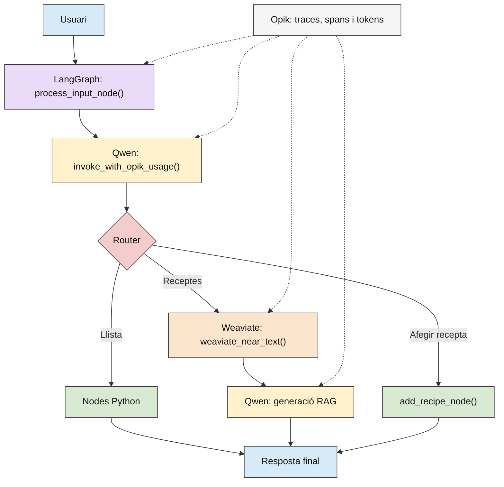

<p align="center">
  <sub>Figura 19. Flux d’execució amb Opik</sub>
</p>

**Execució (des de l’arrel del repositori):**

```bash
python AI_Observability/code/src/09_shopping_list_weaviate_opik.py
```

**Què cal comprovar:** fer una consulta de receptes i obrir el projecte configurat a Opik. S'hi han de poder observar les traces que el programa hagi enviat, incloses les operacions de LLM i Weaviate instrumentades; el consum de tokens apareix quan Ollama en proporciona les metadades.

### 8.11. Menú setmanal amb Hermes — `10_shopping_list_weaviate_opik_hermes.py`

**Programa complet:** [Obrir `10_shopping_list_weaviate_opik_hermes.py`](../code/src/10_shopping_list_weaviate_opik_hermes.py)  
**Snippets destacats (dos fragments diferents):**

- [`10_shopping_list_weaviate_opik_hermes_snippet.py`](../code/snippets/10_shopping_list_weaviate_opik_hermes_snippet.py): preparació de candidats, execució de Hermes CLI i registre amb Opik.
- [`10_calculate_missing_ingredients_snippet.py`](../code/snippets/10_calculate_missing_ingredients_snippet.py): comparació dels ingredients del menú amb la llista de la compra, sense intervenció del LLM.

**Què cal observar:** el primer snippet mostra com `plan_week_node()` recupera receptes, invoca Hermes CLI i valida la proposta amb Python; el segon explica com es calculen els ingredients pendents, es guarden a `last_shown_products` i s'afegeixen només quan l'usuari ho demana.

Aquest exemple amplia l'assistent de llista de la compra desenvolupat anteriorment incorporant Hermes, un assistent d'intel·ligència artificial que s'utilitza per generar una planificació setmanal d'àpats a partir de receptes reals emmagatzemades a Weaviate.

L'aplicació manté les funcionalitats dels exemples anteriors, com gestionar la llista de la compra, buscar receptes a Weaviate i registrar les execucions amb Opik. La principal novetat és que ara també permet planificar els dinars i sopars de la setmana, identificar els ingredients necessaris i afegir a la llista de la compra els productes que encara no hi apareixen.

En aquest exemple es combinen diferents components amb responsabilitats específiques. Qwen interpreta les peticions de l'usuari, LangGraph organitza el flux d'execució, Weaviate proporciona les receptes, Hermes proposa la distribució del menú setmanal i Python s'encarrega de validar els resultats i gestionar la llista de la compra. A més, s'incorporen comprovacions Python per interpretar determinades peticions contextuals sense necessitat de consultar sempre el LLM.

**Components del codi:**

**Configuració d'Ollama i Hermes**

El programa continua utilitzant dos objectes `ChatOllama`, igual que en l'exemple anterior (llm i rag_llm). El primer LLM interpreta les peticions de l'usuari i determina l'acció que s'ha d'executar. El segon s'utilitza per generar les explicacions de les receptes recuperades mitjançant RAG.

Hermes, en canvi, s'integra d'una manera diferent. No es crida mitjançant `ChatOllama`, sinó que s'executa com un procés extern a través de la seva interfície de línia d'ordres (CLI). Això significa que el model utilitzat internament per Hermes depèn de la seva pròpia configuració i no ha de coincidir necessàriament amb el model Qwen configurat a Ollama.

Els principals paràmetres són:

```python
COLLECTION = "Recetas"

MODEL = os.getenv(
    "OLLAMA_MODEL",
    "qwen3.5:9b"
)

THREAD_ID = "shopping-session-hermes"

HERMES_TIMEOUT = int(
    os.getenv("HERMES_TIMEOUT", "240")
)

DAYS = (
    "lunes", "martes", "miércoles",
    "jueves", "viernes", "sábado", "domingo"
)

MEALS = ("comida", "cena")
```

`HERMES_TIMEOUT` estableix el temps màxim que el programa espera una resposta del procés Hermes. Per defecte, aquest límit és de 240 segons. També es defineix un identificador de sessió diferent de l'utilitzat a l'exemple anterior, per evitar que els estats de les dues aplicacions es barregin.

**Ampliació de `ShoppingState`**

L'estat compartit de LangGraph s'amplia amb nous camps:

```python
class ShoppingState(TypedDict, total=False):
    user_input: str
    shopping_list: list[str]
    last_product: str
    last_recipes: list[dict]

    action: str
    products: list[str]

    search_query: str
    required_ingredients: list[str]
    max_minutes: int

    meal_type: str
    weekly_plan: dict
    last_shown_products: list[str]
    last_context: str

    response: str
```

Les noves variables són:

- **meal_type:** indica si es volen planificar únicament dinars (comida), sopars (cena) o tots dos.
- **weekly_plan:** emmagatzema el menú setmanal generat.
- **max_minutes:** permet restringir la planificació a receptes que compleixin un temps màxim de preparació.
- **last_shown_products:** guarda els ingredients pendents que s'han mostrat a l'usuari.
- **last_context:** identifica l'últim context de la conversa, com ara el menú setmanal, els ingredients pendents, les receptes o la llista de la compra.

Aquestes dues últimes variables permeten gestionar millor les referències a missatges anteriors. Per exemple, si el programa mostra els ingredients que falten per preparar el menú i posteriorment l'usuari escriu “añade estos productos”, Python pot recuperar exactament els ingredients mostrats sense haver de tornar-los a identificar mitjançant el LLM.

El programa continua utilitzant `InMemorySaver` per conservar l'estat entre les interaccions d'una mateixa sessió.

**Nous nodes de LangGraph**

S'incorporen tres accions principals:

- **plan_week_node():** genera el menú setmanal utilitzant Weaviate i Hermes.
- **missing_ingredients_node():** identifica els ingredients del menú que encara no apareixen a la llista de la compra.
- **add_missing_node():** afegeix els ingredients pendents quan l'usuari ho sol·licita expressament.

Aquestes accions s'afegeixen a les que ja existien per gestionar productes i buscar receptes. Per tant, LangGraph continua utilitzant el mateix mecanisme de `process_input_node()` i `route_after_input()`, però ara disposa d’aquestes tres noves rutes.

**Recuperació de receptes amb Weaviate**

Abans de generar el menú, el programa necessita obtenir les receptes que Hermes podrà seleccionar. Per fer-ho, s'utilitza la funció:

```python
@track(
    name="weekly_weaviate_candidates",
    type="tool",
    capture_input=False,
    capture_output=False
)
def retrieve_week_candidates(
    query: str,
    max_minutes: int = 0,
    user_input: str = ""
) -> list[dict]:
    ...  # Implementació completa al fitxer de codi font.
```

Aquesta funció es connecta a la col·lecció Recetas de Weaviate i executa una cerca semàntica (utilitzant `near_text()`).

A diferència de `search_recipes()`, que retorna com a màxim cinc receptes, aquesta funció també utilitza fetch_objects(limit=100) per recuperar altres receptes de la col·lecció que podrien no aparèixer entre els primers resultats de la cerca semàntica. Posteriorment, Python combina els resultats i prepara fins a 45 receptes candidates vàlides. Això permet disposar de més opcions per construir un menú setmanal de fins a 14 plats (set dinars i set sopars).

Posteriorment, Python aplica diferents comprovacions (utilitzant `eligible_week_recipe()`):
Descarta receptes que no disposen d'ingredients estructurats a `ingredientesClave`.
Comprova que compleixin el temps màxim indicat.
Elimina receptes duplicades.
Assigna identificadors com R01, R02, R03, etc.

Per exemple, si l'usuari demana «planifica cenas de menos de 20 minutos», Python identifica que la condició és estrictament inferior a 20 minuts i estableix `max_minutes=19`. D'aquesta manera, la validació no depèn únicament de la interpretació del LLM.

**Planificació setmanal amb Hermes**

La funció principal encarregada de comunicar-se amb Hermes és:

```python
@track(
    name="hermes_weekly_planning",
    type="llm",
    capture_input=False,
    capture_output=False
)
def ask_hermes_for_week(
    user_input: str,
    candidates: list[dict],
    meal_type: str
) -> dict:
    ...  # Implementació completa al fitxer de codi font.
```

Aquesta funció rep la petició original de l'usuari, les receptes candidates recuperades de Weaviate i el tipus d'àpats que s'han de planificar.

Primer es prepara una versió simplificada de les receptes. ​​Aquesta informació s'incorpora al prompt que es proporcionarà a Hermes. El prompt indica que ha de generar un menú de set dies, utilitzant únicament les referències de les receptes proporcionades i sense inventar plats. Hermes ha de retornar preferentment set línies de text, una per cada dia.

Per exemple, una possible resposta per planificar únicament els sopars seria:

```text
lunes: cena=R03
martes: cena=R01
miércoles: cena=R07
jueves: cena=R04
viernes: cena=R02
sábado: cena=R06
domingo: cena=R05
```

Els identificadors són referències a receptes recuperades prèviament de Weaviate. El prompt també indica a Hermes que ha de prioritzar les categories adequades per a cada àpat i intentar variar els plats sense repetir-los innecessàriament.

Per executar Hermes, Python utilitza `subprocess.run()`. La crida següent està extreta de [`ask_hermes_for_week()`](../code/snippets/10_shopping_list_weaviate_opik_hermes_snippet.py):

```python
result = subprocess.run(
    [
        "hermes", "-z", prompt,
        "--toolsets", "search",
        "--usage-file", str(usage_path),
    ],
    capture_output=True,
    text=True,
    timeout=HERMES_TIMEOUT,
    check=False,
    env=env,
)
```

La crida executa Hermes en mode no interactiu amb `-z`, proporciona el prompt i recupera la resposta generada. El paràmetre `--usage-file` permet guardar informació del consum de tokens quan Hermes la proporciona.

El programa limita les eines habilitades al conjunt `search`, excloent els conjunts d'eines de terminal, fitxers i MCP. Tot i això, les eines de cerca poden continuar disponibles, i el mode no interactiu pot aprovar automàticament les eines habilitades. Per aquesta raó també s'indica al prompt que no executi eines.

**Validació del menú amb Python**

Una vegada Hermes retorna la planificació, el programa executa:

```python
plan, completed = build_verified_plan(
    raw,
    candidates,
    meal_type,
    minute_limit,
    state["user_input"]
)
```

Aquesta funció és important perquè el programa no accepta directament qualsevol recepta proposada per Hermes. Python comprova que les referències retornades corresponguin a receptes reals recuperades de Weaviate i que compleixin els filtres establerts. També comprova que les receptes siguin adequades com a plats principals, que compleixin les restriccions de dieta i temps i que no es repeteixin innecessàriament quan existeixen altres opcions disponibles.

Si Hermes retorna una referència incorrecta, omet algun dia o no proporciona una selecció vàlida, Python pot completar les posicions del menú utilitzant receptes candidates que sí que han estat validades. D'aquesta manera, el sistema evita incorporar plats inexistents o receptes que no compleixen el límit de temps.

El programa pot generar un menú alternatiu encara que Hermes falli. Si la invocació de Hermes genera un error, supera el temps màxim o no proporciona una resposta aprofitable, Python pot construir la planificació utilitzant directament les receptes vàlides de Weaviate. En aquest cas, el programa mostra un avís indicant que el menú ha estat seleccionat automàticament o corregit per Python. En canvi, si no existeixen receptes candidates que compleixin els requisits de l'usuari, no es pot construir un menú vàlid i el programa informa d'aquesta situació.

Aquesta separació permet diferenciar dues responsabilitats. Es pot veure clarament que Hermes proposa la planificació, però Python verifica i construeix el resultat definitiu.

**Comprovació dels ingredients del menú**

Una vegada generat el menú setmanal, el programa pot identificar quins ingredients són necessaris per preparar-lo.

Aquesta operació es realitza amb:

```python
@track(
    name="calculate_missing_ingredients",
    type="tool",
    capture_input=False,
    capture_output=False
)
def calculate_missing_ingredients(
    plan: dict,
    shopping_list: list[str]
) -> dict:
    ...  # Implementació completa al fitxer de codi font.
```

La funció recorre les receptes assignades als diferents dies de la setmana, extreu els seus `ingredientesClave` i elimina els duplicats. Posteriorment, compara aquests ingredients amb els productes que ja apareixen a `shopping_list`. Per exemple, si el menú necessita ous, llet, arròs i patates, però la llista de la compra ja conté llet i ous, Python identifica arròs i patates com a productes pendents.

És important remarcar que aquesta comprovació no determina quins aliments té realment l'usuari a casa. Únicament compara els ingredients del menú amb els productes que ja estan apuntats a la llista de la compra. Tampoc no calcula les quantitats totals necessàries, ja que treballa amb els ingredients principals de cada recepta.

El node `missing_ingredients_node()` permet consultar aquests productes sense modificar la llista. També guarda els estats per quan l'usuari demana posteriorment “añade estos productos”, el programa pot recuperar exactament els ingredients que acaba de mostrar. En canvi, `add_missing_node()` només executa `add_products()` quan l'usuari demana explícitament afegir-los. Així, consultar els ingredients pendents no provoca automàticament cap modificació de la llista.

**Flux d'execució:**

Suposem que l'usuari introdueix: “Planifica las comidas y cenas de esta semana, con recetas de menos de 30 minutos.”

El procés és el següent:

- **Entrada de l'usuari:** Python rep el missatge i inicia el graf amb `shopping_graph.invoke()`.
- **Interpretació de la petició:** `process_input_node()` comprova primer si existeix una acció contextual identificable amb `contextual_menu_action()`. Si no n'hi ha, envia la petició a Qwen mitjançant `invoke_with_opik_usage()`. El model identifica l'acció plan_week, el tipus d'àpats (ambas), la consulta de receptes i el temps màxim.
- **Selecció de la ruta:** `route_after_input()` consulta el valor `action` i selecciona `plan_week_node()`. Aquesta operació és una decisió programada en Python.
- **Recuperació de receptes:** `plan_week_node()` executa `retrieve_week_candidates()`, que consulta Weaviate i prepara fins a 45 receptes candidates, comprovant els filtres de categoria, dieta i temps, i assignant-ne les referències.
- **Invocació de Hermes:** Python executa `ask_hermes_for_week()`. Aquesta funció construeix el prompt amb les receptes disponibles i inicia Hermes CLI mitjançant subprocess.run().
- **Generació i interpretació del menú:** Hermes processa les instruccions i retorna una proposta de planificació, preferentment en set línies de text. Posteriorment, `parse_hermes_selection()` interpreta la resposta i la transforma en una estructura que Python pugui utilitzar.
- **Validació amb Python:** `build_verified_plan()` comprova que totes les seleccions corresponguin a receptes reals i vàlides. Si falten posicions o hi ha seleccions incorrectes, les completa o corregeix amb receptes verificades. Si Hermes falla, també pot construir un menú alternatiu.
- **Comprovació d'ingredients:** `calculate_missing_ingredients()` recorre el menú i compara els ingredients necessaris amb els productes presents a la llista de la compra.
- **Generació de l'informe:** `format_week()` prepara el menú setmanal. Python també incorpora un resum del nombre d'ingredients diferents i dels que encara no apareixen a la llista.
- **Resposta final:** LangGraph guarda el menú a `weekly_plan`, actualitza el context de la conversa i Python mostra el resultat al terminal.

Si posteriorment l'usuari pregunta “¿Qué productos me faltan para preparar el menú?”, Qwen interpreta l'acció missing_ingredients i LangGraph selecciona el node corresponent, que calcula els ingredients pendents i els guarda a `last_shown_products`. En aquesta segona petició no cal executar Hermes ni tornar a consultar Weaviate, perquè el menú ja està emmagatzemat a l'estat.

Finalment, si l'usuari escriu “Añade los ingredientes que faltan a mi lista”, LangGraph executa `add_missing_node()`, que utilitza la funció Python `add_products()`.

**Flux A — Generació i validació del menú setmanal**

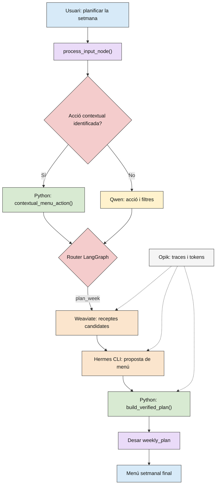

<p align="center">
  <sub>Figura 20. Flux de la planificació setmanal amb Hermes</sub>
</p>

**Flux B — Consultar els ingredients pendents i afegir-los només si l'usuari ho demana**

Aquest segon flux reutilitza el menú emmagatzemat a `weekly_plan`: **no torna a consultar Weaviate ni a executar Hermes** per respondre una pregunta sobre els ingredients.

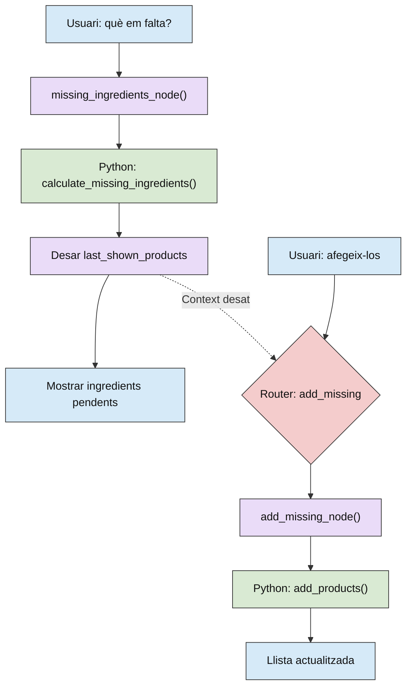

<p align="center">
  <sub>Figura 21. Flux de consulta i actualització de la llista de la compra</sub>
</p>

**Integració amb Opik**

El programa manté la integració amb Opik desenvolupada en l'exemple anterior. Les inferències amb Qwen, les consultes a Weaviate i les execucions dels nodes de LangGraph continuen registrant-se mitjançant traces.

A més, s'incorporen spans específics per a les noves funcionalitats:

- **weekly_weaviate_candidates:** recuperació de receptes candidates per al menú.
- **weaviate_near_text:** cerca semàntica a Weaviate.
- **hermes_weekly_planning:** invocació de Hermes CLI per generar la planificació.
- **calculate_missing_ingredients:** comparació dels ingredients del menú amb la llista de la compra.

Per registrar el consum de Hermes, el programa utilitza el fitxer JSON de mètriques generat mitjançant `--usage-file`. Quan aquest fitxer conté dades de consum, Python incorpora al span d'Opik els tokens d'entrada, els tokens de sortida i el total. Això permet comparar les operacions realitzades per Qwen amb la inferència de planificació executada mitjançant Hermes.

**Execució (des de l’arrel del repositori):**

```bash
python AI_Observability/code/src/10_shopping_list_weaviate_opik_hermes.py
```

**Prova suggerida, en aquest ordre:**

1. «Planifica las cenas de esta semana». Es genera o es completa un menú amb les receptes candidates.
2. «¿Qué ingredientes me faltan?». Es consulta el menú desat i es mostren els ingredients pendents.
3. «Añade estos productos». Es recupera `last_shown_products` i, si l'acció s'identifica correctament, Python actualitza la llista.

Aquestes tres peticions permeten observar la diferència entre **generar el menú**, **consultar informació** i **modificar la llista**. Si Hermes falla o no retorna una selecció aprofitable, el programa pot utilitzar la selecció de reserva de Python; això no implica que la crida a Hermes hagi funcionat correctament.
