# 8. EXAMPLES OF USE IN PYTHON PROGRAMS

This section brings together **thirteen progressive examples (from `00` to `12`)** to understand how Python, Ollama, LangChain, LangGraph, Weaviate, Opik, Hermes, OpenTelemetry integrate with Grafana and LangSmith. The goal is to see what each program does, where an LLM comes in, what Python runs, and how the components connect.

## 8.0. How to use these examples

Each example includes:

1. **Full program:** the file `.py` from [`code/src/`](../code/src/), with the amounts, configuration and logic needed to run it.
2. **Snippet:** a fragment of [`code/snippets/`](../code/snippets/) that highlights the pieces needed to understand the example: configuration → tool or node → connect to agent or graph → run. Some fragments show the complete route. Others omit auxiliary functions or part of the connections. **To run the examples, you must use the programs from `code/src/`.**
3. **Explanation and Flow:** The role of LLM and Python, a diagram of the execution flow and the execution command.

> **How to run them:** all commands `python` of this document are launched **from the root of the repository `Visual_tools_for_AI`**, with the virtual environment enabled and dependencies installed. You must have Ollama available and have downloaded the model used by each example. Programs incorporating Weaviate, Opik, Hermes, OpenTelemetry with Grafana or LangSmith also require the corresponding configuration. Python dependencies are installed with `python -m pip install -r requirements.txt`.

### Direct access to code and snippets

| Example | What do you learn?                            | Full program | Featured Snippet |
| :------------ | :----------------------------------------- | :--------------------------------------------------------------------- | :------------------------------------------------------------------------------------------------------------------------------------------------------------ |
| **8.1 · 00** | Ollama's first consultation | [Full code](../code/src/00_test_ollama.py)                          | [Snippet](../code/snippets/00_test_ollama_snippet.py)                                                                                                         |
| **8.2 · 01** | Agent with weather tool | [Full code](../code/src/01_simple_agent.py)                         | [Snippet](../code/snippets/01_simple_agent_snippet.py)                                                                                                        |
| **8.3 · 02** | Supervisor and specialized sub-agents | [Full code](../code/src/02_multi_agent.py)                          | [Snippet](../code/snippets/02_multi_agent_snippet.py)                                                                                                         |
| **8.4 · 03** | Deterministic calculations of a drone mission | [Full code](../code/src/03_my_drone_mission_agent.py)               | [Snippet](../code/snippets/03_my_drone_mission_agent_snippet.py)                                                                                              |
| **8.5 · 04** | LangGraph Flow and Routers | [Full code](../code/src/04_langgraph_drone_mission_agent.py)        | [Snippet](../code/snippets/04_langgraph_drone_mission_agent_snippet.py)                                                                                       |
| **8.6 · 05** | Evaluation and replanning of missions | [Full code](../code/src/05_langgraph_autonomous_mission_planner.py) | [Snippet](../code/snippets/05_langgraph_autonomous_mission_planner_snippet.py)                                                                                |
| **8.7 · 06** | Shopping List with LangChain Tools | [Full code](../code/src/06_shopping_list.py)                        | [Snippet](../code/snippets/06_shopping_list_snippet.py)                                                                                                       |
| **8.8 · 07** | Shopping list controlled by LangGraph | [Full code](../code/src/07_shopping_list_langgraph.py)              | [Snippet](../code/snippets/07_shopping_list_langgraph_snippet.py)                                                                                             |
| **8.9 · 08** | Semantic Search and RAG with Weaviate | [Full code](../code/src/08_shopping_list_weaviate.py)               | [Snippet](../code/snippets/08_shopping_list_weaviate_snippet.py)                                                                                              |
| **8.10 · 09** | Traces and tokens with Opik | [Full code](../code/src/09_shopping_list_weaviate_opik.py)          | [Snippet](../code/snippets/09_shopping_list_weaviate_opik_snippet.py)                                                                                         |
| **8.11 · 10** | Integration of Hermes | [Full code](../code/src/10_shopping_list_weaviate_opik_hermes.py)   | [Hermes CLI](../code/snippets/10_shopping_list_weaviate_opik_hermes_snippet.py) · [Ingredients](../code/snippets/10_calculate_missing_ingredients_snippet.py) |
| **8.12 · 11** | Observability with OpenTelemetry and Grafana | [Full code](../code/src/11_shopping_list_weaviate_opentelemetry.py)          | [Snippet](../code/snippets/11_shopping_list_weaviate_otel_snippet.py)                                                                                         |
| **8.13 · 12** | Observability with LangSmith | [Full code](../code/src/12_shopping_list_weaviate_langsmith.py)     | [Snippet](../code/snippets/12_shopping_list_weaviate_langsmith_snippet.py)                                                                                    |

---

### 8.1. First query to the LLM — `00_test_ollama.py`

**Full program:** [Open `00_test_ollama.py`](../code/src/00_test_ollama.py)  
**Snippet:** [Open `00_test_ollama_snippet.py`](../code/snippets/00_test_ollama_snippet.py)  
**What to note in the snippet:** the configuration of `ChatOllama` and the first call to `llm.invoke()`. In this case, the fragment matches the full program.

This first example allows you to verify that Python can communicate correctly with Ollama and generate responses using the Qwen model.

**How Code Works:**

```python
from langchain_ollama import ChatOllama

llm = ChatOllama(
    model="qwen3.5:9b",
    temperature=0,
)

response = llm.invoke("Explain to me what LangChain is in two sentences.")

print(response.content)
```

**LLM intervention:**

The model intervenes when Python executes `response = llm.invoke(...)`. At this point, LangChain sends the query to Ollama, which uses the configured model to generate a response.

**Python Operations:**

Python takes care of preparing the query, execute `invoke()`, receive the result and display it with `print()`. There are no tools or agents in this example. The model only generates text.

**Execution Flow:**

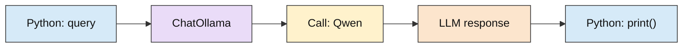

<p align="center">
  <sub>Figure 1. Execution flow of the Ollama test</sub>
</p>

**Execution (from repository root):**

```bash
python AI_Observability/code/src/00_test_ollama.py
```

If a response appears, it checks that the communication between Python, LangChain, Ollama and Qwen is working properly.

### 8.2. Agent with a tool — `01_simple_agent.py`

**Full program:** [Open `01_simple_agent.py`](../code/src/01_simple_agent.py)  
**Snippet:** [Open `01_simple_agent_snippet.py`](../code/snippets/01_simple_agent_snippet.py)  
**What to observe in the snippet:** the four stages: configure `ChatOllama`, define `get_weather()`, create the agent with `create_agent(tools=[get_weather])` and make an inquiry with `agent.invoke()`. The LLM can request the tool, but it is Python that runs it. Weather data is simulated.

This example introduces the concept of tool calling, which allows the model to request the execution of Python functions.

The agent has a tool named `get_weather()` which returns simulated weather information.

**Code Components:**

The Python function is:

```python
def get_weather(city: str) -> str:
    """Get weather for a given city."""

    print(
        f"[TOOL EXECUTED] get_weather(city={city})"
    )

    return f"It's always sunny in {city}!"
```

This function receives the name of a city and returns a dummy response.

Afterwards, the agent is created:

```python
agent = create_agent(
    model=llm,
    tools=[get_weather],
    system_prompt="You are a helpful assistant",
)
```

With `tools=[get_weather]` indicates that the agent can use this function.

**At what point does the LLM intervene?**

When called `result = agent.invoke(...)`.

LangChain sends the user question, system instructions and description of available tools to the LLM. The model interprets the question and can decide to request `get_weather()`.

For example, if the user asks _"What's the weather in San Francisco?"_, the model might ask:

`get_weather(city="San Francisco")`

**What does Python do?**

LangChain receives the request from the model and executes the Python function.

The function returns dummy text `It's always sunny in San Francisco!`. This result is fed back to the LLM, who can use it to write a final answer.

**Execution Flow:**

The LLM interprets the query, and if it needs weather information, LangChain executes `get_weather()`. Python returns the simulated data, which the model can use to generate the final response.

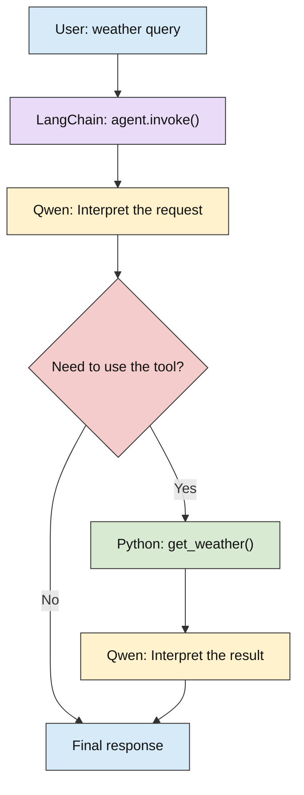

<p align="center">
  <sub>Figure 2. Execution flow of the simple agent</sub>
</p>

**Execution (from repository root):**

```bash
python AI_Observability/code/src/01_simple_agent.py
```

The [TOOL EXECUTED] trace allows you to check that the function was actually executed.

This example shows how LLM makes the decision to use a tool, while Python performs the operation.

### 8.3. Supervisor and sub-agents — `02_multi_agent.py`

**Full program:** [Open `02_multi_agent.py`](../code/src/02_multi_agent.py)  
**Snippet:** [Open `02_multi_agent_snippet.py`](../code/snippets/02_multi_agent_snippet.py)  
**What to note in the snippet:** are created `weather_agent` and `flight_agent` with different tools, `ask_flight_agent()` delegates a request to specialist, and `supervisor_agent` is created with both delegation tools. The supervisor runs with `supervisor_agent.invoke()`.

This example extends the previous one by introducing a multi-agent architecture. The program uses a **supervisor** who coordinates two specialized agents: one in meteorology and one in flight time calculations. All three use Qwen via Ollama, but have different instructions and tools. In other words, they are three agents, not three different language models.

The three agents are:

- **Supervisor Agent:** receives the user's question and decides to which specialized agent to delegate each task.
- **Weather Agent:** is responsible for answering weather questions using the function `get_weather()`.
- **Flight Agent:** Calculates a drone's flight time using the function `calculate_flight_time()`.

**Code Components:**

The model is first configured using `ChatOllama`, in the same way as in the previous example.

The specialized agents are defined below:

- **weather_agent:** has the Python function `get_weather(city)`, which returns simulated weather information for a city.
- **flight_agent:** has the function `calculate_flight_time(distance_km, speed_kmh)`, which calculates a drone's flight time based on distance and speed.

Flight time is calculated using the formula:

$$
t_{\mathrm{min}} = \frac{d_{\mathrm{km}}}{v_{\mathrm{km/h}}} \cdot 60
$$

This calculation is performed directly with Python. The LLM does not calculate the numerical result, but instead interprets the request and determines whether it needs to run the tool.

To allow the supervisor to use these agents, two intermediate functions are defined decorated with `@tool`:

```python
@tool
def ask_weather_agent(query: str) -> str:
    """Delegate weather-related questions to the weather specialist agent."""

    result = weather_agent.invoke({
        "messages": [
            {"role": "user", "content": query}
        ]
    })

    return result["messages"][-1].content
```

The function [`ask_flight_agent()`](../code/snippets/02_multi_agent_snippet.py) works the same way, but invokes `flight_agent`. This is the selected snippet from the repository.

These functions are important because the supervisor does not have direct access to `get_weather()` nor of `calculate_flight_time()`. Instead, you have access to `ask_weather_agent()` and `ask_flight_agent()`, which delegate tasks to specialized agents.

Supervisor is created:

```python
supervisor_agent = create_agent(
    model=llm,
    tools=[
        ask_weather_agent,
        ask_flight_agent,
    ],
    system_prompt=(
        "You are a supervisor agent "
        "that coordinates specialized agents."
    ),
)
```

The instruction `system_prompt` states that the supervisor must identify user tasks, delegate them to the appropriate agent, and combine the results.

**Execution Flow:**

Suppose the user enters the following request: "I want to fly a drone in Barcelona. Tell me the weather and calculate how long it would take to fly 12 km at 40 km/h."

The route is as follows:

- **User input:** Python sends the request to the running supervisor `supervisor_agent.invoke()`. This instruction starts an inference of the LLM using LangChain and Ollama.
- **Supervisor Interpretation:** Qwen analyzes the request and identifies that it contains two different tasks: query the weather and calculate the flight time. The model can generate two tool requests, one for each specialized agent.
- **Delegation to agents:** LangChain receives requests and executes Python functions `ask_weather_agent()` and `ask_flight_agent()`. These functions call the corresponding agents using `.invoke()`.
- **Execution of specialized agents:** each agent performs a new inference with Qwen. The Weather Agent can request `get_weather(city="Barcelona")`, while the Flight Agent may request `calculate_flight_time(distance_km=12, speed_kmh=40)`.
- **Execution of Python functions:** LangChain executes the requested tools. `get_weather()` returns fictitious weather information and `calculate_flight_time()` calculates a time of 18 minutes.
- **Results returned:** Python results are provided to specialized agents, which can use the LLM to generate a response. Intermediate functions return these responses to the supervisor.
- **Final Response:** The supervisor receives both responses and uses Qwen again to combine them into a single message that is displayed to the user.

It is important to note that the LLM intervenes both in the supervisor and in each of the specialized agents, while the Python functions are responsible for providing the data and performing the calculations.

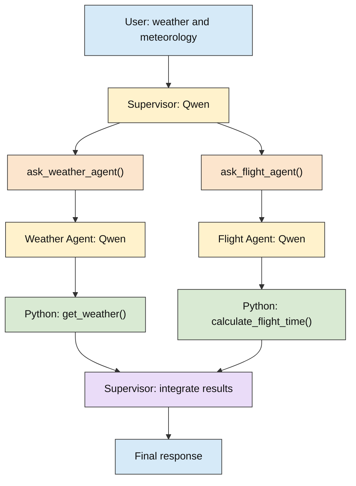

<p align="center">
  <sub>Figure 3. Multi-agent execution flow</sub>
</p>

**Execution (from repository root):**

```bash
python AI_Observability/code/src/02_multi_agent.py
```

**What to check:** Requests combining weather and flight time may result in delegation to two specialists. In addition, the numerical calculation is performed with Python. The traces of the type `[SUBAGENT CALLED]` help identify the delegation.

### 8.4. Analysis of a drone mission — `03_my_drone_mission_agent.py`

**Full program:** [Open `03_my_drone_mission_agent.py`](../code/src/03_my_drone_mission_agent.py)  
**Snippet:** [Open `03_my_drone_mission_agent_snippet.py`](../code/snippets/03_my_drone_mission_agent_snippet.py)  
**What to note in the snippet:** `check_wind_safety()` applies a Python safety rule and `analyse_mission()` calls it directly with `.invoke()`. The LLM only appears in the explanatory route of `answer_question()`, does not decide when to run checks.

This example implements an assistant capable of analyzing the feasibility of a drone mission based on different parameters, such as distance, speed, flight direction, wind, and available battery.

Unlike the previous examples, the program does not use the LLM to decide which functions to run. The main logic is programmed in Python, while the model is used to answer questions and explain the results of calculations.

**Code Components:**

The program defines a structure `MissionState` which stores the mission parameters. This structure allows the user to enter the information progressively and for the program to preserve the values ​​between different messages.

The function `update_state()` parses the text entered by the user and updates the corresponding parameters. To identify the values it uses Python regular expressions, using the library `re`. For example, if the user enters a distance of 10 km and a speed of 40 km/h, Python identifies the numbers and units based on predefined patterns. This extraction does not require an inference from the LLM.

Once the necessary information is available, the function `analyse_mission()` coordinates three tools:

- **`calculate_flight_time()`:** calculates wind components, effective drone speed and flight time.
- **[`check_wind_safety()`](../code/snippets/03_my_drone_mission_agent_snippet.py):** checks if wind conditions respect safety limits. It's the featured feature in the snippet.
- **`check_battery()`:** determines if the available battery is sufficient to complete the mission while maintaining the required reserve.

These functions are decorated with `@tool`, but they are invoked directly by the Python code, without the LLM deciding when to execute them.

For example:

```python
flight_result = calculate_flight_time.invoke({
    "distance_km": state.distance_km,
    "drone_speed_kmh": state.drone_speed_kmh,
    "wind_speed_kmh": state.wind_speed_kmh,
    "flight_bearing_deg": state.flight_bearing_deg,
    "wind_direction_from_deg": state.wind_direction_from_deg,
})
```

In this case, `.invoke()` runs a **python tool**, not the Qwen model. The distinction is important because the same method `invoke()` can be used with different LangChain components.

**Execution Flow:**

- **User Input:** The user enters a mission description into the terminal. The function `main()` receives the text and determines how it should be processed.
- **Status update:** if the message contains parameters, `update_state()` identifies them using regular expressions and saves them to `MissionState`.
- **Operation selection:** the program checks if the user has provided new data, requested an analysis, wants to see calculation steps, or asked a question.
- **Mission Analysis:** when it is appropriate to perform an analysis, Python executes `analyse_mission()`. This function checks what data is available and calls the flight, wind and battery tools when it has the necessary parameters.
- **Generating the report:** Python collects the results of the checks and builds a report. It also generates a trace with the operations carried out, which allows you to check later how the results were obtained.
- **LLM intervention:** if the user formulates an explanatory question, such as “Why is my mission not feasible?”, the program executes `answer_question()`. This function prepares a prompt with the mission status, the latest report, and the calculation trace, and calls `llm.invoke()`.
- **Final Response:** Qwen uses the information provided to generate a natural language explanation, without modifying the parameters or recalculating the security results.

Therefore, there are two main routes: a calculation route, executed entirely with Python, and an explanation route, in which the LLM intervenes.

If the user only asks to view the calculation trace, it is also not necessary to run Qwen, since this information is saved in the program.

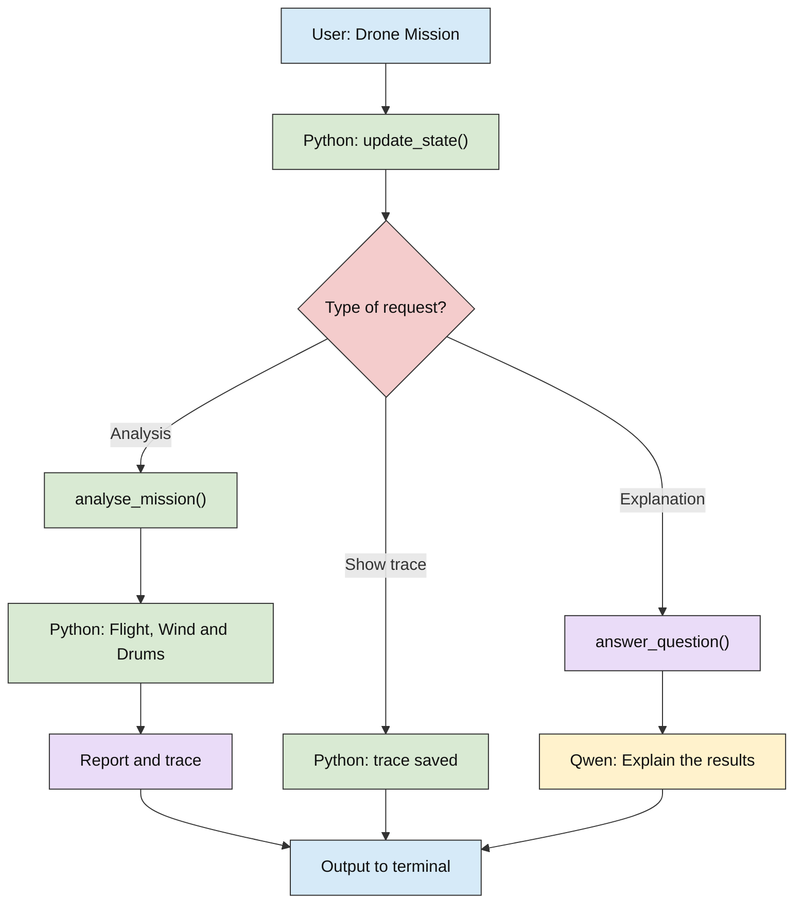

<p align="center">
  <sub>Figure 4. Execution flow of the mission agent</sub>
</p>

**Execution (from repository root):**

```bash
python AI_Observability/code/src/03_my_drone_mission_agent.py
```

### 8.5. Drone Mission with LangGraph — `04_langgraph_drone_mission_agent.py`

**Full program:** [Open `04_langgraph_drone_mission_agent.py`](../code/src/04_langgraph_drone_mission_agent.py)  
**Snippet:** [Open `04_langgraph_drone_mission_agent_snippet.py`](../code/snippets/04_langgraph_drone_mission_agent_snippet.py)  
**What to note in the snippet:** `route_after_input()` decides the next node based on the state, `StateGraph` connects nodes and transitions, `compile()` prepares the graph, and `drone_mission_graph.invoke()` runs it. The router is Python code, not an LLM.

This example implements the functionality of the previous drone wizard, but reorganizes the program using LangGraph. The main difference is that the execution flow is defined as a graph consisting of nodes and connections. Each node performs a specific operation and conditional connections determine what the next step will be.

In this way, LangGraph allows separation of interpretation logic, calculations, reporting and LLM responses.

**Code Components:**

The shared state of the graph is defined by `DroneMissionState`, which contains mission parameters, check results, and control variables needed to select operations.

To preserve information between different executions is used `InMemorySaver`, a memory mechanism that allows recovering the state associated with the same session.

The first node is `process_input_node()`. This node receives the message from the user, executes it `extract_updates()` to identify parameters and update mission status. It also determines whether the user wants to start an analysis, consult calculation steps, or ask a question.

Later, the router `route_after_input()` decides which way to go. This function queries the state values ​​and returns the name of the next node.

The main available nodes are:

- **flight_check_node():** run `calculate_flight_time()`.
- **wind_check_node():** run `check_wind_safety()`.
- **battery_check_node():** run `check_battery()`.
- **final_report_node():** prepare final report.
- **show_trace_node():** shows the calculation steps.
- **answer_question_node():** use the LLM to answer quest questions.

Compute nodes use Python functions. only `answer_question_node()` performs an inference with Qwen.

**Execution Flow:**

- **User input:** the function `main()` receives the message and starts running the graph using `drone_mission_graph.invoke()`.
- **Input processing:** LangGraph executes `process_input_node()`. Python interprets the data, updates the state, and identifies which checks to perform.
- **Route selection:** LangGraph query `route_after_input()`. This router is a Python function that selects the next node based on state conditions. It does not use the LLM.
- **Running calculation nodes:** if the mission requires an analysis, the graph goes through the corresponding flight, wind and battery nodes. Each node runs its Python tool and saves the result in the shared state.
- **Conditional transitions:** after each check, the routers `route_after_flight()` and `route_after_wind()` determine whether to run another node or jump directly to the report.
- **Report generation:** `final_report_node()` retrieves the available results and constructs the response displayed in the terminal.
- **LLM alternative route:** if the user asks a question, `route_after_input()` select `answer_question_node()`. This node prepares mission information and executes `llm.invoke()` for Qwen to generate an explanation.

The program can also reuse already calculated results. When the user modifies a parameter, `process_input_node()` identifies the fields that have changed and determines which checks should be repeated. In this way, unnecessary operations are avoided.

It is important to note that `drone_mission_graph.invoke()` does not mean to run the LLM directly. This statement starts the graph and LangGraph runs the nodes. An inference is only performed if the path reaches a node that calls Qwen.

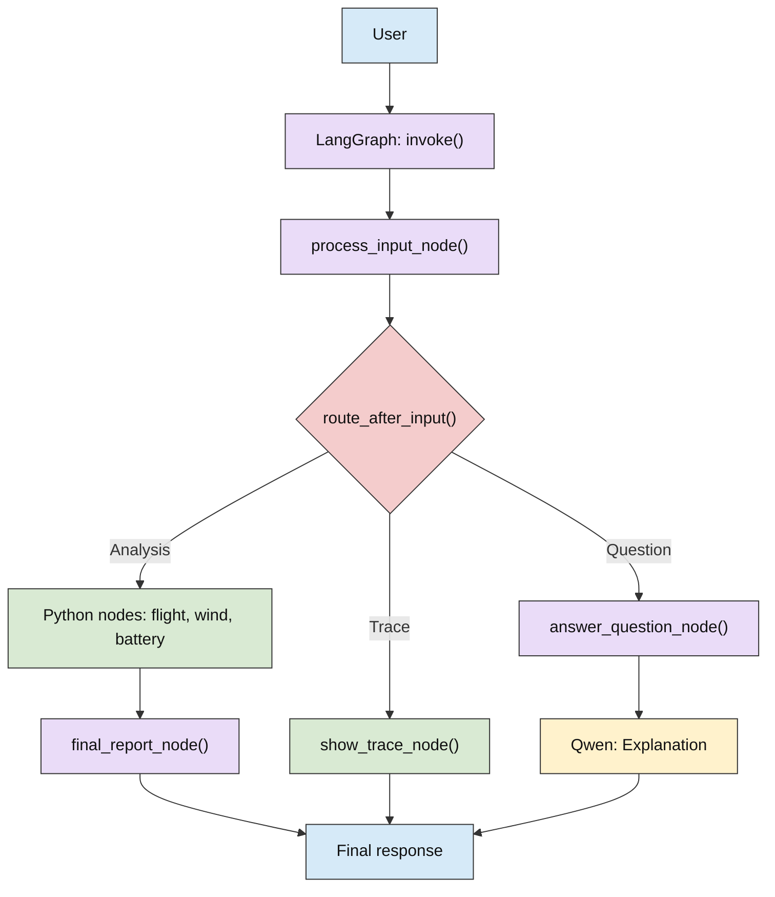

<p align="center">
  <sub>Figure 5. Execution flow with LangGraph</sub>
</p>

This example shows how LangGraph makes it easy to organize processes that have different execution paths, allowing you to preserve state and separate the responsibilities of each function.

**Execution (from repository root):**

```bash
python AI_Observability/code/src/04_langgraph_drone_mission_agent.py
```

### 8.6. Planning and Replanning — `05_langgraph_autonomous_mission_planner.py`

**Full program:** [Open `05_langgraph_autonomous_mission_planner.py`](../code/src/05_langgraph_autonomous_mission_planner.py)  
**Snippet:** [Open `05_langgraph_autonomous_mission_planner_snippet.py`](../code/snippets/05_langgraph_autonomous_mission_planner_snippet.py)  
**What to note in the snippet:** `route_after_evaluation()` choose `replan` or `report` according to the evaluation result, and `StateGraph` connect `evaluate_plan` with `replanner` or `final_report`. The snippet shows only this part of the graph, the rest of the transitions are in the full code.

This example extends the previous system by incorporating the planning, evaluation, and proposed replanning of a drone mission. The application does not limit itself to checking whether a mission is feasible, but also identifies the causes that can prevent its completion and prepares possible corrective actions.

The system is organized using LangGraph, which controls the route between the different stages of planning and validation.

**Code Components:**

The program defines a shared state, `AutonomousMissionState`, which stores mission parameters, current plan, plan version, check results, and possible replanning actions.

The graph incorporates several nodes:

- **process_input_node():** interprets user data and updates status.
- **mission_planner_node():** builds mission plan from available parameters.
- **flight_check_node(), wind_check_node() and battery_check_node():** run the corresponding checks.
- **evaluate_plan_node():** determines the overall mission status.
- **replanner_node():** proposes corrective actions if the mission is not feasible.
- **final_report_node():** generates the final report.
- **answer_question_node():** use the LLM to explain the results.

The node `evaluate_plan_node()` can classify the mission with the following statuses:

- **Feasible:** available checks indicate that the mission is feasible.
- **Not Feasible:** some condition has been detected that prevents it from being considered feasible.
- **Undetermined:** missing information or some required check.
- **Invalid:** Some invalid data or result was detected.

The selection of the replanning path is performed by a Python condition within `route_after_evaluation()`:

```python
def route_after_evaluation(
    state: AutonomousMissionState,
) -> Literal["replan", "report"]:
    if state.get("mission_status") == "NOT FEASIBLE":
        return "replan"

    return "report"
```

This means that when the status is NOT FEASIBLE, LangGraph directs execution to `replanner_node()`.

**Execution Flow:**

- **Input and Interpretation:** User enters mission parameters. Python initializes the graph and `process_input_node()` identifies and updates the data.
- **Scheduling:** the router selects `mission_planner_node()`, which builds a plan description and updates the version when appropriate. This stage uses Python functions.
- **Checks:** LangGraph runs the nodes needed to calculate flight time, evaluate wind, and check battery. The calculations are performed by the Python tools, not Qwen.
- **Rating:** `evaluate_plan_node()` retrieves results, checks conditions, and determines overall mission status.
- **Replanning Decision:** `route_after_evaluation()` query the status obtained. If the mission is NOT FEASIBLE, select `replanner_node()`. In other cases, the graph continues to the report.
- **Proposed Corrective Actions:** `replanner_node()` analyzes detected problems and prepares possible solutions using Python rules. For example, it may suggest checking wind conditions, increasing battery availability, or modifying the route. These proposals are not automatically applied and do not involve re-running the calculations indefinitely.
- **Report generation:** `final_report_node()` collects the plan, checks and possible corrective actions, and builds the final result.
- **Explanation vian LLM:** If the user subsequently asks a question about the plan or results, LangGraph executes `answer_question_node()`, which provides this information to Qwen via `llm.invoke()`.

In this example, planning and replanning are programmed processes in Python. The LLM is used to answer explanatory questions, not to calculate feasibility or determine remedial actions.

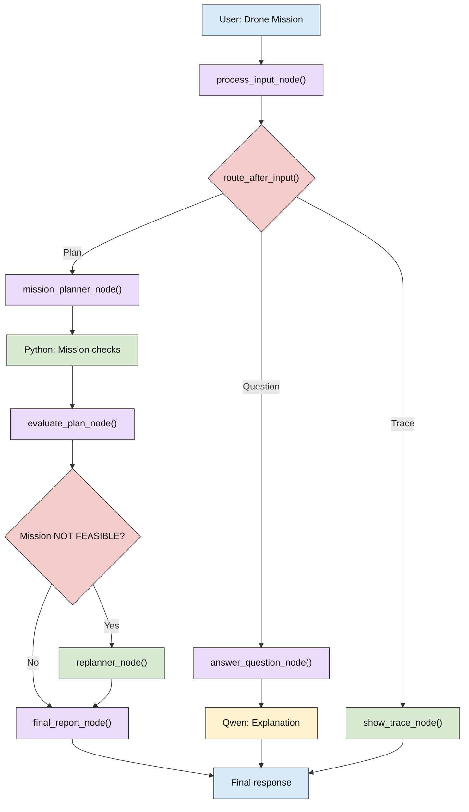

<p align="center">
  <sub>Figure 6. Execution flow of the autonomous scheduler</sub>
</p>

This example demonstrates how to build a planning process with different stages, conditions, and alternative routes using LangGraph.

**Execution (from repository root):**

```bash
python AI_Observability/code/src/05_langgraph_autonomous_mission_planner.py
```

### 8.7. Shopping List with LangChain — `06_shopping_list.py`

**Full program:** [Open `06_shopping_list.py`](../code/src/06_shopping_list.py)  
**Snippet:** [Open `06_shopping_list_snippet.py`](../code/snippets/06_shopping_list_snippet.py)  
**What to note in the snippet:** is configured `ChatOllama`, the tool is defined `add_product()`, the agent is created with the four tools in the list and run `agent.invoke()` retaining message history. The actual list is modified by Python.

This example implements a wizard to manage a shopping list using natural language. The user can add, remove, replace or query products without the need to write instructions with a specific syntax.

The program uses a LangChain agent that interprets requests with Qwen and has different Python functions to modify the list.

**Code Components:**

The shopping list is represented by a Python variable: `shopping_list = []`.

Four decorated tools are defined below `@tool`:

- **[`add_product()`](../code/snippets/06_shopping_list_snippet.py):** add a product (feature highlighted in snippet).
- **`remove_product()`:** remove a product.
- **`replace_product()`:** replace one product with another.
- **`show_list()`:** shows the current list.

These tools perform operations on the variable `shopping_list` using Python instructions, such as `append()`, `remove()` or access elements by index.

The agent is subsequently created with `create_agent()`, providing you with all four tools and one `system_prompt` that defines the behavior of the wizard.

The instructions state that product names must be translated into Spanish before calling the tools, that product details must be preserved, and that user corrections must be handled with `replace_product()`.

The program also keeps a message history. This history allows the model to have the context of previous interactions.

**Execution Flow:**

Suppose the user enters: “Add milk”

- **User input:** Python adds the message to the history and calls `agent.invoke()`.
- **LLM Interpretation:** LangChain sends Qwen the message, instructions and tool descriptions. The model interprets that the user wants to add a product, translates it into Spanish and can generate the tool request `add_product(product="leche")`.
- **Python execution:** LangChain receives the request and executes `add_product()`. The function normalizes the name, checks if the product already exists, and adds it with `shopping_list.append()`.
- **Result Return:** The function returns a confirmation message. LangChain provides this result in the LLM.
- **Final Response:** Qwen generates a response for the user and Python updates the message history.

If the user later types “but I wanted soy milk”, the model can use the previous context to interpret this as a correction. In this case, apply `replace_product()` and Python replaces the original product.

The model is the one who interprets the intent and selects the function, but the actual list is only modified when the Python tool is run.

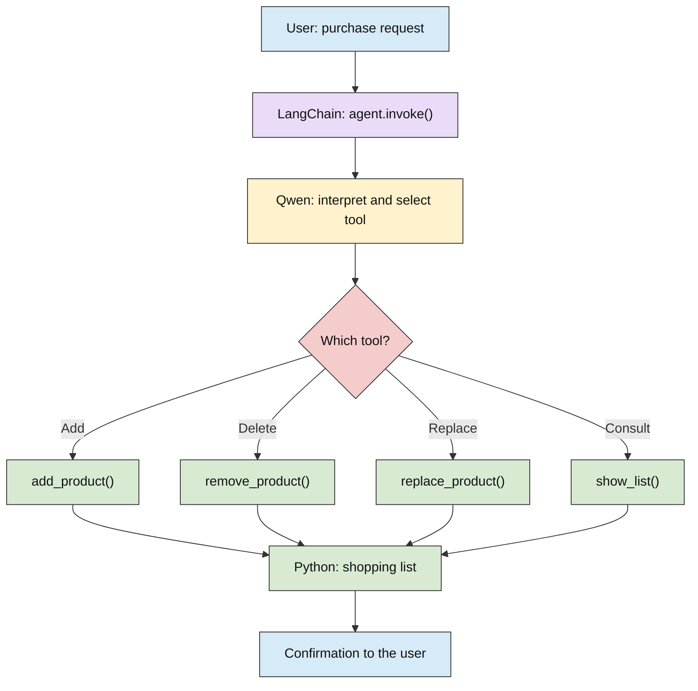

<p align="center">
  <sub>Figure 7. Shopping list manager flow</sub>
</p>

This example introduces the management of modifiable information through tool calling. It also shows the importance of keeping history to interpret user references and corrections.

**Execution (from repository root):**

```bash
python AI_Observability/code/src/06_shopping_list.py
```

### 8.8. Shopping List with LangGraph — `07_shopping_list_langgraph.py`

**Full program:** [Open `07_shopping_list_langgraph.py`](../code/src/07_shopping_list_langgraph.py)  
**Snippet:** [Open `07_shopping_list_langgraph_snippet.py`](../code/snippets/07_shopping_list_langgraph_snippet.py)  
**What to note in the snippet:** Qwen interprets the request in JSON, `route_after_input()` select path, `add_node()` runs a Python tool and `StateGraph` connects, compiles and runs the graph. It is important to differentiate LLM classification from LangGraph routing.

This example implements the same shopping list functionality, but using LangGraph to organize operations into nodes.

The main difference from the previous example is that the LLM does not directly request the management tools to run. In this case, the model interprets the request and returns a JSON structure with the action to be performed. Subsequently, a Python router selects the corresponding node.

**Code Components:**

The program defines `ShoppingState`, a structure that contains the shopping list, the user's message, the last product added and the fields needed to describe an operation. It also uses `InMemorySaver` to preserve state between different session interactions.

The first node is `process_input_node()`, which prepares a prompt with system instructions and executes:

```python
response = llm.invoke([
    ("system", system_prompt),
    ("human", state["user_input"]),
])
```

This is the call to the LLM. Qwen interprets the request and returns a JSON with the fields `action`, `products`, `old_product` and `new_product`.

For example, if the user types “add eggs and flour”, the model can return:

```json
{
  "action": "add",
  "products": ["huevos", "harina"],
  "old_product": "",
  "new_product": ""
}
```

Python interprets this result with `json.loads()`, checks that the fields are valid and saves them to the state.

Next, the function `route_after_input()` query the value of`action`:

```python
def route_after_input(state: ShoppingState) -> Literal["add", "remove", "replace", "show", "other"]:
    action = state.get("action", "other")
    print(f"[ROUTER] {action}")
    return action
```

The router can select the nodes `add`, `remove`, `replace`, `show` or `other`.

Each node executes the corresponding Python function, such as `add_products()`, `remove_products()`, `replace_product()` or `show_products()`.

**Execution Flow:**

- **User input:** the function `main()` receives the message and starts the graph with `shopping_graph.invoke()`.
- **LLM interpretation:** LangGraph runs `process_input_node()`, which calls Qwen via `llm.invoke()`. The model identifies user intent and generates a JSON response.
- **JSON processing:** Python executes `json.loads()`, validate the fields and update the shared state.
- **Node Selection:** LangGraph runs `route_after_input()`, which queries the field `action` and returns the name of the node to run. This decision is based on the JSON value and does not require further inference.
- **Executing Operation:** The selected node executes a Python function. For example, `add_node()` summons `add_products()`, which adds the products to the list.
- **Status Update:** function returns the updated list and a confirmation message. LangGraph saves the results in state and terminates execution.
- **Final response:** Python displays the response and the actual contents of the list in the terminal, without the need to re-consult the LLM.

So, in this example Qwen decides what the user wants to do, the router determines which node to run, and Python performs the operation.

This architecture is different from [`06_shopping_list.py`](../code/src/06_shopping_list.py), where the LLM used LangChain's _tool calling_ mechanism directly. Here the intent is first transformed into JSON and then LangGraph explicitly controls the path.

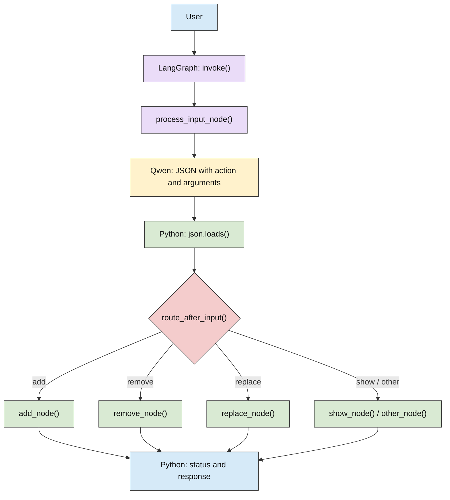

<p align="center">
  <sub>Figure 8. List execution flow with LangGraph</sub>
</p>

This example helps to understand the difference between model decision and graph routing, as well as the role of nodes and shared state.

**Execution (from repository root):**

```bash
python AI_Observability/code/src/07_shopping_list_langgraph.py
```

### 8.9. Search for recipes and RAG — `08_shopping_list_weaviate.py`

**Full program:** [Open `08_shopping_list_weaviate.py`](../code/src/08_shopping_list_weaviate.py)  
**Snippet:** [Open `08_shopping_list_weaviate_snippet.py`](../code/snippets/08_shopping_list_weaviate_snippet.py)  
**What to observe in the snippet:** the first `ChatOllama` interprets the request, `near_text()` retrieve recipes, `has_required_ingredients()` filters with Python and the second `ChatOllama` generates the RAG response from the retrieved context.

This example extends the shopping list wizard by incorporating a connection to Weaviate Cloud, a vector database that allows information to be retrieved through semantic searches.

The application continues to allow you to manage products, but incorporates the ability to search for recipes and add their ingredients to the shopping list. The information is taken from the Weaviate Recipes collection.

**Code Components:**

The program uses two objects `ChatOllama` for different purposes:

```python
llm = ChatOllama(
    model="qwen3.5:9b",
    temperature=0,
    format="json",
    reasoning=False,
)

rag_llm = ChatOllama(
    model="qwen3.5:9b",
    temperature=0,
    reasoning=False,
)
```

Both use the same model, but are configured for two different tasks. The first object (`llm`) interprets the user's requests and generates a JSON structure. The second (`rag_llm`) generates natural language explanations from the retrieved recipes.

The program incorporates the function `weaviate_connection()`, which prepares the connection to Weaviate Cloud. To consult the recipes, [`search_recipes()`](../code/snippets/08_shopping_list_weaviate_snippet.py) runs the following semantic search:

```python
result = collection.query.near_text(**kwargs)
```

This operation allows you to retrieve recipes related to the meaning of the query, even if they do not contain exactly the same words.

The program also applies additional conditions. If the user sets a maximum time, Weaviate receives an envelope filter `tiempoMin` (time in minutes). Subsequently, Python executes `has_required_ingredients()` to check that the recipes contain **all** required ingredients. Therefore, a vector search is combined with a numeric filter in Weaviate and an exact ingredient check in Python.

**Execution Flow:**

Suppose the user enters: “I want recipes with eggs and potatoes that are prepared in less than 30 minutes.”

The flow would be as follows:

- **User input:** Python receives the message and starts the LangGraph graph.
- **First LLM inference:** `process_input_node()` sends the request to Qwen, which identifies the action `search_recipe`, generates a semantic query, and extracts the filters. The JSON can contain `required_ingredients = ["huevos", "patatas"]` and `max_minutes = 30`.
- **Route selection:** Python interprets the JSON and the router selects `search_recipe_node()`.
- **Check Weaviate:** node executes `search_recipes()`. This function opens a connection to Weaviate Cloud and performs the search with `near_text()`, applying the time filter.
- **Filtering with Python:** the program examines the retrieved recipes and checks with `has_required_ingredients()` that contain all mandatory ingredients.
- **Second LLM inference:** if recipes were found, `search_recipe_node()` prepares a prompt with the original question and the retrieved data. Then execute `rag_llm.invoke()` for Qwen to generate an explanation based on these recipes.
- **Final Answer:** LangGraph saves recipes in `last_recipes` and Python displays the numbered results and generated explanation in the terminal.

This second inference is an example of Retrieval-Augmented Generation (RAG), since the model generates the answer using information retrieved from an external source.

The process also allows another interaction. If the user writes “add the ingredients of the second recipe”, the first LLM interprets the action `add_recipe` and identifies the recipe number.

In this case, `add_recipe_node()` retrieves the second recipe from `last_recipes`, extract the ingredients from `ingredientesClave` and run `add_products()` to update the list. There is no need to repeat the search in Weaviate or run the second LLM to generate a new explanation.

So the first LLM interprets the instructions, Weaviate provides the data, Python applies the filters and modifies the list, and the second LLM explains the retrieved recipes.

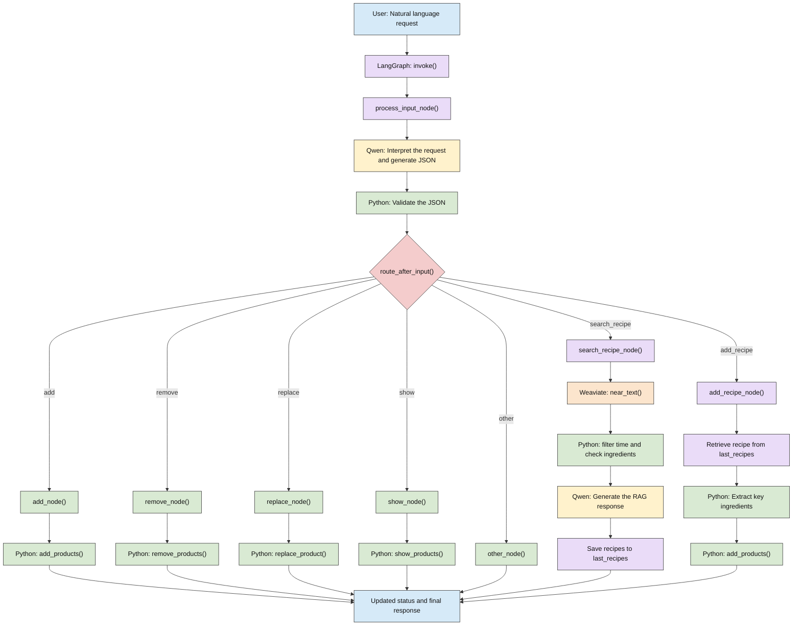

<p align="center">
  <sub>Figure 9. Execution flow with Weaviate</sub>
</p>

This example shows how to integrate a vector database with an LLM-based assistant to answer queries using information external to the model.

**Execution (from repository root):**

```bash
python AI_Observability/code/src/08_shopping_list_weaviate.py
```

### 8.10. Observability with Opik — `09_shopping_list_weaviate_opik.py`

**Full program:** [Open `09_shopping_list_weaviate_opik.py`](../code/src/09_shopping_list_weaviate_opik.py)  
**Snippet:** [Open `09_shopping_list_weaviate_opik_snippet.py`](../code/snippets/09_shopping_list_weaviate_opik_snippet.py)  
**What to note in the snippet:** `invoke_with_opik_usage()` contains the call to the LLM and registers tokens, `weaviate_near_text()` logs semantic queries and `track_langgraph()` connects the graph with `OpikTracer`.

This example embeds Opik in the shopping list wizard with Weaviate. The goal is to add observability, meaning the ability to record and analyze the various operations that occur during an execution.

The main operation of the wizard remains as in the previous example, but it is now possible to observe calls to the LLM, queries to Weaviate, execution times and available consumption metrics.

**Code Components:**

The program incorporates `OpikTracer` and `track_langgraph()`, which allow the LangGraph graph to be instrumented.

It also defines a function to record the consumption of the model:

```python
@track(
    name="ollama_tokens",
    type="llm",
    capture_input=False,
    capture_output=False
)
def invoke_with_opik_usage(
    model,
    messages,
    etapa: str
):
    answer = model.invoke(messages)
    usage = answer.usage_metadata or {}
    if usage:
        opik_context.update_current_span(
            model=MODEL,
            provider="ollama",
            metadata={"etapa": etapa},
            usage={
                "prompt_tokens":
                    usage.get("input_tokens", 0),
                "completion_tokens":
                    usage.get("output_tokens", 0),
                "total_tokens":
                    usage.get("total_tokens", 0),
            },
        )

    return answer
```

Thus, if we click a trace on the dashboard we will see the following:

<p align="center">
  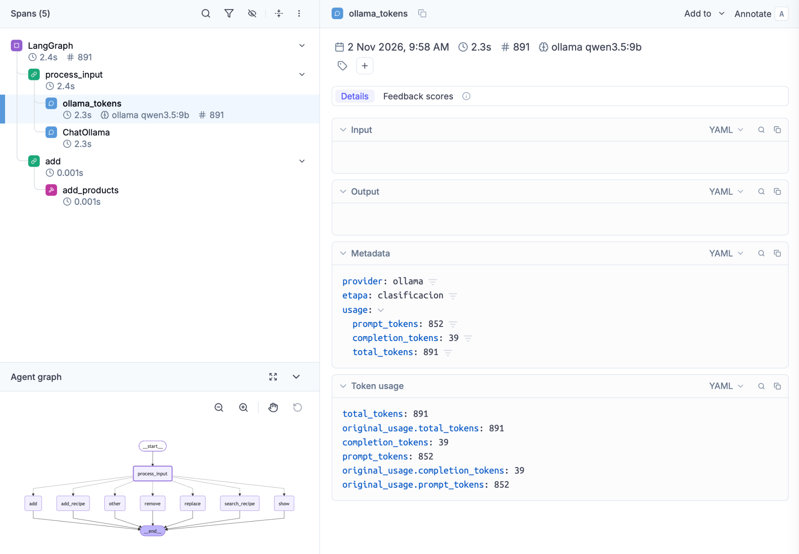
</p>

<p align="center">
  <sub>Figure 10. Token consumption</sub>
</p>

This function runs the model and retrieves the consumption metadata provided by Ollama. Tokens can be differentiated between those used to process input and those generated on output.

Function is also used `weaviate_near_text()` to register semantic queries in the database.

The integration with LangGraph is done through:

```python
shopping_graph = track_langgraph(
    shopping_graph,
    opik_tracer
)
```

This allows you to associate graph executions with traces recorded in Opik.

**Execution Flow:**

- **User input:** Python receives the request and starts the LangGraph instrumented with Opik.
- **Interpretation of the LLM:** `process_input_node()` runs Qwen through `invoke_with_opik_usage()`. The model generates the JSON with the corresponding action, while Opik records the metadata of the invocation.
- **Node Selection:** LangGraph uses the router to determine the required operation. Opik allows you to observe the path of the graph and the instrumented components.
- **Execution of tools:** If the user requests recipes, Python executes the query in Weaviate. `weaviate_near_text()` allows logging of this operation and its execution time.
- **RAG Generation:** when there are recipes retrieved, the program executes the second LLM via `invoke_with_opik_usage()`, indicating stage generacion_rag.
- **Final Answer:** Python displays the generated recipes and explanation. At the same time, Opik has the traces that allow the analysis of registered operations.
- **End:** when the program closes, `opik_tracer.flush()` sends the pending traces to Opik and the code attempts to close Ollama's HTTP connections.

The main difference is that Opik does not intervene in the interpretation of the question or the selection of the tools. Its role is to observe and record the operation of the application.

From the traces it is possible to study, for example, whether the total time of a query comes mainly from the first inference of Qwen, the search in Weaviate or the generation of the RAG response. Token metrics are recorded when Ollama provides the corresponding metadata.

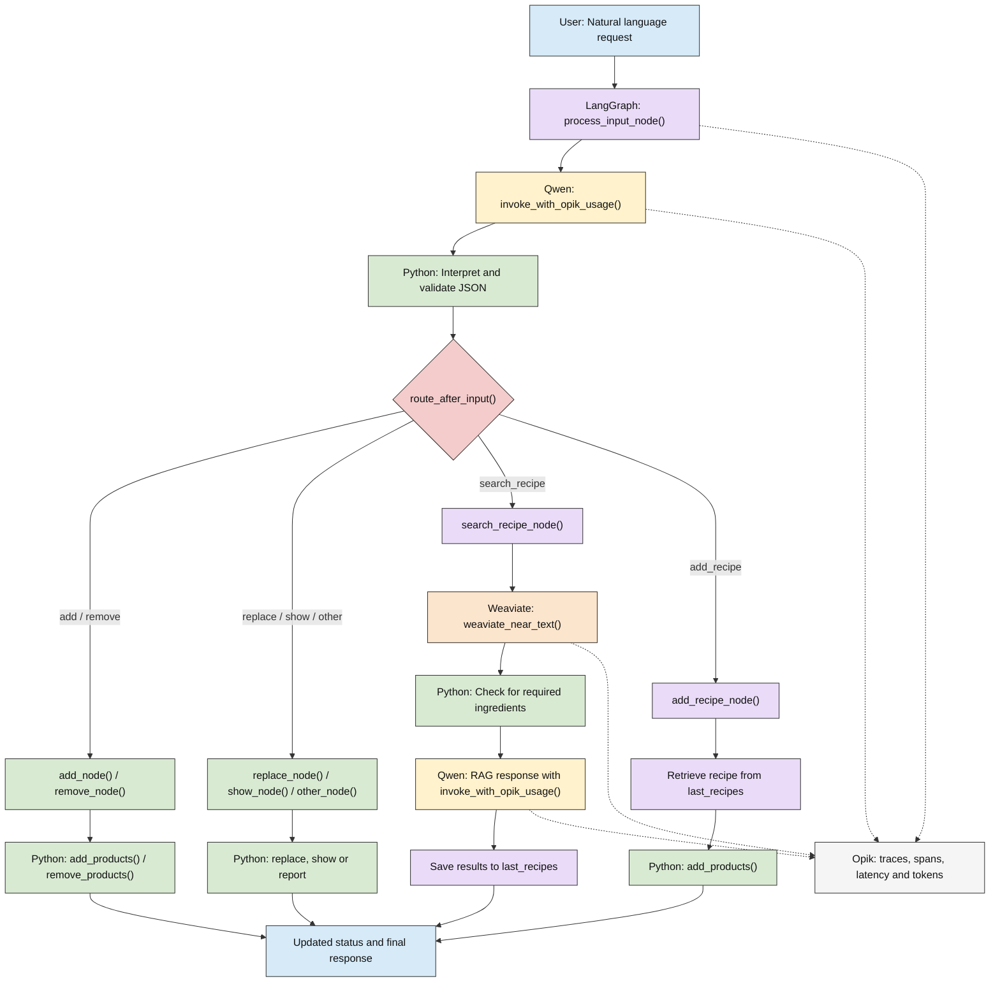

<p align="center">
  <sub>Figure 11. Execution flow with Opik</sub>
</p>

**Execution (from repository root):**

```bash
python AI_Observability/code/src/09_shopping_list_weaviate_opik.py
```

### 8.11. Hermes integration — `10_shopping_list_weaviate_opik_hermes.py`

**Full program:** [Open `10_shopping_list_weaviate_opik_hermes.py`](../code/src/10_shopping_list_weaviate_opik_hermes.py)  
**Featured Snippets (two different snippets):**

- [`10_shopping_list_weaviate_opik_hermes_snippet.py`](../code/snippets/10_shopping_list_weaviate_opik_hermes_snippet.py): Preparing candidates, running Hermes CLI and registering with Opik.
- [`10_calculate_missing_ingredients_snippet.py`](../code/snippets/10_calculate_missing_ingredients_snippet.py): Comparison of menu ingredients with shopping list, without LLM intervention.

**What to note:** the first snippet shows how `plan_week_node()` retrieves recipes, invokes Hermes CLI and validates the proposal with Python. The second explains how pending ingredients are calculated, stored in `last_shown_products` and are added only when requested by the user.

This example extends the previously developed shopping list assistant by incorporating Hermes, an artificial intelligence assistant that is used to generate a weekly meal plan from real recipes stored in Weaviate.

The app maintains the functionality of the previous examples, such as managing the shopping list, searching for recipes in Weaviate, and logging runs with Opik. The main innovation is that it now also allows you to plan lunches and dinners for the week, identify the necessary ingredients and add to the shopping list the products that do not yet appear.

This example combines different components with specific responsibilities. Qwen interprets the user's requests, LangGraph organizes the execution flow, Weaviate provides the recipes, Hermes proposes the distribution of the weekly menu, and Python is responsible for validating the results and managing the shopping list. In addition, Python checks are built in to interpret certain contextual requests without the need to always consult the LLM.

**Code Components:**

**1. Ollama and Hermes settings**

The program continues to use two objects `ChatOllama`, as in the previous example (llm and rag_llm). The first LLM interprets the user's requests and determines the action to be performed. The second is used to generate the explanations of the recipes retrieved using RAG.

Hermes, on the other hand, integrates in a different way. It is not called via `ChatOllama`, but runs as an external process through its command line interface (CLI). This means that the model used internally by Hermes depends on its own configuration and does not necessarily match the Qwen model configured in Ollama.

The main parameters are:

```python
COLLECTION = "Recetas"

MODEL = os.getenv(
    "OLLAMA_MODEL",
    "qwen3.5:9b"
)

THREAD_ID = "shopping-session-hermes"

HERMES_TIMEOUT = int(
    os.getenv("HERMES_TIMEOUT", "240")
)

DAYS = (
    "lunes", "martes", "miércoles",
    "jueves", "viernes", "sábado", "domingo"
)

MEALS = ("comida", "cena")
```

`HERMES_TIMEOUT` sets the maximum time the program waits for a response from the Hermes process. By default, this limit is 240 seconds. A different session ID than the one used in the previous example is also defined, to avoid mixing the states of the two applications.

**2. Extension of `ShoppingState`**

LangGraph shared state is extended with new fields:

```python
class ShoppingState(TypedDict, total=False):
    user_input: str
    shopping_list: list[str]
    last_product: str
    last_recipes: list[dict]

    action: str
    products: list[str]

    search_query: str
    required_ingredients: list[str]
    max_minutes: int

    meal_type: str
    weekly_plan: dict
    last_shown_products: list[str]
    last_context: str

    response: str
```

The new variables are:

- **meal_type:** indicates whether to plan only lunches (lunch), dinners (dinner) or both.
- **weekly_plan:** stores the generated weekly menu.
- **max_minutes:** allows you to restrict planning to recipes that meet a maximum preparation time.
- **last_shown_products:** save the pending ingredients that were shown to the user.
- **last_context:** identifies the last conversation context, such as the weekly menu, pending ingredients, recipes, or shopping list.

These last two variables allow better management of references to previous messages. For example, if the program displays the missing ingredients to prepare the menu and later the user writes “add these products”, Python can retrieve exactly the displayed ingredients without having to re-identify them through the LLM.

The program continues to use `InMemorySaver` to preserve state between interactions in the same session.

**3. New LangGraph nodes**

Three main actions are incorporated:

- **plan_week_node():** generate the weekly menu using Weaviate and Hermes.
- **missing_ingredients_node():** identifies menu ingredients that are not yet listed in the shopping list.
- **add_missing_node():** adds pending ingredients when explicitly requested by the user.

These actions are in addition to those that already existed for managing products and searching for recipes. Therefore, LangGraph continues to use the same mechanism of `process_input_node()` and `route_after_input()`, but now has these three new routes.

**4. Recipe retrieval with Weaviate**

Before generating the menu, the program needs to obtain the recipes that Hermes can select. To do this, the function is used:

```python
@track(
    name="weekly_weaviate_candidates",
    type="tool",
    capture_input=False,
    capture_output=False
)
def retrieve_week_candidates(
    query: str,
    max_minutes: int = 0,
    user_input: str = ""
) -> list[dict]:
    ...  # Complete implementation in source code file.
```

This function connects to the Weaviate Recipes collection and performs a semantic search (using `near_text()`).

Unlike `search_recipes()`, which returns a maximum of five recipes, this function also uses fetch_objects(limit=100) to retrieve other recipes in the collection that might not appear in the first results of the semantic search. Python then combines the results and prepares up to 45 valid candidate recipes. This allows for more options to build a weekly menu of up to 14 dishes (seven lunches and seven dinners).

Afterwards, Python applies different checks (using `eligible_week_recipe()`):
Discard recipes that do not have structured ingredients a `ingredientesClave`.
Check that they meet the maximum time indicated.
Remove duplicate recipes.
Assign identifiers such as R01, R02, R03, etc.

For example, if the user requests "plan dinners under 20 minutes", Python identifies that the condition is strictly less than 20 minutes and sets `max_minutes=19`. In this way, validation does not depend solely on the interpretation of the LLM.

**5. Weekly planning with Hermes**

The main function responsible for communicating with Hermes is:

```python
@track(
    name="hermes_weekly_planning",
    type="llm",
    capture_input=False,
    capture_output=False
)
def ask_hermes_for_week(
    user_input: str,
    candidates: list[dict],
    meal_type: str
) -> dict:
    ...  # Complete implementation in source code file.
```

This function receives the original request from the user, the candidate recipes retrieved from Weaviate, and the type of meals to be planned.

A simplified version of the recipes is prepared first. This information is incorporated into the prompt that will be provided to Hermes. The prompt tells you to generate a seven-day menu, using only the references from the provided recipes and not inventing dishes. Hermes should preferably return seven lines of text, one for each day.

For example, a possible answer for planning only dinners would be:

```text
lunes: cena=R03
martes: cena=R01
miércoles: cena=R07
jueves: cena=R04
viernes: cena=R02
sábado: cena=R06
domingo: cena=R05
```

IDs are references to recipes previously retrieved from Weaviate. The prompt also tells Hermes to prioritize the right categories for each meal and try to vary the dishes without repeating them unnecessarily.

To run Hermes, Python uses `subprocess.run()`. The following call is taken from [`ask_hermes_for_week()`](../code/snippets/10_shopping_list_weaviate_opik_hermes_snippet.py):

```python
result = subprocess.run(
    [
        "hermes", "-z", prompt,
        "--toolsets", "search",
        "--usage-file", str(usage_path),
    ],
    capture_output=True,
    text=True,
    timeout=HERMES_TIMEOUT,
    check=False,
    env=env,
)
```

The call runs Hermes in non-interactive mode with `-z`, provide the prompt and retrieve the generated response. The parameter `--usage-file` allows saving token consumption information when provided by Hermes.

The program limits the tools enabled in the set `search`, excluding terminal, file, and MCP toolkits. However, search tools may still be available, and non-interactive mode may automatically approve enabled tools. For this reason it is also indicated at the prompt not to run tools.

**6. Menu Validation with Python**

Once Hermes returns the schedule, the program executes:

```python
plan, completed = build_verified_plan(
    raw,
    candidates,
    meal_type,
    minute_limit,
    state["user_input"]
)
```

This function is important because the program does not directly accept any recipe proposed by Hermes. Python checks that the references returned correspond to actual recipes retrieved from Weaviate and that they meet the filters set. It also checks that recipes are suitable as main courses, meet dietary and time restrictions, and are not unnecessarily repeated when other options are available.

If Hermes returns an incorrect reference, skips a day, or does not provide a valid selection, Python can complete the menu positions using candidate recipes that have been validated. In this way, the system avoids incorporating non-existent dishes or recipes that do not meet the time limit.

The program can generate an alternate menu even if Hermes fails. If the Hermes invocation fails, times out, or does not provide a usable response, Python can build the scheduler directly using valid Weaviate recipes. In this case, the program displays a warning indicating that the menu has been automatically selected or corrected by Python. However, if there are no candidate recipes that meet the user's requirements, a valid menu cannot be built and the program reports this situation.

This separation makes it possible to differentiate two responsibilities. It can be clearly seen that Hermes proposes the planning, but Python verifies and constructs the final result.

**7. Checking menu ingredients**

Once the weekly menu is generated, the program can identify which ingredients are needed to prepare it.

This operation is performed with:

```python
@track(
    name="calculate_missing_ingredients",
    type="tool",
    capture_input=False,
    capture_output=False
)
def calculate_missing_ingredients(
    plan: dict,
    shopping_list: list[str]
) -> dict:
    ...  # Complete implementation in source code file.
```

The function loops through the recipes assigned to the different days of the week, extracts its own `ingredientesClave` and remove duplicates. Subsequently, compare these ingredients with the products that already appear in `shopping_list`. For example, if the menu calls for eggs, milk, rice, and potatoes, but the shopping list already contains milk and eggs, Python identifies rice and potatoes as pending items.

It is important to note that this check does not determine what food the user actually has at home. It only compares the menu ingredients with the products that are already on the shopping list. It also doesn't calculate the total amounts needed, as it works with the main ingredients of each recipe.

The node `missing_ingredients_node()` allows you to consult these products without modifying the list. It also saves the states so that when the user later asks "add these products", the program can retrieve exactly the ingredients it just displayed. Instead, `add_missing_node()` just run `add_products()` when the user explicitly asks to add them. Thus, checking the pending ingredients does not automatically cause any modification of the list.

**Execution Flow:**

Suppose the user enters: "Plan this week's meals and dinners, with recipes of less than 30 minutes."

The process is as follows:

- **User input:** Python receives the message and starts the graph with `shopping_graph.invoke()`.
- **Interpretation of the request:** `process_input_node()` first checks if a contextual action exists identifiable with `contextual_menu_action()`. If not, send the request to Qwen via `invoke_with_opik_usage()`. The model identifies the action plan_week, the meal type (both), the recipe query, and the maximum time.
- **Route selection:** `route_after_input()` query the value `action` and select `plan_week_node()`. This operation is a programmed decision in Python.
- **Retrieving Recipes:** `plan_week_node()` runs `retrieve_week_candidates()`, which queries Weaviate and prepares up to 45 candidate recipes, checking category, diet and time filters, and assigning their references.
- **Invocation of Hermes:** Python executes `ask_hermes_for_week()`. This function builds the prompt with the available recipes and starts Hermes CLI using subprocess.run().
- **Menu generation and interpretation:** Hermes processes the instructions and returns a planning proposal, preferably in seven lines of text. subsequently, `parse_hermes_selection()` interprets the response and transforms it into a structure that Python can use.
- **Validation with Python:** `build_verified_plan()` checks that all selections correspond to real and valid recipes. If positions are missing or there are incorrect selections, complete or correct them with verified recipes. If Hermes fails, he can also build an alternate menu.
- **Ingredient Check:** `calculate_missing_ingredients()` goes through the menu and compares the necessary ingredients with the products present on the shopping list.
- **Report generation:** `format_week()` prepares the weekly menu. Python also includes a summary of the number of different ingredients and those not yet listed.
- **Final Answer:** LangGraph saves the menu to `weekly_plan`, it updates the conversation context and Python displays the result in the terminal.

If the user subsequently asks “What products do I need to prepare the menu?”, Qwen interprets the action missing_ingredients and LangGraph selects the corresponding node, which calculates the pending ingredients and stores them in `last_shown_products`. In this second request there is no need to run Hermes or query Weaviate again, because the menu is already stored in the state.

Finally, if the user types “Add the missing ingredients to my list,” LangGraph executes `add_missing_node()`, which uses the Python function `add_products()`.

**General Flow**

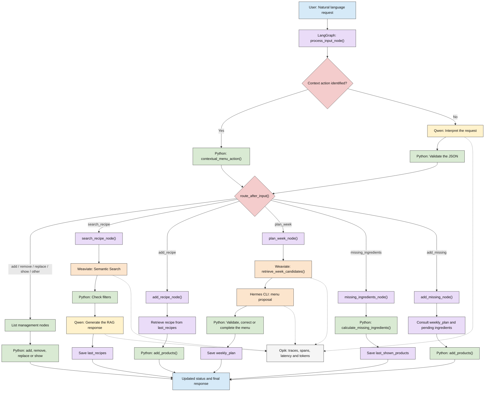

<p align="center">
  <sub>Figure 12. Flow with Hermes integration</sub>
</p>

If we look only at the specific case of generating weekly menus:

**Flow A — Weekly menu generation and validation**

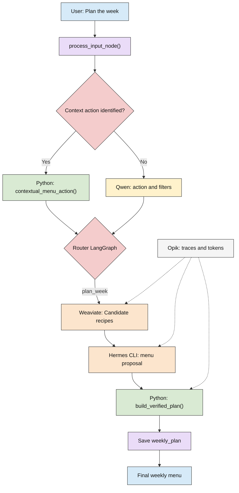

<p align="center">
  <sub>Figure 13. Weekly planning flow with Hermes</sub>
</p>

**Flow B — Check for pending ingredients and add them only if requested by the user**

This second flow reuses the menu stored in `weekly_plan`: **does not query Weaviate or run Hermes again** to answer a question about ingredients.

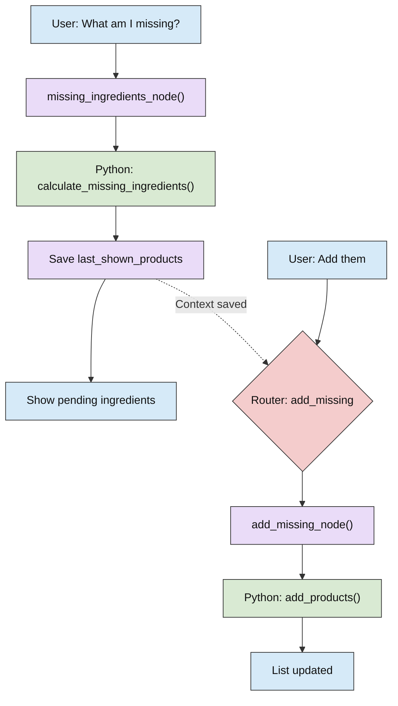

<p align="center">
  <sub>Figure 14. Query flow and update of the shopping list</sub>
</p>

**Integration with Opik**

The program maintains the integration with Opik developed in the previous example. Inferences with Qwen, queries to Weaviate, and executions of LangGraph nodes continue to be logged via traces.

In addition, specific spans are incorporated for the new functionalities:

- **weekly_weaviate_candidates:** retrieval of candidate recipes for the menu.
- **weaviate_near_text:** Semantic search in Weaviate.
- **hermes_weekly_planning:** Hermes CLI invocation to generate schedule.
- **calculate_missing_ingredients:** comparison of menu ingredients with shopping list.

To record Hermes consumption, the program uses the metrics JSON file generated by `--usage-file`. When this file contains consumption data, Python adds the input tokens, output tokens, and total to the Opik span. This allows the operations performed by Qwen to be compared with the planning inference executed using Hermes.

**Execution (from repository root):**

```bash
python AI_Observability/code/src/10_shopping_list_weaviate_opik_hermes.py
```

**Test in this order:**

1. "Plan this week's dinners". A menu is generated or completed with the candidate recipes.
2. "What ingredients am I missing?". The saved menu is consulted and the pending ingredients are displayed.
3. "Add these products". He recovers `last_shown_products` , and if the action is successfully identified, Python updates the list.

These three requests allow you to observe the difference between generating the menu, consulting information and modifying the list. If Hermes fails or does not return a usable selection, the program can use Python's fallback selection. This does not imply that the call to Hermes has worked properly.

### 8.12. Observability of the RAG with OpenTelemetry and Grafana — `11_shopping_list_weaviate_opentelemetry.py`

**Full program:** [Open `11_shopping_list_weaviate_opentelemetry.py`](../code/src/11_shopping_list_weaviate_opentelemetry.py)  
**Snippet:** [Open `11_shopping_list_weaviate_otel_snippet.py`](../code/snippets/11_shopping_list_weaviate_otel_snippet.py)  
**Reference Documentation:**

- [Sections 6.6–6.7 — OpenTelemetry, traces, spans and RAG attributes](./06_observalility.md#66-opentelemetry).
- [Section 6.8 — Installing Docker, Configuring OpenTelemetry, and Running on macOS, Linux, and Windows](./06_observalility.md#68-local-installation-and-connection-with-grafana).
- [Section 6.9 — Creation of the dashboard `RAG recetas`, trace table, Node Graph and token metrics](./06_observalility.md#69-creation-and-configuration-of-the-grafana-dashboard).

**What to observe in the snippet:** the initialization of the `TracerProvider`, creating spans for nodes, logging token consumption and exporting traces to Grafana via OTLP/HTTP. The snippet is self-explanatory, the full program is used to run the case study.

This example starts from the recipe assistant in section 8.9. It continues to use LangGraph, the Qwen model run with Ollama, and the collection `Recetas` by Weaviate Cloud. The main change is that instead of logging the run with Opik, it uses OpenTelemetry and sends the traces to Tempo, which can be analyzed from within Grafana.

**Code Components:**

The initial configuration creates a trace provider associated with a service name. `BatchSpanProcessor` bundles and sends the spans to the Grafana container's OTLP/HTTP receiver:

```python
otel_provider = TracerProvider(
    resource=Resource.create({
        "service.name": os.getenv("OTEL_SERVICE_NAME", "shopping-rag-weaviate-otel"),
        "service.version": "1.0.0",
    }),
    sampler=ParentBased(ALWAYS_ON),
)

otel_provider.add_span_processor(
    BatchSpanProcessor(
        OTLPSpanExporter(
            endpoint=os.getenv(
                "OTEL_EXPORTER_OTLP_TRACES_ENDPOINT",
                "http://localhost:4318/v1/traces",
            ),
        )
    )
)

trace.set_tracer_provider(otel_provider)
tracer = trace.get_tracer("shopping-rag-weaviate-otel")
```

The alternative `OTEL_CONSOLE_ONLY=1` is for inspecting spans by terminal without Docker. that appears on the dashboard, we use `OTEL_CONSOLE_ONLY=0`\*\* and send the traces to Tempo.

**LangGraph Nodes:**

The decorator `observed_node()` wraps each node's Python function with a span `langgraph.node.<nom>`. The program propagates value `traceparent` through the LangGraph state so that all these spans can be related to the same run.

```python
with tracer.start_as_current_span(
    f"langgraph.node.{name}", context=parent_context
) as span:
    span.set_attribute("langgraph.node.name", name)
    result = fn(state)
    if name == "process_input":
        span.set_attribute("langgraph.route", str(result.get("action", "other")))
```

The attribute `langgraph.route` lets you know what action the router has classified, while spans indicate which nodes and tools have been run. For example, a request to add ingredients from an already consulted recipe can go through `add_recipe` and `tool.add_products` not executed `weaviate_near_text` again.

**Token logging with Ollama:**

The function `invoke_with_otel_usage()` surrounds with a span the two possible calls to the model: the classification of the request (`ollama.clasificacion`) and the generation of the RAG response (`ollama.generacion_rag`). after `model.invoke()`, read the counters of `usage_metadata` or, if they are not there, those of `response_metadata`.

```python
answer = model.invoke(messages)
usage = getattr(answer, "usage_metadata", None) or {}
metadata = getattr(answer, "response_metadata", None) or {}

input_tokens = usage.get("input_tokens")
output_tokens = usage.get("output_tokens")
if input_tokens is None:
    input_tokens = metadata.get("prompt_eval_count")
if output_tokens is None:
    output_tokens = metadata.get("eval_count")

if input_tokens is not None:
    span.set_attribute("gen_ai.usage.input_tokens", int(input_tokens))
if output_tokens is not None:
    span.set_attribute("gen_ai.usage.output_tokens", int(output_tokens))
```

When the total is known, the attributes are also saved `gen_ai.usage.total_tokens` and `rag.tokens.total`. The latter is used in a TraceQL query of the dashboard. To facilitate debugging, the program continues to print the summary:

```text
[OTEL] Tokens clasificacion: {'input_tokens': ..., 'output_tokens': ..., 'total_tokens': ...}
```

Ellipses represent values that change at each inference.

**Weaviate:**

The function `weaviate_near_text()` opens a span with that name around `collection.query.near_text(...)`, records the collection and the number of candidates recovered, and allows to differentiate the time consumed by the vector search from that consumed by Ollama.

**Execution Flow:**

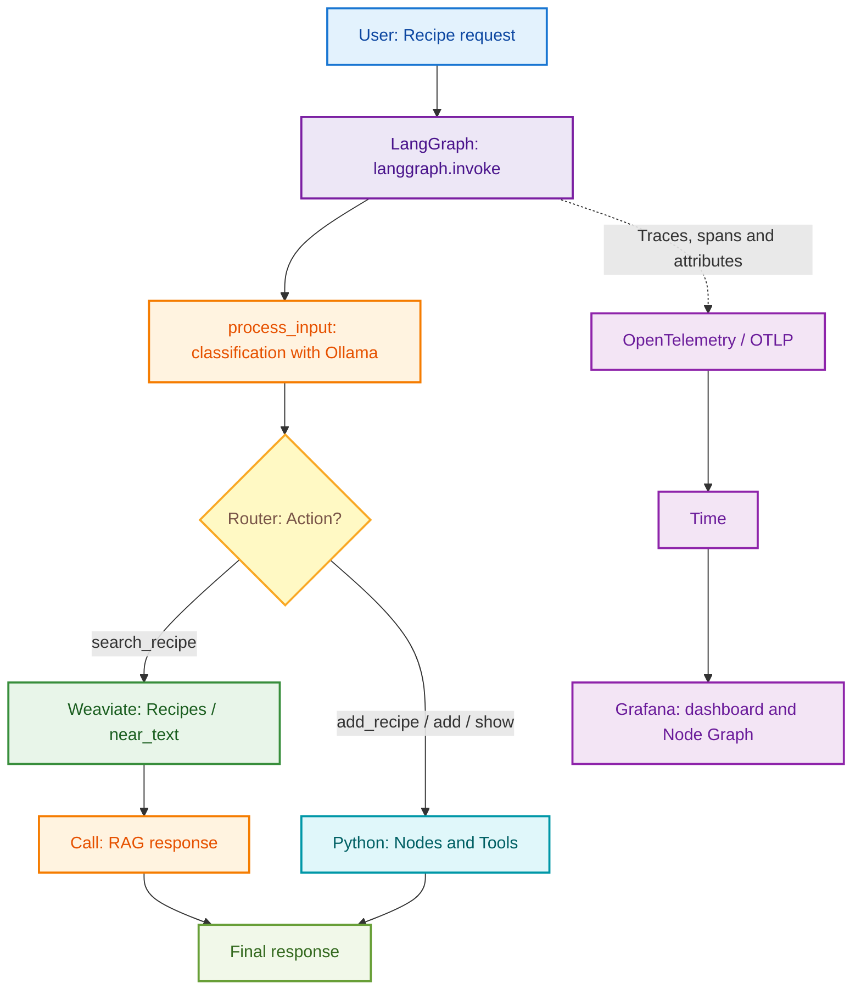

<p align="center"><sub>Figure 15. The same RAG application instrumented with OpenTelemetry. The dashed arrows represent the observability data flow.</sub></p>

**Configuring and running the example (from the repository root):**

Before running the program, you must follow [section 6.8 of `06_observalility.md`](./06_observalility.md#68-local-installation-and-connection-with-grafana). It details, **step-by-step and for macOS/Linux and Windows**, how to check Docker, build or resume the container `grafana-lgtm` without deleting it, prepare the virtual environment, configure Ollama and Weaviate using `.env` and define the OpenTelemetry variables. **No need to repeat `docker run` if the container already exists.**

After this configuration is complete, access to the collection is checked `Recetas` and then the wizard runs. If the check `--check` fails, it needs to be fixed before running the second command.

**macOS/Linux (Bash/Zsh):**

```bash
python AI_Observability/code/src/11_shopping_list_weaviate_opentelemetry.py --check
python AI_Observability/code/src/11_shopping_list_weaviate_opentelemetry.py
```

**Windows (PowerShell):**

```powershell
python .\AI_Observability\code\src\11_shopping_list_weaviate_opentelemetry.py --check
python .\AI_Observability\code\src\11_shopping_list_weaviate_opentelemetry.py
```

The setting of `OTEL_CONSOLE_ONLY=0` and of the endpoint `http://localhost:4318/v1/traces` is in **step 5 of section 6.8**. The syntax should not be copied `export` macOS/Linux in PowerShell: The manual includes the correct commands for each system.

**Test in this order:**

1. "Recommend recipes with eggs and potatoes in less than 30 minutes". Check the RAG search path, `weaviate_near_text` and text generation with Ollama.
2. «Add the ingredients of the second recipe». Check the route `add_recipe`, the tool `add_products()` and state reuse `last_recipes`.
3. «Show me the list». Check the route `show`, without the need to make a new vector query.
4. Write `exit` to close the program. OpenTelemetry flushes pending spans before terminating.

**Results in Grafana:**

From `http://localhost:3000` can be entered in **Explore → Tempo** and search:

```traceql
{ resource.service.name = "shopping-rag-weaviate-otel" }
```

The dashboard **`RAG recetas`** organizes information into four areas. The **steps to create all the panels, the TraceQL queries, the selector `TraceId` and the links from the table to the graph** are explained in [section 6.9](./06_observalility.md#69-creation-and-configuration-of-the-grafana-dashboard). Here's what each result allows you to observe:

**1. Overall performance.** Number of executions, average duration, Ollama time and semantic search time.

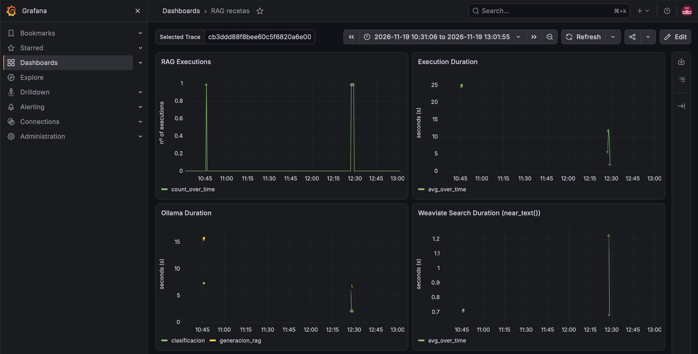

<p align="center"><sub>Figure 16. Performance of the assistant in Grafana.</sub></p>

**2. Table of traces and graph of a run.** The table shows the identifiers, times and durations. By selecting a trace, the graph of executed spans can be inspected.

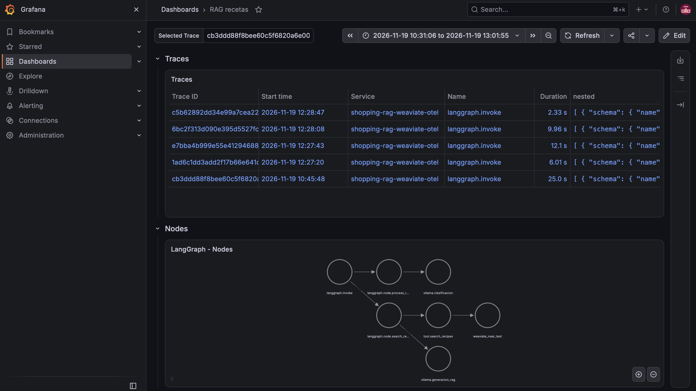

<p align="center"><sub>Figure 17. Table of requests and Node Graph of the process.</sub></p>

**3. Token consumption.** The panels `Input Tokens`, `Output Tokens` and `Total Tokens` show the accumulated consumption of the selected period, obtained from the attributes of the Ollama spans with `sum_over_time()`.

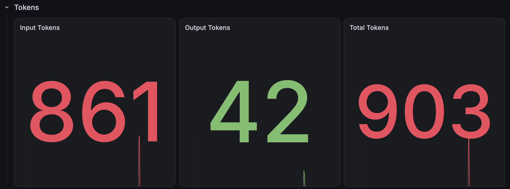

<p align="center"><sub>Figure 18. Entry, exit and total time range tokens.</sub></p>

**Interpretation of results:**

If the trace corresponds to a recipe search, the RAG generation and search spans must appear. If it corresponds to adding ingredients from a previously found recipe, it is normal that it does not appear `weaviate_near_text`: The state already holds the recipes. Therefore, the graph makes it possible to study which route has been executed. It is not intended to represent all possible paths in the LangGraph diagram.

Dashboard token metrics correspond to the **chosen time period** and do not change automatically when a trace is selected. The specific trace is consulted in the Node Graph or in the Tempo detail. Unlike Opik, which integrates trace and metrics presentation into the same platform, this alternative combines an open instrumentation standard (**OpenTelemetry**), a trace backend (**Tempo**), and a visualization interface (**Grafana**).

Finally, to **stop and resume practice without losing the container**, you need to use `docker stop grafana-lgtm` and `docker start grafana-lgtm`, as explained in **step 3 of [section 6.8](./06_observalility.md#68-local-installation-and-connection-with-grafana)**. It should not be run `docker run` every day. For detailed interpretation of visualizations, limitations and comparison with Opik, see **sections 6.9–6.11 of [`06_observalility.md`](./06_observalility.md#69-creation-and-configuration-of-the-grafana-dashboard)**.

### 8.13. Observability of RAG with LangSmith — `12_shopping_list_weaviate_langsmith.py`

**Full program:** [Open `12_shopping_list_weaviate_langsmith.py`](../code/src/12_shopping_list_weaviate_langsmith.py)  
**Snippet:** [Open `12_shopping_list_weaviate_langsmith_snippet.py`](../code/snippets/12_shopping_list_weaviate_langsmith_snippet.py)  
**What to observe in the snippet:** the project configuration, the context `ls.tracing_context()`, the automatic logging of inferences, the manual instrumentation of Weaviate, and the submission of pending runs.

This example is based on the shopping list and recipe assistant in section 8.9, with LangGraph, Ollama and Weaviate Cloud. It does not incorporate the weekly planning with Hermes in section 8.11. The difference is that it replaces Opik and manual OpenTelemetry instrumentation with LangSmith. One integration per project is used (`LANGSMITH_PROJECT`) with the Cloud service, without the need for Docker.

**Code Components:**

1. **Graph setup and execution** `load_dotenv()` loads credentials and project name. The function `main()` creates `ls.Client()` if tracing is enabled and runs the graph within the context:

```python
with ls.tracing_context(enabled=tracing_enabled, client=client, project_name=PROJECT):
    result = shopping_graph.invoke(
        {"user_input": user_input},
        config={**config, "run_name": "langgraph.invoke",
                "metadata": {"thread_id": THREAD_ID, "collection": COLLECTION}},
    )
```

The root run is named `langgraph.invoke`. The nodes, the router, the tools decorated with `@tool` and the calls `ChatOllama` are automatically registered within the same context. The `thread_id` groups conversation requests. No need to add manual decorators to each node.

2. **Ollama's inferences and tokens.** The function `invoke_with_langsmith_usage()` runs the original model and assigns a different name to each stage:

```python
answer = model.invoke(messages, config={
    "run_name": f"ollama.{etapa}",
    "metadata": {"llm.etapa": etapa},
})
```

This is how they can be identified `ollama.clasificacion` and `ollama.generacion_rag`. The program retrieves tokens from `usage_metadata` and if the input or output counters are missing, check `response_metadata` (`prompt_eval_count` and `eval_count`). If the total is missing and both counters exist, Python adds them. the message `[LANGSMITH] Tokens ...` is just a terminal summary - it does not create a second LLM run or manually send these counters to LangSmith.

3. **Weaviate manual instrumentation.** The feature `weaviate_near_text()` registers direct client operation using `ls.trace()` with `run_type="chain"`. The run receives the collection, query, and minute limit. In the end it registers `candidates_retrieved`.

```python
with ls.trace("weaviate_near_text", run_type="chain", inputs={
    "collection": COLLECTION, "query": query, "max_minutes": max_minutes,
}) as run:
    # The full program builds kwargs with filters and target_vector.
    result = collection.query.near_text(**kwargs)
    if run is not None:
        run.end(outputs={"candidates_retrieved": len(result.objects)})
```

The tool `search_recipes()` preserves ingredient AND filtering and returns up to five recipes. with `get_current_run_tree()` adds metadata about retrieved candidates, returned matches, and number of required ingredients. Instrumentation does not replace Python search or validation.

4. **Sending traces.** On the block `finally` of each request, `wait_for_all_tracers()` and `client.flush()` empty pending logs when there is a configured client. This makes it easy to check the traces after the response in the terminal.

**LLM intervention:**

The first `ChatOllama` interprets the request to `process_input_node()` and returns a JSON classification. Python validates the action and fields. The router `route_after_input()` selects the corresponding branch. If the action is `search_recipe` and valid recipes are retrieved, the second model generates a RAG response with the context provided. The operations `add`, `remove`, `replace`, `show` and `add_recipe` do not need a second RAG generation inference. LangSmith does not decide the route or generate the response.

**Python Operations:**

Python validates JSON, runs router and tools, retrieves Weaviate recipes, filters ingredients and time, saves `last_recipes` and update `shopping_list`. When the user selects a previous recipe, `add_recipe_node()` retrieves the state ingredients and executes `add_products.invoke()` without consulting Weaviate again. The checkpoint `InMemorySaver` preserves state within the process.

**Execution Flow:**

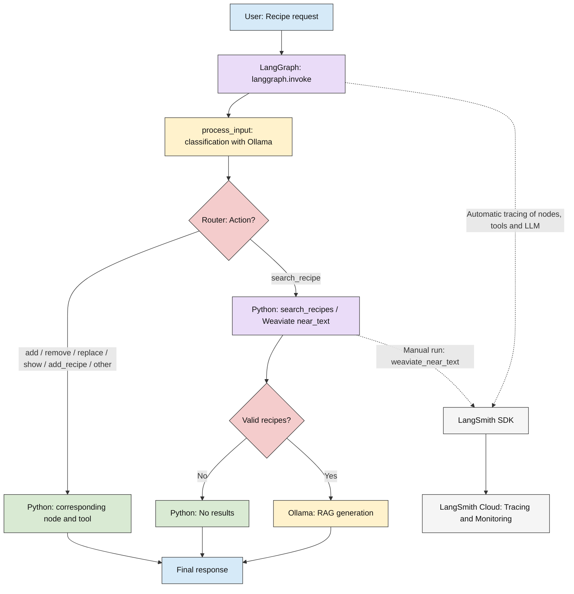

<p align="center"><sub>Figure 19. RAG assistant flow and sending traces to LangSmith.</sub></p>

**Setup and run (from repository root):**

Free account creation, virtual environment preparation, file configuration `.env` and error resolution are detailed in [section 6.11.1 of `06_observalility.md`](./06_observalility.md#6111-installation-and-configuration). No need to create a second agent or deploy the program to the cloud.

**1. Dependencies:** with the virtual environment enabled, if the repository dependencies are not already installed, run the following commands, common to macOS, Linux, and Windows:

```bash
python -m pip install -r requirements.txt
python -m pip check
```

LangSmith (`langsmith==0.12.6`) is already included in `requirements.txt`. There is no need to install it separately or update the libraries if the environment is already working. If `pip check` detects incompatibilities, they must be resolved before continuing.

**2. Configuration:** check that Ollama is running, that Weaviate Cloud contains the collection `Recetas` and that the `.env` includes the variables `WEAVIATE_URL`, `WEAVIATE_API_KEY`, `OLLAMA_MODEL`, `LANGSMITH_TRACING=true`, `LANGSMITH_API_KEY`, `LANGSMITH_ENDPOINT` and `LANGSMITH_PROJECT=shopping-rag-weaviate-langsmith`. Section 6.11.1 contains the complete configuration block and the endpoints of each region. Variables should not be defined `LANGSMITH_AGENT_ID` nor `LANGSMITH_AGENT_ENVIRONMENT` for this example. The `.env` with real keys should not be published to the repository.

**3. Execution:** first check connection with Weaviate with `--check`. This check does not validate Ollama or LangSmith. If the collection is accessible, run the assistant with the second command.

**macOS/Linux:**

```bash
python AI_Observability/code/src/12_shopping_list_weaviate_langsmith.py --check
python AI_Observability/code/src/12_shopping_list_weaviate_langsmith.py
```

**Windows (PowerShell):**

```powershell
python .\AI_Observability\code\src\12_shopping_list_weaviate_langsmith.py --check
python .\AI_Observability\code\src\12_shopping_list_weaviate_langsmith.py
```

**Test in one session:**

| Petition | Expected Action | What do you need to check?                                                              |
| --------------------------------------------- | --------------- | ------------------------------------------------------------------------------- |
| `Add milk`                                 | `add`           | Classification and `add_products`.                                                 |
| `Recommend recipes with eggs and potatoes`   | `search_recipe` | Vector search, AND filter and generate if results.                     |
| `Add the ingredients of the first recipe` | `add_recipe`    | If there is a previous recipe, reuse of `last_recipes`, no new search. |
| `Show me the list`                          | `show`          | Execution of `show_products`.                                                    |
| `Remove the milk`                              | `remove`        | Execution of `remove_products`.                                                  |

Write `exit` to exit. `reset` clears list and last recipes from local memory, not LangSmith traces.

**Results in LangSmith:**

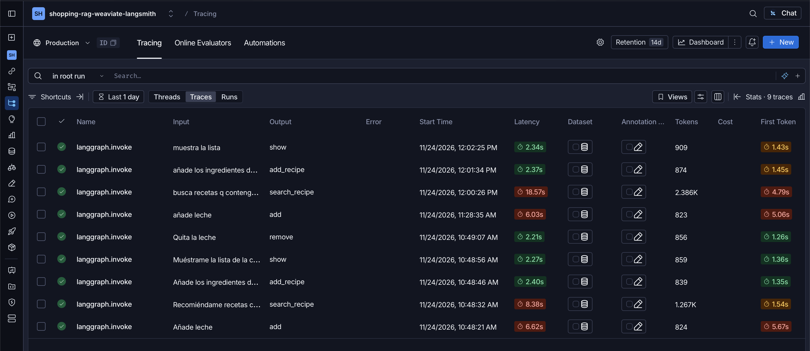

<p align="center"><sub>Figure 20. Nine assistant traces with selected action, latency, and tokens.</sub></p>

In the screenshot you can see the operations `add`, `remove`, `show`, `search_recipe` and `add_recipe`. The two recipe lookups consume approximately 1,267 and 2,386 tokens, while direct operations on the list log between 823 and 909 tokens in these tests. These results depend on the request, context, and model performance.

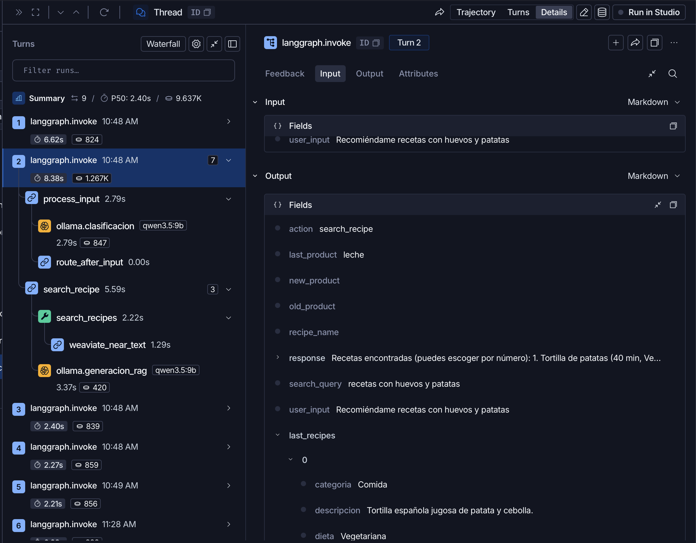

<p align="center"><sub>Figure 21. Hierarchical detail of the search for recipes with eggs and potatoes.</sub></p>

The request "Recommend recipes with eggs and potatoes" records a total duration of 8.38 s. Classification consumes 847 tokens and RAG generation consumes 420 tokens: a total of 1,267 tokens. The router selects `search_recipe`, which executes `search_recipes` (2.22 s) and the query `weaviate_near_text` (1.29s, including tool time). At the exit you can check `action=search_recipe` and consult the recipes saved in `last_recipes`.

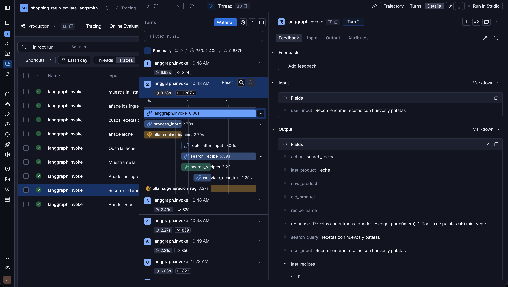

<p align="center"><sub>Figure 22. Waterfall of the same search: classification, retrieval of recipes and generation of the answer.</sub></p>

The first inference takes 2.79s and the second 3.37s. The node `search_recipe` takes 5.59s and includes both retrieval and generation. Waterfall allows you to check when each operation is executed without counting the durations of child runs twice.

To compare overall performance, go to **Monitoring → Analytics**. Figures 12–14 of [section 6.13 of `06_observalility.md`](./06_observalility.md#613-monitoring-and-interpretation-of-the-results) show volume and latency of traces, tool calls, and node executions. They allow checking that a vector search is more expensive than direct Python operations on the list. The [section 6.12](./06_observalility.md#612-analysis-of-traces-and-execution-flow) explains how to interpret a trace and the Waterfall, [section 6.14](./06_observalility.md#614-comparison-between-opik-opentelemetry-and-langsmith) compares the three platforms.

LangSmith can send prompt content, responses, and status to the cloud. Test data must be used and credentials must be protected.
